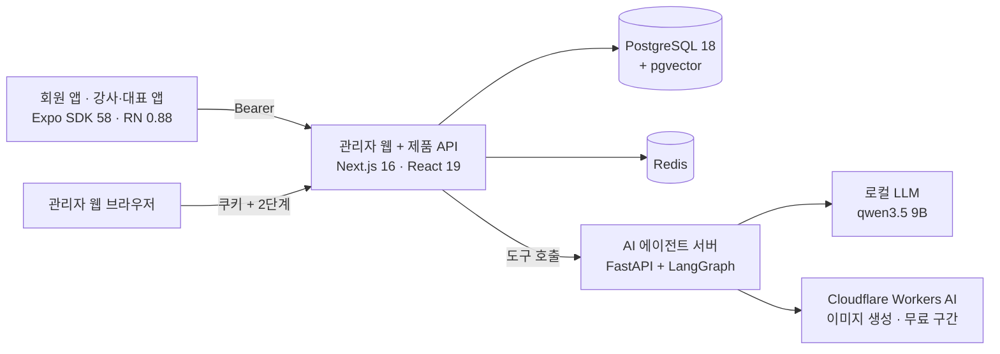

# K-DanceX4 — AI 소셜댄스 수업 예약·멤버십 플랫폼

> 회원은 찾고, 강사는 올리고, 대표는 승인한다 — 소셜댄스 수업과 학원 운영을 한곳에서.

K-DanceX4 는 댄스스포츠(라틴·스탠다드)·아르헨티나 탱고·스윙·살사/바차타 수업을 찾고 신청하는 회원 앱과, 그 수업을 여는 강사·학원 대표의 운영 도구를 하나로 묶은 서비스입니다. 수업 검색과 수업 홍보물 만들기에는 AI 를 씁니다.

| 제출 자료 | 위치 |
|---|---|
| 기능 명세서(24쪽) | [`docs/submission/임채웅_기능명세서.pdf`](docs/submission/임채웅_기능명세서.pdf) |
| 최종 발표 장표(21장) | [`docs/submission/임채웅_발표장표.pdf`](docs/submission/임채웅_발표장표.pdf) · [`.pptx`](docs/submission/임채웅_발표장표.pptx) |
| 제품 요구사항 원본 | [`specs/001-ai-dance-class-platform/spec.md`](specs/001-ai-dance-class-platform/spec.md) |

---

## 1. 기획

### 풀려는 문제

- **회원**: 소셜댄스 수업 정보가 학원 블로그·단체 채팅방·포스터 사진에 흩어져 있습니다. 내 장르·레벨·시간에 맞는 수업을 한 번에 찾기 어렵고, 남녀 정원이 따로 있는 커플 댄스는 빈자리를 알기가 더 어렵습니다.
- **강사**: 수업 홍보 이미지와 소개 글을 매번 직접 만들고, 수강생 출결과 레벨을 손으로 관리합니다.
- **학원 대표**: 소속 강사 승인, 수업 승인, 예약 명단, 공지가 여러 도구에 나뉘어 있습니다.

### 해결 방향

1. **장르에서 시작하는 앱** — 처음 고른 장르(와 세부 장르)로 홈이 바뀝니다. 장르 카드 사진이 3초마다 바뀌고, 누르는 순간 보이는 세부 장르(쌈바면 라틴, 비엔나왈츠면 스탠다드)가 골라집니다.
2. **등록 → 승인 → 노출이 이어지는 흐름** — 강사가 수업을 올리면 대표가 승인하고, 승인되는 즉시 회원 홈에 뜹니다.
3. **AI 로 일을 줄인다** — 말로 수업 찾기(AI 플래너), 포스터 사진에서 수업 정보 읽기, 수업 홍보 이미지·소개 문구 만들기.
4. **레벨로 성장을 보여 준다** — 강사가 수강생 레벨을 정하면 회원이 받을지 고르고, 받으면 레벨 카드가 발급됩니다.

### 사용자와 범위

| 역할 | 쓰는 곳 | 핵심 |
|---|---|---|
| 회원 | 회원 앱 | 장르 선택 · 수업 탐색·신청 · AI 플래너 · 캘린더 · 레벨 카드 |
| 강사 | 강사·대표 앱(웹은 위임 권한이 있을 때) | 오늘 수업 · 회원 관리·출결 · 레벨 정하기 · 수업 등록 · 홍보 이미지 |
| 대표 | 강사·대표 앱 + 관리자 웹 | 입점 · 강사 소속 승인 · 수업 승인 · 예약 명단 · 공지 · 앱 페이지 |
| 운영자 | 관리자 웹 | 신고 처리 · 플랫폼 정산 · 점검 |

규모 목표는 베타 1~10명, 3년 뒤 1천~1만 명이고, 설계는 최대 10만 명을 기준으로 합니다.

---

## 2. 주요 기능

### 회원
- **장르 사진 카드** — 4장르 카드, 댄스스포츠·살사/바차타는 사진이 3초마다 바뀌고 누른 사진의 세부 장르로 선택. 관심 장르는 여러 개 선택 · `FR-022a(첫 화면 장르 선택·유지)`
- **홈과 장르 바꾸기** — 기준 장르·세부 장르로 걸러진 수업 목록, 남녀 정원 좌석 칸, 정렬(추천순·마감 임박·남은 자리)
- **수업 상세와 결제 대기** — 요일·회차·정원, 신청 자리(남/여) 선택
- **AI 플래너** — 「아이유 강사님 수업 전체 알려줘」처럼 말로 물으면 수업 카드로 답
- **캘린더·마이·레벨 카드** — 레벨이 오르면 홈 위에 「LEVEL UP」 연출과 3D 카드 발급

### 강사
- **오늘 수업 인원** — 참석 남·여, 결석 예정
- **회원 관리** — 회차별 명단과 출결, 여러 명을 골라 레벨 정하기(회원에게 승급 안내)
- **수업 만들기** — 활동 장르의 세부 장르만 고를 수 있고, 홀 시간 충돌을 서버가 막음
- **홍보 이미지 AI 생성** — 필수 칩(누가·분위기·장소·색감)을 고르면 이미지와 소개 문구를 만듦(무료 엔진, 하루 횟수 제한)

### 대표
- **강사 소속 승인**, **수업 승인 → 회원 홈 노출**, **예약·명단**, **학원 공지**, **입점·설정**, **학원 앱 페이지 꾸미기**

### 로그인과 보안
- 회원은 이메일, 강사·대표는 아이디·비밀번호. 회원 로그인 화면 바탕을 0.6초 안에 세 번 누르면 강사·대표 로그인으로 넘어갑니다(시연용 지름길). 강사 탭과 대표 탭은 배경 그림이 다릅니다.
- **관리자 웹은 2단계 인증(인증 앱 6자리) 필수.** 강사·대표 앱은 앱 전용 로그인 경로로 2단계 없이 들어가되, 그 세션은 관리자 웹 콘솔·2단계 설정·비밀번호 변경을 쓸 수 없습니다([ADR-007](CLAUDE-decisions.md)).

### 아직 하지 않은 것
결제 대행(PG) 실연동, 그에 걸린 환불·정산·멤버십 정기결제, 소셜 로그인 실연동, 스토어 배포는 사업자 등록·PG 계약 뒤에 진행합니다. 로드맵 Task 512개 중 320개 완료(2026-11-24 기준, [`_workspace/roadmap-tasks.json`](_workspace/roadmap-tasks.json)).

---

## 3. 시스템 구성



| 영역 | 기술 | 폴더 |
|---|---|---|
| 앱 | Expo SDK 58.0.23 · React Native 0.88.1 · TypeScript 6.0 · expo-router | `mobile/` |
| 관리자 웹·제품 API | Next.js 16.3 (App Router) · React 19.3 · Better Auth 1.7 · Prisma 8 (`@prisma/orm-postgres` 8.0.0-rc.24) | `admin-web/` |
| DB | PostgreSQL 18 + pgvector 0.8.6 · Redis | `infra/docker-compose.yml` |
| AI 에이전트 | Python · FastAPI 0.141 · LangGraph 1.2 · llama-server(qwen3.5 9B, 포트 11436) | `agent-server/` |
| 옛 백엔드 | FastAPI + SQLAlchemy2 (Next.js 로 옮기는 중, 삭제 시점은 결정 대기) | `backend/` |

원칙: DB 에 쓰는 곳은 Next.js 하나이고, AI 에이전트는 도구로 읽기만 합니다. 외부 API 는 무료 구간 안에서만 쓰고, 유료 예외는 PG 와 휴대폰 본인확인 두 가지입니다. 버전은 「호환되는 선에서 최신」을 따르며 값의 원본은 [`docs/planning/tech/tech-stack.md`](docs/planning/tech/tech-stack.md) 「11. 기술 스택 고정표」입니다.

---

## 4. 실행과 검증

```bash
# DB·Redis·로컬 LLM (Windows 의 Docker Desktop 이 켜져 있어야 한다)
docker compose -f infra/docker-compose.yml up -d

# 관리자 웹·제품 API (:3000)
cd admin-web && npm install && npm run dev

# AI 에이전트 서버 (:8100)
cd agent-server && uv run uvicorn app.main:app --port 8100

# 앱 — 브라우저(:8081) 또는 안드로이드 에뮬레이터의 Expo Go
cd mobile && npx expo start --web
```

| 검증 | 명령 | 최근 결과(2026-11-25) |
|---|---|---|
| admin-web DB 테스트 | `npm run test:db` | 1704 passed |
| admin-web 단위 테스트 | `npm run test:unit` | 1768 passed |
| admin-web 타입·빌드 | `npm run build` | 성공 |
| mobile 타입 검사 | `npx tsc --noEmit` | 오류 0 |
| agent-server | `uv run pytest` | 199 passed |
| backend | `uv run pytest -q` | 186 passed |

화면을 바꾼 작업은 실제 브라우저·에뮬레이터 스크린샷을 증거로 남기고(`leave-verifiable-evidence`), 보안이 걸린 변경은 공격을 먼저 재현하는 테스트를 쓴 뒤 고칩니다. 환경 변수 예시는 `admin-web/.env.example` 에 있습니다.

---

## 5. 저장소 안내

| 폴더 | 내용 |
|---|---|
| `specs/` | 기능 명세(spec.md) — 제품 요구사항의 단일 원본 |
| `docs/` | `planning/` 서비스 정의·기술 스택 · `policy/` 정책 · `legal/` 약관 · `guide/` 사람용 HTML 가이드 · `submission/` 제출 서류 · `prototype/` 화면 보드·그림 |
| `_workspace/` | 계약(`03_contracts/`)·데이터 모델·로드맵 Task·작업 기록 |
| `admin-web/scripts/` | 개발 DB 시연 데이터·시연 녹화 스크립트 |
| `scripts/` | 제출 서류·발표 자료·구조 지도 생성기 |
| `.claude/` | 개발 파이프라인(`kdance-dev-harness`)·규칙·스킬 |

처음 보신다면 이 순서를 권합니다.
1. [`CLAUDE.md`](CLAUDE.md) — 실행 명령, 개발 규칙, 4계층(환경·명세·파이프라인·공구) 개발 방식
2. [`CLAUDE-decisions.md`](CLAUDE-decisions.md) — 되돌리기 어려운 결정(ADR)과 버린 대안
3. [`docs/structure-map.md`](docs/structure-map.md) — 파일 구조와 파일끼리의 관계
4. [`docs/guide/harness-ecc-guide.html`](docs/guide/harness-ecc-guide.html) — 개발 방식을 그림으로 설명한 가이드(내려받아 브라우저로 열기)
