# kdancex4 — 사용자·강사·업주/관리자 서비스 정의 및 기술 스택
**기준일: 2026-09-17**

> **서비스 한 줄 정의**
>
> **kdancex4는 AI와 함께하는 K-소셜댄스 플랫폼으로, 사용자의 취향과 일정에 맞춰 온라인 댄스 수업·강사·파티·공연을 추천하고, 강사는 수업과 일정을 관리하며, 업주/관리자는 매장·댄스학원 운영과 수업·회원·매출 정보를 관리하는 Web + Mobile 서비스이다.**

---

## 1. 서비스 전체 구조

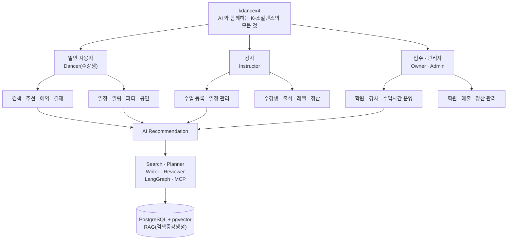

# 2. 사용자별 서비스 정의

## 2.1 일반 사용자 / 댄서

### 핵심 목적
**"나이별 레벨별 수업 카테고리 취향 및 시간일정에 맞는 수업과 강사, 파티·공연·대회을 발견하고 실제 참여까지 연결"**

### 핵심 기능

| 영역   | 기능       | 설명                                                                                     |
|------|----------|----------------------------------------------------------------------------------------|
| 회원   | 회원가입/로그인 | 대학생 인증(학교 이메일 `.ac.kr` 도메인, 2026-09-21 확정) 및 Kakao/Google/Naver 소셜 로그인(이름,이,성별,연락처 필수) |
| 프로필  | 댄스 프로필   | 경험 수준, 선호 장르, 지역, 활동 시간                                                                |
| 취향   | 선호도 설정   | 장르·세부장르·레벨·음악·강사 스타일·거리                                                                |
| 추천   | AI 수업 추천 | 나의 취향 + 강사의 학원별 수업 시간 및 활동 지점 + 일정 기반                                                  |
| 추천   | AI 강사 추천 | 수업 스타일, 장르·세부장르, 거리, 시간대 기반                                                            |
| 검색   | 수업 검색    | 날짜·지역·장르·난이도·강사 검색                                                                     |
| 검색   | 강사 검색    | 강사 프로필·전문 장르·수업 일정(학원별, 전체 수업별)                                                        |
| 일정   | 내 일정     | 신청한 수업·파티·공연·대회 통합                                                                     |
| 알림   | 수업 알림    | 수업 전 알림 선택사항(하루전, 2시간 전, 1시간 전, 30분 전), 장소/시간 변경                                       |
| 알림   | 관심 알림    | 좋아하는 강사/댄스학원 신규 수업/이벤트                                                                 |
| 커뮤니티 | 파티       | 댄스 파티 탐색·참여                                                                            |
| 공연   | 공연 추천    | 소셜댄스 외부 공연(주관사 일정 공지 포함) 일정                                                            |
| 기록   | 활동 기록    | 수강/참여 이력                                                                               |
| AI   | AI 코칭/추천 | 사용자의 선택을 학습하여 추천 정교화(취향 4종 댄스 카테고리별, 학원별, 시간대별, 강사별,지역별)                               |
| 문의   | 사용자 문의   | QA                                                                                     |

### 사용자에게 중요한 추가 기능

- **원하는 시간에 가능한 수업 자동 검색**
- **내가 원하는 강사의 특정 학원 수업, 수업시간 및 내가 조회한 강사마다 전체 학원 수업 및 수업시간 탐색**
- **내 일정과 충돌하는 수업 자동 표시 및 등록 불가 메시지 알람**
- **처음 배우는 사람에게 입문 수업 추천**
- **같은 강사의 다음 수업 자동 알림 및 해당 강사 수업 추천 알람**
- **관심 장르의 파티·공연·대회 자동 추천**
- **수업 → 파티 → 공연으로 이어지는 활동 추천**
- **찜/좋아요/싫어요 기반 추천 개선(개인사용자 취향 학습)**
- **수업 취소·시간 변경·장소 변경 알림**
- **사용자 문의 사항(Q&A) 페이지**
---

# 3. 강사 / Instructor

## 3.1 강사의 핵심 목적


**"내 수업을 등록하고, 가능한 시간에 수강생을 모집하며, 수강생과 수업 일정을 효율적으로 관리"**


### 강사 프로필

| 항목 | 기능                                                                                                                            |
|---|-------------------------------------------------------------------------------------------------------------------------------|
| 기본정보 | 이름/프로필 이미지/소개                                                                                                                 |
| 장르 | Dancesport(Latin, Standard) / ArgentineTango / Swing / Salsa, Bachata                                                         |
| 세부장르 | Latin(Chachacha,Samba,Rumba,PasoDoble,Jave) /Standard(Waltz, Tango, VienneseWaltz, Foxtrot, Quickstep), Swing, Salsa, Bachata |
| 경력 | 경력/자격/활동 이력                                                                                                                   |
| 레벨 | Introductory(6개월 이하), Beginner(1년 이하) / Intermediate(2~4년) / Advanced(5년 이상)                                                  |
| 수업구분 | 입문/초급/중급/고급입문/베이직/베이직심화/레이디스타일/공연                                                                                             |
| 활동지역 | 학원/지역/강사                                                                                                                      |
| 소개영상 | 수업(페이스 오프 멀티모달 영상) 및 댄스 영상                                                                                                    |

## 3.2 수업 관리

> **정원은 성별이 아니라 역할로 나눈다(2026-09-21 확정).** 소셜 댄스에서 실제로 짝을
> 이루는 단위가 `Lead(리드)` / `Follow(팔로우)` 이기 때문이다. 성별로 잡으면 여성 리드,
> 남성 팔로우, 동성 파트너링을 표현할 방법이 없다. 저장되는 값은 역할이고, 학원이
> 원하면 화면 표기만 자기 학원에서 쓰는 말로 바꿀 수 있다.

### 수업 등록

```text
강사
 ↓
수업 생성
 ↓
장르-세부장르 / 레벨 / 수업구분 / 수업명
 ↓
일시 / 장소 / 정원(최대 인원 지정 필수 및 신청자 역할별(Lead/Follow) 정원 실시간 결제 등록자 수 표시)
 ↓
수강료 / 신청방법
 ↓
공개
 ↓
AI 추천 Pool에 등록
```

### 수업 운영

| 레벨 | 영어 | 기간     | 의미 |
|---|---|--------|---|
| 입문 | Introductory | 0~6개월  | 처음 배우거나 기본 동작을 익히는 단계 |
| 초급 | Beginner | 6개월~1년 | 기본 동작을 익히고 간단한 루틴을 수행하는 단계 |
| 중급 | Intermediate | 2~4년   | 기술·리드앤팔로우·응용이 가능한 단계 |
| 고급 | Advanced | 5년 이상  | 높은 숙련도와 다양한 응용이 가능한 단계 |

- 정규 수업
- 단기 클래스
- 원데이 클래스
- 개인 레슨
- 그룹 레슨
- 이벤트 수업

### 일정 관리

- 강사 가능 시간 등록
- 수업 일정 확인
- 개인 일정 등록
- 일정 충돌 감지
- 휴강/보강 관리
- 일정 변경(사용자 알림)
- 수업 장소 변경(사용자 알림 선택사항)
- 수업 시작 전 알림(강사, 사용자 알림 선택 사항)

## 3.3 수강생 관리

강사는 자신의 수업에 참여하는 수강생을 확인할 수 있다.
업주는 모든 수강생을 확인 할 수 있다.(단 업주에게 웹 관리자 권한을 받은 강사는 전체 수강생 관리 가능 하지만 모든 수강생에 대한 재무 관련 현황 및 재무 관련 대시 보드 및 금액관리는 업무의 고유 권한으로 제외)

```text
수업
 └─ 수강생
     ├─ 신청
     ├─ 결제승인
     ├─ 취소(계좌이체 시 즉시 환불이 어려움으로 담당 강사에게 환불 처리 문의 문구 필수)
     ├─ (불참)(수업 날짜별 불참 체크 기능으로 역할별 수업 인원 확인으로 원활한 수업을 위해 수강생 권고 기능) 
```

추가 기능:

- 수강생 명단
- 출석 관리
- 신청 상태
- 정원 관리(Lead/Follow 비율 및 인원, 권고 기능으로 불참 인원만 사용자가 불참 체크 함)
- 수강생 알림
- 대기자 관리(인원 초과 시 결제 안됨 X,수업 하루(24시간) 전까지 인원 초과는 수강 신청만 가능하고 대기자 팝업 창 뜸(나의 대기 순번 수) 결제 취소자 수 만큼 대기자 결제 가능 알람)
- 공지사항

## 3.4 강사 대시보드

```text
오늘의 수업
이번 주 일정
한달 일정
1년 일정(스케쥴 달력)
강사의 수강생 신청 인원(요일별, 학원별)
남은 자리(Lead/Follow)
대기자
취소 인원
관심 사용자(수강생 관리)
```

### 강사에게 AI가 제공할 수 있는 기능

- 빈 시간대에 적합한 학원별 공강 수업시간 및 업주의 학원별 시간대별 빈 공강 시간을 강사 모집 및 수업 추천
- 강사가 회원 등록 시 장르 기준(중복 및 수정 가능)
- 학원별 시간대별 수업 등록 및 공지
- 업주의 강사 급구 모집 포함 조회 및 업주의 요청으로 사용 가능한 수업 및 공강 수업 제공 요청 및 해당 수업 노쇼로 인한 긴급 모집 및 공강 시간 알림 
- 수업 등록 시 업로드 사진 및 영상을 활용한 힉스필드과 같은 MCP를 활용하여 수업 이미지, 설명, 영상 등 자동 작성 및 피드백
- 수업 제목/소개 문구 생성
- 수업 이미지/홍보 문구 생성
- 반복 수업 일정 자동 생성
- 강사 일정 충돌 탐지
- 강사는 해당 수업(무료,유료)을 신청 완료한 수강생만 관리 가능하며 수업, 장르, 세부장르, 레벨 분석 및 레벨 등급 수정 및 관리 분석표 제공
- 해당 강사의 수강 결제 완료한 수강생들만 레벨 분석 가능하며 수강한 이력 수업 장르, 세부장르 데이터 분석, 출석율을 통해 수강생들의 이력을 분석하여 개인별, 단체별 레벨 스킬 그래프로 구현 후 수강생에 맞는 단체수업, 개인별 레벨을 조합하여 수강 개설 인원 및 명단 가상 시나리오 분석.
- 해당 강사 수업을 신청한 수강생의 이름과 나이, 성별, 연락처는 대시보드에 관리된다.
- 수강생 가입 시 약관에 포함 및 개인정보(이름과 나이, 성별, 연락처) 필수 체크(권고) 필수로 해야 쿠폰 및 이벤트 사용 가능 경고 알람으로 유도, 소셜 로그인 간편가입도 최초 가입 시 동일하게 필수 체크(권고) 여부 뜸, 로그인 가입 시 개인정보 미체크 시 다시 체크 가능하게 설정에서 수정 가능 기능.
- 강사는 수동으로 세부 장르의 레벨을 0~10까지 수강생마다 레벨을 부여 할 수 있음
- 레벨 등급(세부장르): 0~1입문 / 2~3 초급 / 레벨 4~7 중급 /레벨 8~10 고급
- 강사의 강의 추천 AI Agent 기능으로 예시 질문 프롬프트로 토요일에 새로 개강할 6명 고급 모집으로 Rumba(룸바)인원 추천해줘 질문시 예상 답변: "현재 수강중인 브레드님은 Rumba Leval 10 / Samba Level 8으로 평균 고급 레벨이며 모집하고자 하는 Rumba 레벨에 적합하며 매주 금요일 수강을 1년동안 꾸준히 수업을 하였으며 아이유 강사(본인)님이 토요일에 개강 모집하려는 12월달 Rumbja(고급)클래스 토요일 아침 9시에 소수 고급 레벨(Lavel) 6명을 모집 공고를 바탕으로 최근에 수강이력이나 레벨(Leval)이 고급인 브레드,카리나,뷔,리나,카즈하,정국을  12월달 Rumba(고급)클래스 개설하는 6명 정원에 추천합니다." 라고 분석 답변을 제공 그리고 추가 답변으로 이름, 성별, 나이, 연락처 명단을 출력해드릴까요?(Y/N) 입력 화면 출력.


---

# 4. 업주 / 댄스학원 관리자

## 4.1 핵심 목적

**"댄스학원/매장의 수업·강사·회원·시설·매출·이벤트를 한 곳에서 관리"**

### 업주/관리자 대시보드

```text
┌────────────────────────────────────┐
│          Studio Dashboard          │
├────────────────────────────────────┤
│ 오늘 수업 │ 예약 │ 출석 │ 매출 │ 취소 │
├────────────────────────────────────┤
│ 강사 일정 │ 수업시간 │ 회원 │ 이벤트  │
├────────────────────────────────────┤
│ 공지 │ 알림 │ 후기 │ 통계 │ 정산     │
└────────────────────────────────────┘
```

## 4.2 댄스학원 관리

- 댄스학원 등록
- 지점 관리
- 주소/지도 위치( AI 멀티 에이전트 검색 시 장르별 학원 추천 검색으로 사용되며 예로 강남(구)별/강사별/시간대 별 사용자(수강생)추천 검색 및 네이버 지도 화면 표시 기능으로 사용됨)
- 운영시간(예로 AI 멀티 에이전트 검색 시 해당 학원 의 시간표 알려줘, 이번주 내가 수강하는 월요일반 수업 정상여부 및 운영시간 알려줘)
- 연락처
- 강사진 소개
- 시간대별 수업 및 강사 정보
- 사진/영상
- 시설 정보(학원 구성 사진, 락커룸 대여비 등등)
- 주차 정보(해당 핵원 주차정보 및 만석 시 유료주차, 무료주차 주의 주차장 가능 여부)
- 접근성 정보(네이버 지도 화면)

## 4.3 강사 관리

업주는 댄스학원 소속 강사를 관리한다.

- 강사 등록
- 강사 승인
- 강사 웹 관리자 권한 부여(전체 수강생 조회 권한, 수업 등록 및 취소 등 인원 관리 권한만)
- 강사 프로필 관리
- 담당 수업(수업명, 수업 시간)
- 강사 일정(강사의 해당 소속 수업만 관리하면 외부 수업을 제외)
- 수업시간 배정
- 휴무
- 대체 강사
- 수업별 담당자

## 4.4 댄스학원 운영을 대부분 단일 공간에서 사용하기 때문에 다른 강사와 수업시간이 겹치면 안됨.(앱에 핵심 기능으로 이미 해당 년월일에 앱으로 수업 등록 개설을 완료하면 같은 시간대에 다른 수업 등록이 거부되며 그 시간에 등록한 강사가 취소해야 등록 됨)


## 4.5 수업 운영

업주는 댄스학원 전체 수업을 관리한다.
- 강사에게 권한 부여시 조회 및 수정 가능
- 전체 수업 조회
- 수업 등록/수정/삭제
- 강사 배정
- 정원 설정
- 수강료
- 반복 일정
- 휴강
- 보강
- 예약 현황
- 대기자
- 출석(불참만 수강생(사용자)의 체크 표시를 통해 대략 확인 가능하며 수강생(사용자)의 적극 활용을 권고함)
- 취소

## 4.6 회원 관리

- 회원 목록
- 신규 회원
- 활동 회원
- 휴면 회원: 1년 이상 수업 미등록 시 이벤트 1회 반값 쿠폰 발급 가능 여부 업주의 권한으로 선택사항 기능
- 수강 이력(우수회원): 약 1년(11~12개월)이상 모든 기간에 연속하여 참여한 우수회원에게 매년 2월1일에 반값 쿠폰 적용 업주에게 대상 회원 일관 알림 기능 및 발급 선택사항 기능, 쿠폰은 우수회원에게 업주 재량이며 선택사항으로 지급 시 올해까지 사용기간 적용 가능한 쿠폰 지급, 우수회원 쿠폰의 산정이 2월 1일이기 때문에 그 다음날에 약 1년(11~12개월)이 되는 회원은 그 다음해에 반값 쿠폰 적용 업주에게 대상 회원 일관 알림
- 예약 이력
- 출석 이력
- 관심 장르
- 후기
- 문의

## 4.7 매출/정산

실서비스 확장 단계에서 고려할 영역.

- 수업 매출
- 강사별 매출
- 수업별 매출
- 기간별 매출
- 환불
- 취소
- 정산
- 결제 상태
- 수수료
- 업주/강사 정산

> 결제 기능을 실제 도입할 경우 결제와 환불의 권한 및 감사 로그를 별도로 설계한다.

## 4.8 관리자 알림

- 수업 신청 증가
- 정원 마감
- 취소 증가
- 강사 일정 변경
- 수업시간 충돌
- 결제 실패
- 환불 요청
- 신규 후기
- 공지사항

---

# 5. 파티 & 공연

kdancex4의 차별적인 콘텐츠 축으로 별도 도메인으로 관리한다.

## Party

- 댄스 파티 검색
- 장르별 파티
- 날짜별 파티
- 지역별 파티
- 참가 신청
- 파티 일정
- 장소
- 주최자
- 관심 파티
- 파티 알림

## 공연(댄스학원)

- 댄스학원 공연 검색
- 댄스학원 공연 추천
- 댄스학원 공연 일정
- 댄스학원 장소
- 댄스학원 출연자
- 댄스학원 장르
- 댄스학원 예매 앱 알림
- 사용자 관심 공연 추천
- 사용자 공연 알림

### 사용자 여정

```text
수업 추천
   ↓
수업 참여
   ↓
비슷한 장르 추천
   ↓
강사 추천
   ↓
관련 파티 추천
   ↓
관련 공연 추천
   ↓
다음 수업 추천
```

---

# 6. AI 추천 시스템

## AI가 해결해야 하는 문제

단순히 "인기 수업"을 보여주는 것이 아니라:

> **사용자가 지금 참여할 수 있고, 좋아할 가능성이 높은 수업/강사/파티/공연을 찾아주는 것**

### 추천 입력 데이터

```text
사용자 프로필
+ 선호 장르
+ 좋아요/싫어요
+ 수강 이력
+ 검색 이력
+ 일정
+ 지역
+ 이동 가능 거리(AI 멀티 에이전트 네이버 지도 검색 조회)
+ 경험 수준
+ 관심 강사
+ 관심 댄스학원
+ 파티/공연 활동
```

### 추천 Pipeline

```text
User Context
     ↓
Embedding
     ↓
PostgreSQL + pgvector
     ↓
Top-K Retrieval
     ↓
NVIDIA Reranker
     ↓
Top-N Candidates
     ↓
LangGraph
     ↓
Search Agent
     ↓
Planner
     ↓
Reviewer
     ↓
Writer
     ↓
Personalized Recommendation
```

---

# 7. AI Agent 역할

## Search Agent

**수업·강사·파티·공연 후보를 검색하고 관련 정보를 수집**

- DB 검색
- 벡터 검색
- 외부 데이터 검색
- 일정 조건 검색
- 위치 조건 검색

## Planner

**사용자의 조건을 분석하여 어떤 콘텐츠를 추천할지 계획**

예:

```text
"이번 주말 서울에서
초급 살사 수업을 듣고
끝나고 파티도 가고 싶어"
```

↓

```text
① 토요일 가능한 수업 검색
② 초급 필터
③ 이동거리 계산
④ 수업 종료시간 확인
⑤ 이후 가능한 파티 검색
⑥ 일정 충돌 검사
```

## Writer

**최종 사용자에게 자연스럽게 추천 내용을 생성**

예: 이번주 강남의 토요일 살사 저녁에 수업과 파티 가능한 학원 추천해줘

> "이번주 토요일 18시 "Latin" 바에서 5.pm 초급 리나 강사의 살사 수업이 있으며
> 7시 파티에 기본 입장료 카드1만2천원/현금 1만원이며 수강 신청 확인 결과 워크샵은 7.pm 2만원 해외워크샵 Luis 강사의 바차타, 8.pm 1만원 해외워크샵 Salsa 소셜반 Lucy 강사의 남20(18)/여20(14) 총원(잔여)으로 자리가 남2/여6이 비여 일정이 가능합니다." 해당 수업 화면 전환으로 전환하겠습니까? Y/N(y/n), Y(y) 입력 시 해당 수강 접수 화면 링크로 전환 

## Reviewer

**추천 결과의 오류와 조건 충족 여부 검증**

- 시간 충돌
- 거리
- 영업/운영 여부
- 정원
- 중복 추천
- 존재하지 않는 정보
- 사용자 조건 누락

## Triage(분류)

**들어온 질문이 어느 경로로 가야 하는지 가른다. 사용자 문의(Q&A)의 첫 관문이다.**

모든 질문을 LLM 에 보내면 GPU 1대로는 감당이 안 된다 — 실측으로 동시 처리가 1~4건
수준이다(`docs/kdance-beta-infra.html`). 그래서 **대부분의 질문을 모델 없이 처리하도록
먼저 갈라내는 것**이 이 역할의 존재 이유다.

| 등급 | 무엇을 묻는가 | 어떻게 답하나 | 모델 |
|---|---|---|---|
| `T0(내 데이터 조회)` | 내 예약·결제·환불액·일정·대기 순번·정산 | 저장값과 도메인 계산 결과를 그대로 읽어준다 | 안 씀 |
| `T1(정해진 지식)` | 약관·환불 정책·요금제·학원 정보 | 승인된 답변을 찾아 제시 | 검색만 |
| `T2(판단이 필요한 질문)` | 무엇부터 배울지, 일정을 어떻게 짤지 | 멀티에이전트가 생성 | 씀 |
| `T3(사람)` | 결제 실패·분쟁·개인정보·신고, 그리고 확신 못 한 것 | 사람이 답한다 | 안 씀 |

## Escalator(이관)

**모델이 답하면 안 되는 것과 답하지 못한 것을 사람에게 넘긴다.**

이관 사유는 넷이다.

- **민감** — 결제 실패·환불 분쟁·개인정보·신고. 애초에 모델을 거치지 않는다
- **저신뢰** — 근거를 찾지 못했거나 확신이 기준에 못 미친다
- **사용자 요청** — 언제든 사람을 부를 수 있다. AI 를 거쳐야만 사람에게 닿는 구조를 만들지 않는다
- **불만족** — 답변이 도움이 안 됐다고 표시하면 대화 맥락 그대로 넘긴다

**배정은 거래 당사자가 먼저다.** 결제와 환불 정책이 학원마다 다르기 때문에, 플랫폼
운영자가 대신 답할 근거가 없다.

| 문의 내용 | 1차 |
|---|---|
| 학원 수업의 결제·환불·수강 규정 | **그 학원(업주)** |
| 개인 레슨의 결제·환불 | **그 강사** |
| 수업 운영·보강·정원·레벨 | 그 수업의 강사 |
| 계정·앱 오류·결제 시스템 장애 | 운영자 |

운영자는 **2차 조정자**다 — 당사자 사이에서 풀리지 않았거나, 학원이 기한 안에 답하지
않았거나, 플랫폼 귀책 사안일 때만 나선다.

> **"모른다"가 틀린 답보다 낫다.** 돈이 걸린 질문에 그럴듯한 추측을 내놓으면 그 자체가
> 분쟁이 된다.

---

# 8. LLM / RAG 기술 구조

## LLM

**Qwen 3.5 9B**

Search / Planner / Writer / Reviewer가 동일한 모델을 공유하는 구조를 기본으로 한다.

```text
                 Qwen 3.5 9B
                      │
             Model Provider
                      │
       ┌──────────────┼──────────────┐
       ↓              ↓              ↓
    Search          Planner        Writer
       │              │              │
       └──────────────┼──────────────┘
                      ↓
                  Reviewer
```

> 논리적으로는 여러 Agent이지만, 모델 프로세스를 Agent마다 별도로 띄울 필요는 없다.

---

# 9. Embedding / Vector Search

### Embedding

**Nemotron-3-Embed-1B-BF8**

텍스트/콘텐츠를 벡터로 변환한다.

```text
수업 설명
강사 소개
공연 설명
파티 정보
사용자 취향
       ↓
Embedding
       ↓
Vector
       ↓
pgvector
```

### BF16 / BF8

- BF16: 원본에 가까운 높은 정밀도
- BF8: VRAM 사용량을 줄이는 양자화 계열 표현
- 로컬 GPU 환경에서는 VRAM과 품질의 균형을 고려해 선택

---

# 10. Reranker

**llama-Nemotron-Rerank-VL-1B-v2** — 개발·베타는 NVIDIA 호스팅 API(`https://ai.api.nvidia.com/v1/retrieval/nvidia/llama-nemotron-rerank-vl-1b-v2/reranking`)로 부르고, 운영은 공식 FP8판을 vLLM 으로 자체 서빙한다. 텍스트판 1B-v2 는 호스팅이 2026-08-25 에 끝나 VL 로 바꿨다(11-2 「임베딩·리랭커 배치」).

Vector Search가 가져온 후보를 다시 정렬한다.

```text
Embedding
   ↓
pgvector
   ↓
Top-K
   ↓
Reranker
   ↓
Top-N
```

Vector Search만 사용하는 것보다 사용자 질문과 후보 콘텐츠의 의미적 관련성을 추가로 판단하는 구조다.

---

# 11. 기술 스택 고정표

**확정 기준일: 2026-09-20** (AI 패키지 3종은 2026-09-24 패치 갱신). 아래 버전은 npm 레지스트리·Docker Hub·peerDependencies 를
실제 조회해 확인한 값이다. 추정치가 아니다.

원칙은 **호환되는 선에서 최신**이다. "최신"과 "의존성 호환"이 충돌하면 호환이 이긴다.

**에이전트 서버는 Next.js 와 별도 프로세스인 Python 서버다**(`CLAUDE-decisions.md`
ADR-004, 경계는 「11-3. 백엔드 교체」). `Agent 서버`·`Agent`·`Agent Core`·`LLM 연결`·`Chunking`·`Queue` 행은
2026-09-24 PyPI 조회값이다 — 아직 설치해 보지 않았다. 나머지 행(웹·앱·DB)은 TypeScript 쪽이다.

| 영역 | 기술 | 버전/기준 | 역할                            |
|---|---|---|-------------------------------|
| Web | Next.js | 16.3.5 | Web/App Router, 서버 기능         |
| UI | React | 19.3.0 | Web UI                        |
| Mobile | Expo SDK | 58.0.0-preview.6 | 모바일 툴체인 · RN 앵커 |
| Mobile | React Native | 0.88.0-rc.1 | Android/iOS App (Expo SDK 핀) |
| Language | TypeScript | 6.0.3 | 타입 안정성                        |
| Runtime | Node.js | 24.21.0 LTS (Krypton) | Next.js/Prisma 실행환경           |
| CSS | Tailwind CSS | 4.3.3 | UI 스타일                        |
| UI System | shadcn/ui | 4.21.0 | 디자인 시스템                       |
| Client State | Zustand | 5.0.15 | UI 상태                         |
| Server State | TanStack Query | 5.103.1 | API/cache                     |
| Auth | Better Auth | 1.7.5 | 인증                            |
| Auth 대안 | Clerk | 보류 | 관리형 인증                        |
| ORM | Prisma | 8.0.0-rc.15 (CLI) / @prisma/orm-postgres 8.0.0-rc.11 (런타임) | DB 접근                         |
| DB | PostgreSQL | 18.6 | 관계형 DB                        |
| Vector | pgvector | 0.8.6 (`pgvector/pgvector:0.8.6-pg18`) | RAG                           |
| AI UI | Vercel AI SDK | 7.0.113 (`ai`) | Streaming/Tool/UI             |
| Agent 서버 | Python · FastAPI · uvicorn | 3.12 · 0.141.1 · 0.53.0 | 에이전트 서버 런타임(ADR-004) — `backend/` 와 같은 Python 3.12·uv. 스키마는 pydantic 2.13.5 |
| Agent | LangGraph (Python) | 1.2.12 (`langgraph`) | Agent workflow — T2 그래프, 베타 체크포인터는 메모리(`langgraph-checkpoint` 4.2.0) |
| Agent Core | LangChain Core (Python) | 1.6.4 (`langchain-core`) | LangGraph 가 `<2,>=1.4.7` 로 요구 |
| LLM 연결 | LangChain OpenAI · OpenAI SDK (Python) | 1.6.6 (`langchain-openai`) · 3.19.2 (`openai`) | llama-server·NVIDIA 호스팅 호출. **`response_format` 은 `json_schema` 로**(11-2) — `json_object` 는 코드블록이 온다 |
| Chunking | LangChain Text Splitters (Python) | 1.1.2 (`langchain-text-splitters`) | 긴 설명문 청킹 |
| Queue | Redis Streams (`redis` 8.1.0) | 기존 `kdance-redis` | 포스터 작업 큐. Next.js 가 넣고 Python 워커가 동시 1건으로 꺼낸다 — 언어 중립이라 BullMQ(Node 전용) 대신 고름. 후보 |
| Date/Time | temporal-polyfill | 1.0.5 | Node 24 LTS 에 없는 `Temporal` 보충 — Prisma 8 timestamptz 필수 |
| Schema | zod | 4.6.5 | Next.js 쪽 `ai`·MCP SDK·Better Auth 가 공유 — 표에 없으면 3.x 가 섞여 깨진다. 에이전트 쪽(pydantic)과는 JSON Schema 로 맞춘다 |
| LLM | Qwen | 3.5 9B | 기본 LLM                        |
| Embedding | Nemotron | 3-Embed-1B-BF8 (8비트. 정식 모델명 `nvidia/nemotron-3-embed-1b`) | 임베딩 — **개발·베타: NVIDIA 호스팅** / 운영: vLLM GPU. 11-2 「임베딩·리랭커 배치」 |
| Reranker | NVIDIA Nemotron | llama-Nemotron-Rerank-**VL**-1B-v2 (운영: 공식 FP8 `-fp8`) | 후보 재정렬 — **개발·베타: NVIDIA 호스팅** / 운영: FP8 vLLM GPU. 1B-v2(텍스트판)는 호스팅 종료·llama.cpp 미지원·FP8 없음으로 대체 |
| Protocol | MCP | 1.30.1 (`@modelcontextprotocol/sdk`, Next.js 도구 서버) · 2.2.0 (`mcp`, Python 클라이언트) | 에이전트가 데이터를 읽는 유일한 통로(ADR-004) |
| Storage | Cloudflare R2 | latest | 이미지/영상/파일                     |
| Deploy | Vercel | latest | Web/Edge/배포                   |
| Dev AI | Claude Code | latest | AI Coding Agent               |
| Container | Docker | latest stable | 개발/배포 환경                      |
| VCS | Git/GitHub | latest | 형상관리                          |

## 11-1. 버전을 이렇게 정한 이유

### React Native 0.88.0-rc.1 — 앵커를 Expo 58 preview 로 옮겼다

RN 버전은 직접 고르는 값이 아니다. Expo SDK 가 고정한다. 그래서 고를 수 있는 건
**어느 SDK 를 앵커로 둘 것인가** 뿐이다.

```
Expo SDK 58.0.0-preview.6  →  react-native 0.88.0-rc.1   ← 채택
```

핀은 패키지 안의 `bundledNativeModules.json` 에 들어 있다. 58 preview 의 실제 값은
`react-native` 0.88.0-rc.1, `react` 19.3.0, `react-native-worklets` 0.12.2 다
(2026-09-25 preview.3 → preview.6 갱신. preview.3 때는 rc.0 · 19.2.3 이었다).

**RN 의 안정 최신인 0.87.1 은 Expo 를 쓰는 한 도달할 수 없는 값이다. 0.87 을 쓰려면 Expo 를
버려야 하고, 그러면 EAS 빌드와 `expo-*` 모듈 전체를 잃는다. 그 대가가 크다고 보아
58 preview 를 택했다. 58 안정판이 나오면 그리로 옮긴다.

**peer 는 이걸 막아주지 않는다.** `expo` 의 `react-native` peer 는 `*` 이고
`expo-modules-core` 도 마찬가지다. RN 을 아무 버전이나 깔아도 `npm install` 은
경고 없이 통과한다. 네이티브 호환성은 npm 버전 범위로 표현되지 않기 때문이다.
그래서 설치 성공을 호환 근거로 삼으면 안 된다 — 버전 정책의 함정 ③ 이 이 자리다.

**모바일의 React 도 preview.6 부터 19.3.0 이다.** 웹(admin-web)과 같아졌다. preview.3 까지는
19.2.3 이라 웹과 달랐다. React 버전은 우리가 고르는 값이 아니라 Expo 가 preview 마다 바꾸는 값이다.
그래서 "RN 을 올리면 React 도 따라 오른다"고 기대하지 말고, 올릴 때마다
`bundledNativeModules.json` 을 다시 읽는다.

### Prisma 8 RC — `@prisma/client` 를 쓰지 않는다

Prisma 8 은 런타임 패키지 이름이 바뀌었다. `@prisma/client` 는 7 계열까지의 이름이고
(최신 7.10.0), 8 의 런타임은 **`@prisma/orm-postgres`** 다. 8 을 찾으면서
`@prisma/client` 만 보면 "8 이 없다"는 잘못된 결론에 이른다.

또한 8 부터 CLI 가 ORM 을 넘어 플랫폼(`auth`/`project`/`postgres`/`bucket`/`branch`/
`git`/`service`/`deploy`/`dev`)으로 확장됐고, ORM 은 `prisma orm` 서브커맨드로 들어갔다.

```
prisma orm init --target postgres --authoring psl
  → src/prisma/contract.prisma   (PSL 데이터 계약)
    prisma.config.ts
    src/prisma/db.ts
prisma contract emit
  → contract.json + contract.d.ts 생성
```

접근 방식도 `new PrismaClient()` 가 아니라 계약 기반이다.

```typescript
import postgres from '@prisma/orm-postgres/runtime';
import type { Contract } from './contract.d';
import contractJson from './contract.json' with { type: 'json' };

export const db = postgres<Contract>({ contractJson, url: process.env['DATABASE_URL']! });
```

`@prisma/orm-postgres` 는 `"type": "module"` 인 ESM 패키지다. 다만 **소비하는 쪽까지 ESM 일 필요는 없었다** — CommonJS 기본값인 admin-web 에서 그대로 import 된다(2026-09-20 실측). `prisma.config.ts` 를 Node 가 직접 실행할 때는 다를 수 있어 스캐폴딩 단계에서 확인한다.

**AI 코딩 에이전트 지원이 8 을 택한 이유 중 하나다.** `prisma init --skills=claude` 가
에이전트용 스킬 파일을 깔고 postinstall 훅으로 동기화하며, CLI 출력이 전부 구조화 JSON
(`{"kind":"result","envelope":{...,"nextActions":[...]}}`)이라 에이전트가 바로 파싱한다.

### pgvector 는 부동 태그를 쓰지 않는다

`pgvector/pgvector:pg18` 은 내용이 바뀌는 부동 태그라 재현성이 없다.
`0.8.6-pg18` 로 고정해 PostgreSQL 18.6 + pgvector 0.8.6 을 확정한다.

### AI 스택은 라인 자체를 올렸다

`ai` 6.x(6.0.286 까지)와 `@langchain/langgraph` 1.2.x(1.2.9 까지)는 구세대 에이전트
API 다. AI SDK 7 은 agent 루프와 tool 호출 구조가 6 과 다르고, LangGraph 1.4 는 1.2 에서
두 마이너 앞선다. 에이전트 기능을 쓰려면 이 둘은 올려야 한다.

**2026-09-24 패치 갱신.** 라인은 그대로 두고 패치만 올렸다 — `@langchain/langgraph` 1.4.16 → 1.4.17,
`ai` 7.0.107 → 7.0.113, `@modelcontextprotocol/sdk` 1.30.0 → 1.30.1. `@langchain/core` 1.2.12 와
`zod` 4.6.5 는 이미 최신이다. `1.4.18-rc.0` 은 안정판이 있으니 쓰지 않았다.

- peer 범위: LangGraph 1.4.17 이 `@langchain/core ^1.1.48` · `zod ^3.25.32 || ^4.2.0` 을 요구한다. 1.4.16 과 같고, 바뀐 것은 내부 의존성 `langgraph-sdk ~1.11.1 → ~1.11.2` 하나다
- 중복 설치 없음: `npm ls` 에서 `@langchain/core@1.2.12`·`zod@4.6.5` 가 전부 deduped 다. core 가 두 벌 깔리면 LangGraph 의 `instanceof` 검사가 깨지므로 이 확인이 핵심이다
- 검증: `npm run build` 성공, Node 에서 `StateGraph` 컴파일·`invoke` 와 `ai`·MCP SDK·zod import 확인. **admin-web 코드는 아직 이 패키지들을 import 하지 않는다** — 빌드 통과는 타입 충돌이 없다는 뜻까지만이다

**같은 날 에이전트를 별도 Python 서버로 떼기로 했다(ADR-004 — 중간에 TypeScript 안(ADR-003)을 거쳤다).** 위 `@langchain/langgraph`·`@langchain/core` 는 에이전트 런타임에서 빠진다. admin-web `package.json` 에는 아직 남아 있고, 제거는 에이전트 서버를 만드는 회차에서 한다. `ai`·MCP SDK·zod 는 채팅 UI·도구 서버용으로 admin-web 에 남는다.

## 11-2. 알려진 위험

| 항목 | 내용 | 상태 |
|---|---|---|
| Better Auth × Prisma 8 | 레지스트리 조회 결과 `better-auth@1.7.5` 와 `@better-auth/prisma-adapter@1.7.5` 의 peer 가 둘 다 `prisma: ^5.0.0 \|\| ^6.0.0 \|\| ^7.0.0` 이다. **8 이 범위 밖이다.** `peerDependenciesMeta` 가 전부 `optional: true` 지만 **`npm install` 은 실제로 차단된다** — `optional` 은 "없어도 된다"는 뜻이지 "있으면 아무 버전이나 된다"가 아니다. Prisma 8 이 설치돼 있으면 npm 이 범위를 검사해 ERESOLVE 로 거부한다(2026-09-20 실측). 구조도 안 맞는다 — Prisma 8 은 계약 기반(`postgres<Contract>({contractJson, url})`)인데 어댑터는 `new PrismaClient()` 를 전제한다. 두 패키지 모두 최신이 1.7.5 라 올려서 풀 수 없다 | **비호환 확정** |
| Better Auth 설치 해결 | `package.json` 에 `"overrides": {"better-auth": {"prisma": "$prisma"}}` 를 넣어 해결했다. better-auth 가 선언한 `prisma` peer 범위를 루트 버전으로 덮어쓴다. 우리는 prisma 어댑터를 쓰지 않으므로 그 제약이 우리 구성에 해당하지 않는다. 플래그 없는 `npm install` 이 exit 0 으로 통과한다(2026-09-20 실측). `--legacy-peer-deps` 보다 낫다 — `package.json` 에 남아 다른 PC·CI 에서도 동작하고, peer 검증을 이 한 건에만 끈다 | **해결** |
| Better Auth 어댑터 경로 | `@better-auth/prisma-adapter` 는 optional peer 가 아니라 `better-auth` 의 **정식 dependency** 라 항상 설치된다. 막을 수 없고, 설정에서 고르지 않으면 쓰이지 않는다. 대신 `kysely` 가 better-auth 의 직접 의존성이고 `@better-auth/kysely-adapter` 가 `createKyselyAdapter`·`getPostgresSchema` 를 내보낸다 — **Postgres 직결이 임시방편이 아니라 정식 지원 경로다**(2026-09-20 실측) | **경로 확정** |
| Better Auth 런타임 | 2026-09-24 `kdance_test` 의 임시 스키마에서 스모크 테스트 10항목 통과 — Kysely 경로(`pg.Pool` 을 `database` 로 전달)로 테이블 4개(`user`·`session`·`account`·`verification`) 생성, 재실행 시 추가 변경 없음, 회원가입·비밀번호 해시 저장·로그인·세션 쿠키 조회·틀린 비밀번호 거부·로그아웃 후 세션 무효·`public` 스키마 침범 없음. `pg@8.22.0` 은 `@prisma/orm-postgres` 가 이미 가져온 드라이버라 **Prisma 8 과 Better Auth 가 같은 드라이버를 쓴다.** 남은 것: Prisma 8 계약과 인증 테이블의 관계(마이그레이션 충돌·`user` 외래키)는 확인 안 했다 — Phase 3(구현 계획)에서 정한다 | **스모크 통과** |
| Prisma 8 | RC 다. 안정판 전까지 breaking change 가 올 수 있다 | 감수 |
| Expo 58 preview | preview 이고 RN 0.88 도 RC 다. 안정판 전까지 breaking change 가 올 수 있다. 58 안정판이 나오면 옮긴다 | 감수 |
| TypeScript 6.0.3 | 7.0.2 에서 **6.0.3 으로 내렸다**(2026-09-23). `typescript-eslint@8.70.0` 의 peer 가 `>=4.8.4 <6.1.0` 이라 7 을 받지 않고, Expo 58 도 `~6.0.3` 을 기대한다. 설치된 전 패키지의 TS peer 를 대조한 결과 **7 을 요구하는 패키지는 0개**다 — Next.js 16.3.5 는 peer 선언이 없고 코드상 최소 5.1.0, AI SDK·LangGraph·MCP SDK·Better Auth·Prisma 8 도 6.0.3 을 받는다. 6.x 안정판은 6.0.2·6.0.3 둘뿐이라 최신 패치인 6.0.3 을 쓰고, `typescript-eslint` 상한을 넘지 않게 `~6.0.3` 으로 고정한다. 검증: admin-web `next build` 성공, mobile `tsc --noEmit` exit 0, `expo install --check` 의 TS 경고 소멸. 예외: `capnp-es@0.0.14`(Prisma 경유 optional)는 `^5.7.3` 이라 6·7 모두 벗어난다 — 전부터 있던 경고다 | **적용** |
| admin-web lint | TS 를 6.0.3 으로 내린 뒤에도 `npm run lint` 는 실패한다. 남은 원인은 `eslint.config.mjs` 가 `FlatCompat` 으로 `next/core-web-vitals` 를 감싸는 옛 방식이라 생기는 순환 참조(`Converting circular structure to JSON`)다. Next 16.3 문서(`dist/docs/.../03-eslint.md`)는 `eslint-config-next/core-web-vitals` 를 직접 import 하는 방식을 쓴다. 원인이 두 겹이었고 TS 쪽 하나만 풀렸다 | **미해결** |
| Temporal 부재 | Prisma 8 Postgres 타깃은 `timestamptz` 를 `Temporal.Instant` 로 읽고 쓴다. 런타임 가드가 `typeof Temporal === "undefined"` 면 `RUNTIME.TEMPORAL_UNAVAILABLE` 로 던진다(`orm-target-postgres/dist/*.mjs` 실측). **`globalThis.Temporal` 은 Node 26.8.2+ 에만 있고 우리는 24.21.0 LTS 다.** 이 프로젝트는 `starts_at`·`paid_at`·`cancelled_at`·`created_at`/`updated_at` 이 전부 timestamptz 라 첫 읽기/쓰기에서 죽는다 | **해결** |
| Temporal 대응 | `temporal-polyfill@1.0.5` 를 도입했다(2026-09-20). 가드가 맨 식별자 `Temporal` 을 보므로 `import 'temporal-polyfill/global'` 로 전역에 심으면 통과한다 — 실측: 주입 전 `undefined` → 주입 후 `object`, `Temporal.Instant.from()` 왕복 정상. **Node 26 은 아직 LTS 가 아니라(2026-09-20 기준 v26.9.0 LTS:False) 런타임 업그레이드 대신 폴리필을 택했다.** 26 이 LTS 가 되면 폴리필만 걷어낸다 | **적용** |
| Temporal 대안 | 쓰지 않았지만 기록한다 — Prisma 8 은 코덱을 쌍으로 제공한다(`timestampTemporalColumn` ↔ `timestampStringColumn`, `date`/`time` 도 동일). 문자열 코덱은 Temporal 없이 동작하는 **정식 경로**다. 폴리필이 문제를 일으키면 이쪽으로 옮길 수 있다 | 대안 확보 |
| 폴리필 주입 시점 | 폴리필은 **Prisma 코드가 처음 돌기 전에** 로드되어야 한다. Next.js 에서는 `instrumentation.ts` 같은 최초 진입점이 후보다. 어디에 넣을지는 Phase 3(구현 계획)에서 정한다 | **미검증** |
| Python ↔ AI SDK 스트림 | 에이전트가 Python 이라(ADR-004) `@ai-sdk/langchain` 어댑터는 쓰지 않는다. 대신 Python 서버의 스트림을 AI SDK 7 `useChat` 에 붙이는 방법이 남는다 — Python 이 AI SDK UI 스트림 형식을 직접 내보낼지, Next.js 가 중간에서 변환할지 확인하지 않았다. **구현 첫 단계에서 검증한다** | **미검증** |
| AI SDK → llama-server 구조화 출력 | `@ai-sdk/openai-compatible@3.0.55` 로 포스터 구조화 추출을 시험했다(2026-09-24, 비전 CPU 구성). `supportsStructuredOutputs` **끔**: `json_object` 만 가서 마크다운이 돌아와 파싱 실패. **켬**: `json_schema` 가 가서 순수 JSON·zod 통과, 17/18(날짜만 원문 형식). 날짜를 zod `regex` 로 걸면 llama-server 가 `pattern` 을 생성 때 강제하지 않아 zod 가 거부(틀린 값이 저장되지 않는 쪽으로 실패). **프롬프트에 "날짜 YYYY-MM-DD·시각 HH:MM·금액 정수" 를 적으니 18/18, 2회 연속**, 28.1~28.6초. 규칙: 형식은 프롬프트로 유도하고 zod 로 검증한다  에이전트가 Python 으로 바뀌어도(ADR-004) 같은 llama-server 라 **`json_schema` 로 보내고, pattern 은 모델이 아니라 pydantic 이 검증한다**는 규칙은 그대로다. Python 클라이언트 경로 자체는 아직 돌려 보지 않았다 | **실측(서버) · Python 경로 미검증** |
| 임베딩·리랭커 배치 | 2026-09-24 실측으로 정했다. **원칙: 개발은 원본 품질로, 로컬 GPU 는 채팅·비전 전용.**<br>① **로컬 llama.cpp 임베딩은 원본과 다르다** — NVIDIA 호스팅 `nemotron-3-embed-1b` 를 기준으로 로컬 GGUF 벡터 일치(코사인) 평균 0.82·최소 0.52. 원인은 양자화가 아니다(Q8_0 과 BF16 은 거의 같음). 모델은 양방향 어텐션(`is_causal: false`)인데 llama.cpp 가 단방향으로 돌리고, 이 빌드에는 바꿀 옵션이 없다. BOS 를 꺼도 0.84. 원본은 살사 0.53·요가 0.34 로 벌리는데 로컬은 0.38·0.36 으로 붙는다. 호출 규칙: `query: `·`passage: ` 접두어 필수(빼면 요가가 1위).<br>② **리랭커 1B-v2 는 막혔다** — NVIDIA 호스팅 410 Gone(2026-08-25 종료), llama.cpp 미지원(PR #24083 OPEN, 공식 build 11151 에서도 텐서 수 불일치), 공식 FP8 없음. **VL-1B-v2 호스팅은 정상**: 후보 5개 452~463ms, 정답 −2.60 · 나머지 −6.90 이하. 공식 FP8판(`-fp8`, W8A8 정적, 가중치 약 2.4GB)은 vLLM·GPU 전용이라 CPU 에서는 이득이 없다.<br>③ **재측정(반영 후)**: GPU 에는 Qwen + 비전(A)만. 채팅 10건 단독 p95 6.63초. **최악 부하(채팅 10 + 포스터 1 + 호스팅 임베딩·리랭크 10명 동시)**: 채팅 p95 **6.98초**(반영 전 24.28초), 포스터 12.6~16.3초·18/18, 호스팅 10명 전원 성공·임베딩 최대 1.34초·리랭크 최대 0.48초·합계 최대 1.83초, VRAM 최고 7,903/8,188MiB, 재시작 0.<br>**단계별 배치**: 개발·베타 — 둘 다 NVIDIA 호스팅(2026-09-24 사용자 결정). **전제: 베타 기간의 실제 사용자는 개발자 본인뿐(혼자 시험)이다** — 약관이 허용하는 "limited trial purposes" 범위로 본다. **다른 사람이 실제로 쓰기 시작하면 운영에 가까워지므로 그 시점에 재검토한다.** 운영 — 둘 다 vLLM 도커(GPU), 리랭커는 FP8. **베타 호스팅의 알려진 위험**: ① NVIDIA 체험 약관 1.2항이 "production" 사용을 금지한다 — 실사용자 베타가 여기에 해당할 수 있다(해석은 NVIDIA 확인 사항) ② 1B-v2 처럼 예고 없이 종료될 수 있다 ③ 입력(사용자 검색어·수업 설명)이 NVIDIA 로 나가고 약관상 세션 지표·로그가 수집된다 ④ 한도 분당 약 40회로 알려져 있다(약관 원문에는 수치 없음) — 베타 10명 동시 T2 는 임베딩 10 + 리랭크 10 = 20회라 들어간다(실측 10명 전원 성공). **대비책(에이전트 서버)**: 리랭커 실패 → 벡터 순위 그대로, 임베딩 실패 → SQL 조건 검색만으로 답한다(다른 임베딩 모델로 바꾸지 않는다 — 벡터가 호환되지 않는다). 엔진이 바뀌면 벡터를 다시 만든다(벡터에 모델·엔진 기록). 키는 저장소 밖 `~/.config/kdance/nvidia.env` | **개발·베타 배치 확정(위험 인지) · 운영은 방향만** |
| LLM 3종 | 2026-09-20 에는 npm 밖이라 검증하지 못했다. **2026-09-24 전부 실측**: Qwen 3.5 9B(llama-server 10슬롯·비전) · Nemotron 3-Embed-1B-BF8(NVIDIA 호스팅 `nemotron-3-embed-1b`) · 리랭커는 1B-v2 호스팅 종료로 **Rerank-VL-1B-v2**(NVIDIA 호스팅)로 교체 — 상세는 이 표의 비전·임베딩·리랭커 행 | **실측** |
| Qwen 3.5 9B 비전 입력 | 모델 파일(Ollama `qwen3.5:9b`, Q4_K_M) 안에 비전 인코더가 들어 있다 — GGUF 텐서 `v.*` 441개·27블록, Ollama capability `vision` 표시. 합성 한국어 포스터 1장으로 구조화 추출을 시험했다(Ollama 0.33.3, `format: json`, `think: false`, temperature 0): **18개 항목 전부 정확**(학원명·주소·수업명·강사·날짜·시간·수강료·남녀 정원·파티 시간·카드/현금 입장료·워크샵·환불 규정·연락처·인스타). 시간은 첫 호출 18.3초(로딩 7.3초 포함), 이후 9.5초이고 이미지 1장이 입력 약 1,180토큰이다(2026-09-24). **포스터 OCR 에 별도 라이브러리가 필요 없을 가능성이 크다.** 남은 것: ① 실제 사진 포스터로는 재지 않았다 ② 지금 `kdance-llm`(llama-server)은 `vision: False` 다 — llama-server 는 비전 부품을 `--mmproj` 별도 파일로 받는데 Ollama 는 본체에 합쳐 저장한다 ③ 서빙 구성은 아래 행 | **모델 지원 확인** |
| Qwen 비전 서빙(`--mmproj`) | 2026-09-24 실측. llama-server 는 비전 부품을 `--mmproj` 별도 파일로 받는다. `unsloth/Qwen3.5-9B-GGUF` 의 `mmproj-F16.gguf`(0.92GB, Apache 2.0, 원본 `Qwen/Qwen3.5-9B`, sha256 `f70dc350…` HF 값과 일치)를 `~/models/qwen3.5-9b/` 에 받아, compose 원본은 두고 임시 override 로 `LLAMA_ARG_MMPROJ` 만 더해 10슬롯 그대로 시험했다. 캐시 끔(`cache_prompt: false`), 합성 포스터 1장, 각 구성 1회씩이라 편차가 있다.<br>· **기준선(비전 없음)**: VRAM 6,735MiB · 텍스트 동시 10건 완료 p95 5.61초 · 89.5 tok/s<br>· **A. 비전 GPU**: VRAM 7,869MiB(**+약 1.1GB, 남는 공간 약 320MB**) · 포스터 11.2~11.7초 · 18/18 정확 · 텍스트 동시 10건 p95 6.5~7.3초 · 텍스트 10건과 포스터를 동시에 넣어도 VRAM 최고 7,911MiB·에러 0<br>· **B. 비전 CPU(`LLAMA_ARG_MMPROJ_OFFLOAD=false`)**: VRAM 6,787MiB(기준선과 거의 같음) · 포스터 **25.8~26.4초** · 18/18 정확 · 텍스트 p95 6.73초<br>**둘 다 8GB 에 들어간다.** A 는 빠르지만 여유가 320MB 뿐이고, B 는 포스터가 2배 넘게 느린 대신 GPU 여유를 그대로 둔다. 포스터 등록은 실시간 요청이 아니라 뒤에서 도는 작업이라 **베타는 B 가 안전한 쪽**이다. **JSON 모드가 먹지 않았다** — `response_format: {type: json_object}` 를 줘도 출력이 ```` ```json ```` 코드블록에 싸여 왔다. 호출 쪽에서 감싸개를 벗기거나 `json_schema` 로 강제할지 확인해야 한다. **베타는 B 로 compose 에 반영했다**(`infra/docker-compose.yml` — `--mmproj` + `--no-mmproj-offload`, `${HOME}/models/qwen3.5-9b` 읽기 전용 마운트). 반영 뒤 재확인: `vision: True`, VRAM 6,836MiB, 포스터 24.7~25.5초 18/18, 텍스트 동시 10건 p95 7.51초·에러 0. **mmproj 파일이 없으면 컨테이너가 뜨지 않는다** — 새 PC 에서는 먼저 받는다: `mkdir -p ~/models/qwen3.5-9b && curl -L -o ~/models/qwen3.5-9b/mmproj-F16.gguf https://huggingface.co/unsloth/Qwen3.5-9B-GGUF/resolve/main/mmproj-F16.gguf` 후 `sha256sum` 이 `f70dc350…ae029f` 인지 본다.<br>**베타 이후(GPU 서버로 옮길 때)**: ① `--no-mmproj-offload` 를 지워 비전을 GPU 에 올린다(같은 인스턴스, 모델 한 벌) ② 포스터 처리는 작업 큐로 받아 **동시 1건**으로 제한한다 — 채팅 슬롯을 몰아 쓰지 않게 ③ 출력은 `json_schema` 로 강제한다 ④ 서버에서 A 구성을 다시 잰다. 채팅 p95 가 포스터 때문에 목표를 넘기면 그때 비전 전용 인스턴스를 따로 띄운다 <br>**2026-09-24 A 로 되돌렸다** — B 에서는 CPU 가 이미지를 읽는 동안 채팅 슬롯이 멈췄다(채팅 10 + 포스터 1: 채팅 p95 **24.28초**, 채팅만 6.49초). 임베딩을 GPU 밖(NVIDIA 호스팅)으로 빼서 A 의 VRAM 을 확보했다 — 아래 「임베딩·리랭커 배치」 | **A 적용(비전 GPU)** |

## 11-3. 백엔드 교체

이 표는 TypeScript 단일 스택이다. ORM(Prisma 8) · Auth(Better Auth) · AI UI(Vercel AI SDK)가
모두 TypeScript 전용이라 제품 API 는 Next.js 가 맡는다. **AI 에이전트는 별도 Python
서버로 뗀다**(ADR-004). 기존 `backend/`(FastAPI + SQLAlchemy 2 + Alembic +
psycopg3)는 **Next.js + Prisma 8 로 교체**한다.

| 대상 | 전 | 후 |
|---|---|---|
| API | FastAPI Route | Next.js Route Handler / Server Action |
| DB 접근 | SQLAlchemy 2 + psycopg3 | Prisma 8 (`@prisma/orm-postgres`) |
| 마이그레이션 | Alembic | `prisma migration` / `prisma db` |
| 테스트 | pytest 159개 | TypeScript 테스트로 재작성 |
| 배포 | 로컬 Docker | Vercel |

유지되는 것: PostgreSQL 18.6 + pgvector(스키마 그대로, 접근 계층만 교체) ·
mobile(Expo/React Native, API 계약 유지 시 영향 최소) · `_workspace/` 작업 기록과
SCH 가이드 · 하네스 9단계 · ECC.

교체 시점 근거: Alembic 마이그레이션이 1개뿐이라 이관 부채가 거의 없다. 스키마가 커진
뒤에 옮기면 비용이 몇 배가 된다.

### 서비스 경계 — 계산하는 쪽과 기록하는 쪽

```
mobile(Expo) · Next.js 화면
        ↓ OpenAPI
Next.js API (TS) ── Prisma 8 · Better Auth · 결제 · Triage(T0·T1·T3) · 이관 처리
        │                          └─ PostgreSQL + pgvector   ← 쓰기는 여기만
        │ T2 요청 ↓         ↑ 도구 호출(MCP): 수업 검색 · 벡터 검색 · 일정 충돌
AI 에이전트 서버 (Python) ── FastAPI + LangGraph · T2 추론 · 포스터 읽기 · 임베딩 호출
        ↓ OpenAI 호환 API
llama-server(Qwen 3.5 9B) · 임베딩 · 리랭커   ← 베타: 노트북 GPU / 운영: GPU 서버
```

| 규칙 | 이유 |
|---|---|
| **DB 에 쓰는 곳은 Next.js 하나다.** 에이전트 서버는 DB 에 접속하지 않고 도구로만 읽는다 | 스키마 원본이 Prisma 8 계약 하나로 남는다. 권한 검사도 Better Auth 세션이 있는 한 곳에서 끝난다 |
| **벡터는 에이전트 서버가 계산하고 Next.js 가 기록한다** | 벡터는 원본(수업·강사·파티)에서 나온 파생물이다. 수업 취소와 그 벡터의 비활성을 한 트랜잭션으로 묶어야 "취소된 수업을 추천"하는 중간 상태가 안 생긴다 |
| **돈·사람이 걸린 판단은 Next.js 에서 끝낸다** | 에이전트는 이관을 제안만 한다. 결제 확정·환불·사람 배정은 도메인 흐름이다 |

| **모델에 닿는 곳은 에이전트 서버 하나다** | Next.js 는 llama-server·임베딩 서버를 직접 부르지 않는다. 모델 위치(노트북 → GPU 서버)가 바뀌어도 에이전트 서버만 고친다 |

**에이전트 서버가 하는 일은 세 가지뿐이다.**

| 일 | 들어오는 길 | 나가는 길 |
|---|---|---|
| T2 질문 | Next.js 가 Triage 로 T2 를 골라 `POST /runs`(사용자·권한 범위를 담은 단기 토큰) | 도구는 MCP 로 Next.js 에, 답은 스트림으로 Next.js 에. 이관은 제안 이벤트만 |
| 포스터 읽기 | Next.js 가 원본을 R2 에 올리고 큐에 넣는다. 워커가 동시 1건으로 꺼낸다 | Qwen 비전 + zod 결과를 Next.js 에 돌려준다 → 「확인 대기」 → **업주 확인 후** 확정 |
| 임베딩 계산 | Next.js 가 저장 직전 `POST /embeddings` | 벡터를 돌려주면 Next.js 가 원본과 한 트랜잭션으로 기록 |

**에이전트만 Python 인 이유(ADR-004).** 기술만 보면 TypeScript 로도 된다(ADR-003 에서 실측).
Python 을 고른 건 채용·포트폴리오 기준이다 — 실무에서 AI 에이전트 개발은 Python 이 표준이고,
"제품 백엔드는 다른 언어, 에이전트 서비스는 Python" 이 흔한 구조다. 에이전트 서버가 HTTP·MCP 로만
대화하고 DB 에 접속하지 않으므로, 언어가 둘이어도 스키마 원본은 Prisma 8 계약 하나로 남는다.
노트북 자원도 차이가 없다. 에이전트 서버는 모델을 싣지 않고 `kdance-llm` 을 HTTP 로 부르기만 하므로 VRAM 0 이고,
RAM 은 136MB 다(2026-09-25 실측, 뼈대 서버 worker 1개 기준 — 구현 뒤엔 조금 는다).

---

# 12. Web / Mobile 역할 분리

## Web

**React + Next.js**

대상:

- 일반 사용자 Web
- 강사 Web
- 업주/관리자 Web
- 운영자/Admin

```text
Next.js
      ↓
React
      ↓
Web UI
      ↓
Vercel AI SDK
```

> 버전은 적지 않는다. 값의 원본은 「11. 기술 스택 고정표」 하나다(19절과 같은 원칙).

## Mobile

**React Native** (Expo SDK 가 버전을 고정한다 — 값과 앵커 선택 이유는 「11-1. 버전을 이렇게 정한 이유」)

대상:

- 일반 사용자
- 강사 모바일 관리

주요 기능:

- 수업 검색
- 추천
- 일정
- 알림
- 파티
- 공연
- 지도
- 이미지 업로드
- 오프라인 대응

---

# 13. 권한 구조

실제 서비스에서는 사용자 역할을 분리한다.

```text
                    User
                     │
           ┌─────────┼─────────┐
           ↓         ↓         ↓
         Dancer    Instructor   Owner
           │         │          │
        사용자 기능  강사 기능   관리자 기능
                              │
                              ↓
                         Admin/Operator
```

### 권한 예시

| 역할 | 핵심 권한 |
|---|---|
| Dancer | 검색/추천/예약/일정/후기 |
| Instructor | 수업/일정/수강생 관리 |
| Owner | 댄스학원/강사/수업/회원/매출 |
| Admin | 전체 서비스 운영/정책/신고/데이터 관리 |

---

# 14. Claude Code + MCP + Skills

## 개발 철학

**Claude Code가 코드를 작성하고 MCP가 외부 도구/데이터에 연결되며 Skills가 반복적인 개발 작업의 절차를 표준화한다.**

```text
Claude Code
     │
     ├── Plugin
     │
     ├── MCP
     │
     └── Skills
           │
           ↓
      실제 프로젝트
```

## 현재 환경에서 핵심적으로 사용할 영역

### MCP

| MCP | 역할 | 이유 |
|---|---|---|
| postgres-kdance | PostgreSQL DB | DB 구조/쿼리/데이터 확인 |
| chrome-devtools | 브라우저 | Web 디버깅/성능 확인 |
| playwright | E2E | 실제 사용자 흐름 검증 |
| context7 | 공식 문서 | 라이브러리 최신 문서 확인 |
| agent-reach | 외부 정보 | Agent의 외부 정보 접근 |
| memory | 프로젝트 맥락 | 반복 작업의 맥락 유지 |
| mindpilot | 사고/계획 | 복잡한 작업 구조화 |

### Plugin

| Plugin | 역할 | 이유 |
|---|---|---|
| ECC | 개발 작업 표준화 | 대규모 개발 작업 보조 |
| frontend-design | UI 구현 | 화면 설계 품질 보조 |
| harness | Agent 실행 관리 | 반복적인 Agent 작업 관리 |
| humanizer | AI 문체 개선 | AI 생성 문구를 자연스럽게 조정 |
| ui-ux-pro-max | UX/UI | 화면/UX 설계 보조 |

### Skills

| Skill | 역할 | 사용하는 이유 |
|---|---|---|
| ai-image-creator | 이미지 생성 | 서비스 이미지/콘텐츠 제작 |
| anthropic:apply-thinking-to | 사고 구조화 | 복잡한 문제 분석 |
| anthropic:convert-to-todo | 작업 분해 | 큰 작업을 단계별 Task로 변환 |
| anthropic:update-memory-bank | 프로젝트 기억 | 장기 개발 맥락 유지 |
| architecture:explain-architecture-pattern | 아키텍처 설명 | 구조 검토/학습 |
| audit-session-metrics | 세션 분석 | Agent 작업 품질 확인 |
| ccusage | Claude 사용량 | 토큰/비용 확인 |
| cleanup-context | Context 정리 | 긴 세션 최적화 |
| diagram-this | 다이어그램 | 시스템 구조 시각화 |
| documentation | 문서화 | README/문서 자동화 |
| graphify | 코드 구조 시각화 | 프로젝트 이해 |
| humanizer-kr | 한국어 문체 | AI 문장 자연스럽게 수정 |
| kdance-dev-harness | 프로젝트 개발 | kdancex4 전용 개발 규칙 |

---

# 15. OmniRoute

현재 캡처상:

```text
omniroute MCP → failed
```

따라서 **핵심 기술 스택에 포함시키지 않는다.**

현재 구조는:

```text
Claude Code
 ├─ MCP
 ├─ Plugins
 └─ Skills
```

를 중심으로 구성한다.

향후 OmniRoute가 정상 연결되고 실제 모델 라우팅에 필요한 경우 별도 선택 구성으로 추가한다.

---

# 16. 데이터 모델 핵심 엔티티

엔티티 이름은 코드 식별자라 영어를 그대로 쓴다. 대신 처음 나올 때 `English(한글)` 로
병기해, 코드를 모르는 사람도 무엇을 가리키는지 알 수 있게 한다.

> **이름이 하나 바뀌었다.** 이 문서는 원래 학원을 `Studio` 로 적었는데, 실제 구현은
> `Academy(학원)` 로 들어가 있다(`backend/app/models/academy.py`). **구현 쪽 이름을
> 정본으로 삼는다** — 문서가 코드를 따라간다.
>
> **실측(實測) 표시** — ✅ 는 이미 테이블이 있는 것, ⬜ 는 아직 없는 것이다
> (2026-09-21 `backend/app/models/` 기준).

## 16-1(사람과 계정) — 누가 쓰는가

| 엔티티 | 무엇을 담는가 | 상태 |
|---|---|---|
| `User(사용자)` | 사람 하나의 계정. 본인확인 정보, 역할 집합, 나이·성별·연락처 | ⬜ |
| `UserRole(역할)` | Dancer(수강생) · Instructor(강사) · Owner(업주) · Admin(운영자). **한 사람이 여러 개를 동시에 가질 수 있다** — 강사가 다른 학원에서 수강생일 수 있다 | ⬜ |
| `UserPreference(취향 설정)` | 선호 장르·세부장르·레벨·활동 지역·활동 가능 시간·이동 가능 거리 | ⬜ |
| `RolePreference(역할 선호)` | Lead(리드) / Follow(팔로우). 소셜 댄스는 성별이 아니라 **역할**로 짝을 이룬다 | ⬜ |
| `UserLike(찜) · UserDislike(비선호)` | 추천을 교정하는 신호 | ⬜ |
| `StudentBenefit(대학생 혜택)` | 인증 시각, 3개월 주기의 시작·종료, 각 달의 소진 상태 | ⬜ |

## 16-2(공간과 수업) — 무엇을 파는가

| 엔티티 | 무엇을 담는가 | 상태 |
|---|---|---|
| `Academy(학원)` | 지점·주소·운영시간·시설 정보와 **환불 비율표**. 소속 강사·수업시간·수업의 상위 단위 | ✅ |
| `Branch(지점)` | 한 학원의 물리적 지점 | ⬜ |
| `Room(수업시간)` | 지점 안의 공간. **같은 시각 중복 배정 금지의 판정 단위** | ⬜ |
| `InstructorProfile(강사 프로필)` | 장르·세부장르·경력·자격·소개 영상. 여러 학원에 동시에 속할 수 있다 | ⬜ |
| `InstructorAvailability(강사 가능 시간)` | 강사가 수업을 열 수 있는 시간대와 개인 일정 | ⬜ |
| `Class(수업)` | 수업의 정의 — 장르·레벨·수업구분·운영 형태(정규/원데이/개인레슨 등) | ⬜ |
| `ClassSchedule(수업 회차)` | 실제 1회차 — 일시·장소·정원·신청 인원·수강료. **정원의 정본은 이 테이블이다** | ✅ |
| `CapacitySlot(역할별 정원)` | 회차의 리드/팔로우 잔여 자리 | ⬜ |

## 16-3(거래) — 돈이 어떻게 도는가

| 엔티티 | 무엇을 담는가 | 상태 |
|---|---|---|
| `Reservation(예약)` | 한 사람의 한 회차에 대한 자리. `held(대기)` · `confirmed(확정)` · `cancelled(취소)` | ✅ |
| `Waitlist(대기)` | 정원이 찬 회차의 순번. 승계 시각과 응답 기한 | ⬜ |
| `Order(주문)` | 결제 단위. `pending(미결제)` · `paid(결제완료)` · `refunded(환불)` | ✅ |
| `Payment(결제)` | 실제 결제 원거래. 수단(가상계좌/카드), 금액, 결제 시각, PG 식별자 | ✅ |
| `Refund(환불)` | 취소에 따른 환불. 멱등키(idempotency key), 산정 금액, 적용 비율 | ✅ |
| `RefundEvent(환불 감사 로그)` | 환불의 상태 전이. **추가만 하고 고치지 않는다(append-only)** | ✅ |
| `Coupon(쿠폰)` | 발급 시각, 유효기간, 사용 여부, 사용된 예약. 양도 불가 | ⬜ |

## 16-4(이행과 정산) — 언제 돈이 나가는가

**이 묶음이 이번에 새로 생겼다.** 강사는 프리랜서라 급여가 없고, 실제로 수업을 진행해
**기간이 끝난 분**에 대해서만 정산을 받기 때문이다. 결제는 수업 **전**에, 정산 완료는
수업 **기간이 끝난 뒤**에 일어나므로 그 사이 금액을 담을 자리가 필요하다.

### 정산은 한 번에 끝나지 않는다 — 3단계로 익는다

| 시점 | 정산 상태 | 뜻 |
|---|---|---|
| 결제 완료 ~ 수업 시작 전 | `hold(정산 보류)` | 돈은 들어왔지만 아직 **누구 것도 아니다** |
| 수업 시작 ~ 기간 종료 전 | `scheduled(정산 완료 예정)` | 수업이 시작됐으니 정산이 **예정**됐다. 아직 확정은 아니다 |
| 수업 기간 종료 | `settled(정산 완료)` | 확정. 강사 전용 계좌로 나간다 |
| (예외) 수업 취소 · 수강생 취소 | `adjusted(정산 조정)` | 환불을 먼저 처리하고 그 결과를 정산 금액에 반영한다 |

**왜 2단계가 아니라 3단계인가.** 수업 시작과 기간 종료 사이에는 대개 몇 주가 있다.
그 구간을 보류로 두면 강사는 수업을 하고 있는데도 자기 몫이 얼마인지 볼 수 없고,
완료로 두면 중간에 취소가 나도 이미 돈이 나가 버린다. `scheduled(정산 완료 예정)` 가
그 사이를 메운다 — **금액은 보이되 아직 나가지는 않는다.**

| 엔티티 | 무엇을 담는가 | 상태 |
|---|---|---|
| `Attendance(출석)` | 회차별 참석·불참. 인원 파악과 **노쇼·분쟁 판정**의 근거 | ⬜ |
| `PayoutHold(정산 보류분)` | 결제됐지만 아직 수업이 시작되지 않은 금액 | ⬜ |
| `PayoutSchedule(정산 예정분)` | 수업이 시작되어 정산이 예정된 금액. 기간 종료 시 확정으로 넘어간다 | ⬜ |
| `InstructorPayout(강사 정산)` | 강사 × 기간. 예정분·확정분·조정분·공제 항목·실지급액. 학원 수업분과 개인 레슨분을 구분한다 | ⬜ |
| `InstructorPayoutAccount(강사 전용 계좌)` | 정산금이 실제로 나가는 계좌. **강사 1인당 전용**이며 정산 이력이 이 계좌에 묶인다 | ⬜ |
| `PayoutAdjustment(정산 조정)` | 수업 취소·수강생 취소로 생긴 증감. 어느 정산 주기에 반영됐는지 남는다 | ⬜ |
| `Settlement(학원 정산)` | 학원 × 기간. 총 결제액·환불액·수수료·실지급액·쿠폰 사용 건수 | ⬜ |
| `SkillLevel(레벨)` | 수강생 × 세부장르 × 부여 강사 × 시각. 이력으로 쌓인다 | ⬜ |

## 16-5(콘텐츠와 운영) — 수업 밖의 것

| 엔티티 | 무엇을 담는가 | 상태 |
|---|---|---|
| `Event(파티·공연·대회)` | 유형, 예약 가능 여부, 일정, 장소, 주최자, 외부 예매 링크 | ⬜ |
| `Notice(공지)` | 학원별 공지. 자동 추출 대상이 아니라 직접 작성 | ⬜ |
| `Review(후기)` | 수업 후기. 실제 수강 이력이 있어야 쓸 수 있다 | ⬜ |
| `Notification(알림)` | 대상·유형·발송 시각·확인 여부·실패 이력 | ⬜ |
| `AuditLog(감사 기록)` | 수행자·시각·대상·변경 전후. **고치거나 지울 수 없다** | ⬜ |

## 16-6(관계도) — 서로 어떻게 이어지는가

```mermaid
erDiagram
    User ||--o{ UserPreference : "취향을 갖는다"
    User ||--o{ UserRole : "역할을 갖는다"
    User ||--o| StudentBenefit : "대학생 혜택"
    User ||--o{ Reservation : "예약한다"
    User ||--o{ Order : "결제한다"
    User ||--o{ Attendance : "출석한다"
    User ||--o{ SkillLevel : "레벨을 받는다"

    Academy ||--o{ Branch : "지점을 갖는다"
    Branch  ||--o{ Room : "수업시간을 갖는다"
    Academy ||--o{ Class : "수업을 연다"
    Academy ||--o{ Settlement : "정산받는다"

    InstructorProfile ||--o{ InstructorAvailability : "가능 시간"
    InstructorProfile ||--o{ Class : "가르친다"
    InstructorProfile ||--o{ InstructorPayout : "정산받는다"
    InstructorProfile ||--o{ SkillLevel : "레벨을 부여한다"

    Class        ||--o{ ClassSchedule : "회차로 열린다"
    ClassSchedule ||--o{ CapacitySlot : "역할별 정원"
    ClassSchedule ||--o{ Reservation : "자리를 내준다"
    ClassSchedule ||--o{ Waitlist : "대기를 받는다"
    ClassSchedule ||--o{ Attendance : "출석을 남긴다"
    Room         ||--o{ ClassSchedule : "공간을 배정한다"

    Order       ||--o{ Reservation : "예약을 담는다"
    Order       ||--|| Payment : "결제된다"
    Payment     ||--o{ Refund : "환불된다"
    Refund      ||--o{ RefundEvent : "전이를 남긴다"
    Order       ||--o| Coupon : "쿠폰이 붙는다"

    Reservation ||--o| PayoutHold : "보류분을 만든다"
    PayoutHold  ||--o| PayoutSchedule : "수업 시작 시 예정으로"
    PayoutSchedule }o--|| InstructorPayout : "기간 종료 시 확정"
    PayoutSchedule }o--|| Settlement : "기간 종료 시 확정"
    Refund      ||--o{ PayoutAdjustment : "정산을 조정한다"
    PayoutAdjustment }o--|| InstructorPayout : "증감으로 반영"
    InstructorProfile ||--|| InstructorPayoutAccount : "전용 계좌를 갖는다"
    InstructorPayout }o--|| InstructorPayoutAccount : "이 계좌로 나간다"

    Academy ||--o{ Event : "주최한다"
    Academy ||--o{ Notice : "공지한다"
    ClassSchedule ||--o{ Review : "후기를 받는다"
```

**이 그림에서 가장 중요한 줄기 하나** — `PayoutHold(정산 보류분)` →
`PayoutSchedule(정산 예정분)` → `InstructorPayout(강사 정산)` →
`InstructorPayoutAccount(강사 전용 계좌)`. 돈이 결제에서 계좌까지 가는 데 세 관문을
지난다. 관문을 넘기는 것은 **시각**이다 — 수업 시작이 첫 관문, 기간 종료가 둘째다.

`Refund(환불)` 에서 `PayoutAdjustment(정산 조정)` 로 가는 선이 예외 경로다. 취소는
늦게 올 수 있어서, 이미 지나간 정산을 되돌리는 대신 **다음 주기에 증감으로 반영**한다.

# 17. 핵심 사용자 경험

## 사용자

```text
가입
 ↓
취향 입력
 ↓
AI 추천
 ↓
수업 발견
 ↓
강사 확인
 ↓
일정 추가
 ↓
수업 알림
 ↓
수업 참여
 ↓
후기
 ↓
파티 추천
 ↓
공연 추천
```

## 강사

```text
프로필 생성
 ↓
가능 시간 등록
 ↓
수업 생성
 ↓
학생 모집
 ↓
신청 확인
 ↓
수업 진행
 ↓
출석
 ↓
후기 확인
 ↓
다음 수업 운영
```

## 업주

```text
댄스학원 등록
 ↓
강사 등록
 ↓
수업시간 등록
 ↓
수업 배정
 ↓
예약 관리
 ↓
출석 관리
 ↓
매출/정산
 ↓
운영 분석
```

---

# 18. 최종 제품 정의

## kdancex4

### 사용자에게

**"내 취향과 일정에 맞는 카테고리(장르별) 소셜 댄스학원의 레벨에 맞는 수업 및 강사 추천 및 원하는 수업,파티,공연을 찾아주고 나의 취향 및 레벨과 일정에 맞는 수업을 추천해주는 AI 서비스"**

### 강사에게

**"수업과 일정, 수강생을 효율적으로 관리하는 강사 플랫폼"**

### 업주에게

**"댄스학원와 강사, 수업, 회원, 운영을 한 곳에서 관리하는 관리자 플랫폼"**

### AI에게

**"사용자의 취향·일정·활동 데이터를 바탕으로 수업·강사·파티·공연을 연결하는 추천 Agent"**

---

# 19. 최종 아키텍처

여기부터는 **지금 모습이 아니라 다 만들어졌을 때의 모습**이다. 현재 코드는 예약
취소·환불 구간만 서 있고 나머지는 비어 있다 — 그 공백까지 포함해 "결국 이렇게 될
것이다" 를 그린 그림이다.

> **버전 숫자를 그림에 적지 않는다.** 값의 원본은 「11. 기술 스택 고정표」 하나다.
> 그림에 복제하면 표를 고칠 때마다 그림이 뒤처져 반드시 어긋난다(`core-rules.md`
> 「버전 정책」). 그림은 **무엇이 무엇을 부르는지**만 말한다.
>
> **이 장을 고치면서 바로잡은 불일치 3건** — 기존 그림은 ① AI 계층을 `Python
> LangGraph` 로, ② AI UI 를 `AI SDK 6` 으로, ③ 모바일을 옛 RN 버전으로 적고 있었다.
> 셋 다 「11. 기술 스택 고정표」 및 「11-3. 백엔드 교체」와 어긋난다. 고정표 기준으로
> 맞췄다 — **백엔드는 TypeScript 단일 스택이고, Python 계층은 남지 않는다.**

## 19-1(전체 다이어그램) — 무엇이 무엇을 부르는가

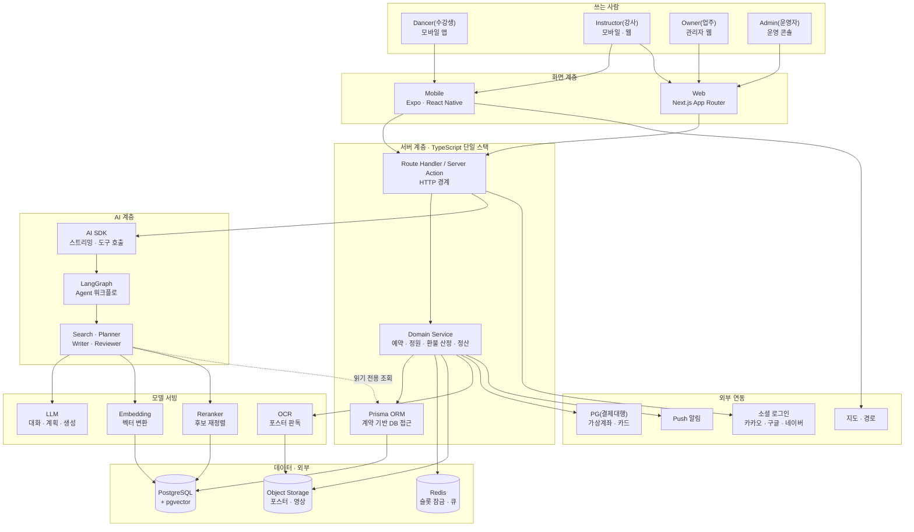

**점선 하나를 눈여겨볼 것** — `Agent` 가 DB 로 가는 선은 **읽기 전용**이다. AI 가
예약을 만들거나 돈을 움직이지 않는다. 쓰기는 전부 `Domain Service` 를 거친다.
정원·금액 같은 규칙이 한 군데에만 있어야 하고, 모델이 그 규칙을 우회하면 정합성
보장이 통째로 무너지기 때문이다.

## 19-2(서브 다이어그램) — 층을 하나씩 뜯어본다

### 19-2-1(권한) — 누가 무엇을 만질 수 있는가

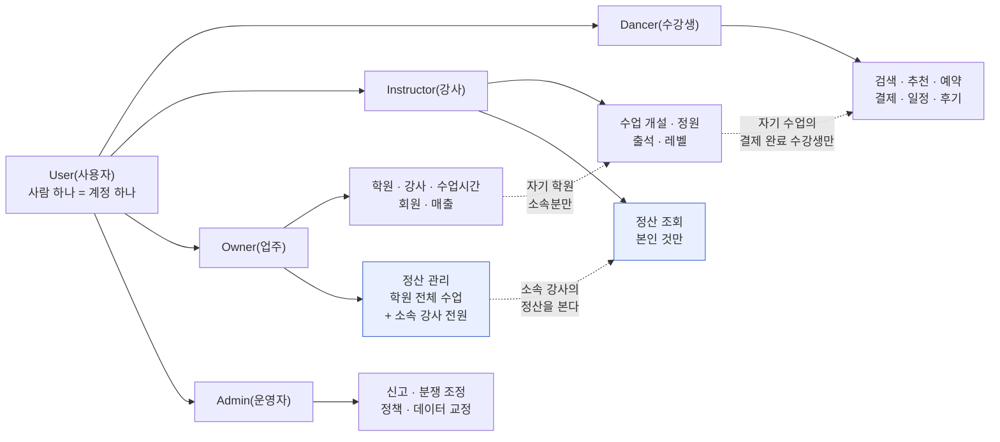

**한 사람이 여러 역할을 동시에 갖는다.** 강사가 다른 학원에서는 수강생이다. 그래서
역할을 계정에 하나 박지 않고 **집합**으로 둔다. 점선은 범위 제한이다 — 강사가 볼 수
있는 수강생은 "자기 수업을 결제한 사람" 뿐이다.

**정산 조회 범위는 비대칭이다**(파란 상자, 2026-09-21 확정). 정산은 **전부 플랫폼
안에서** 확인한다 — 별도 정산서를 주고받지 않는다.

| 역할 | 볼 수 있는 정산 |
|---|---|
| `Instructor(강사)` | **본인 것만.** 다른 강사의 정산은 같은 학원이어도 볼 수 없다 |
| `Owner(업주)` | **자기 학원의 모든 수업** + **소속 강사 전원**의 정산. 관리까지 한다 |
| `Admin(운영자)` | 분쟁 조정에 필요한 범위. 열람하면 기록이 남는다 |

방향이 한쪽이다 — 업주는 소속 강사의 소속 학원에 대한 정산만 내려다보지만, 강사는 옆을 보지 못한다.

### 19-2-2(도메인) — 데이터가 어느 묶음에 사는가

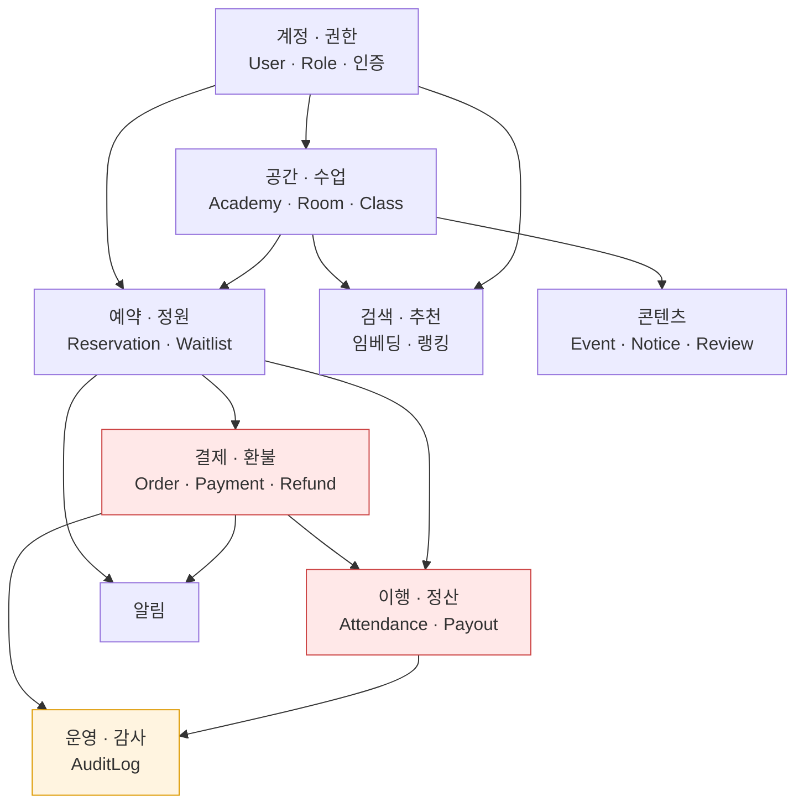

붉은 두 묶음이 **돈이 걸린 자리**다. 여기만은 정합성이 100% 여야 하고, 노란 묶음
(운영·감사)이 그 둘을 되짚을 수 있게 받쳐 준다.

### 19-2-3(런타임) — 무엇이 어디서 도는가

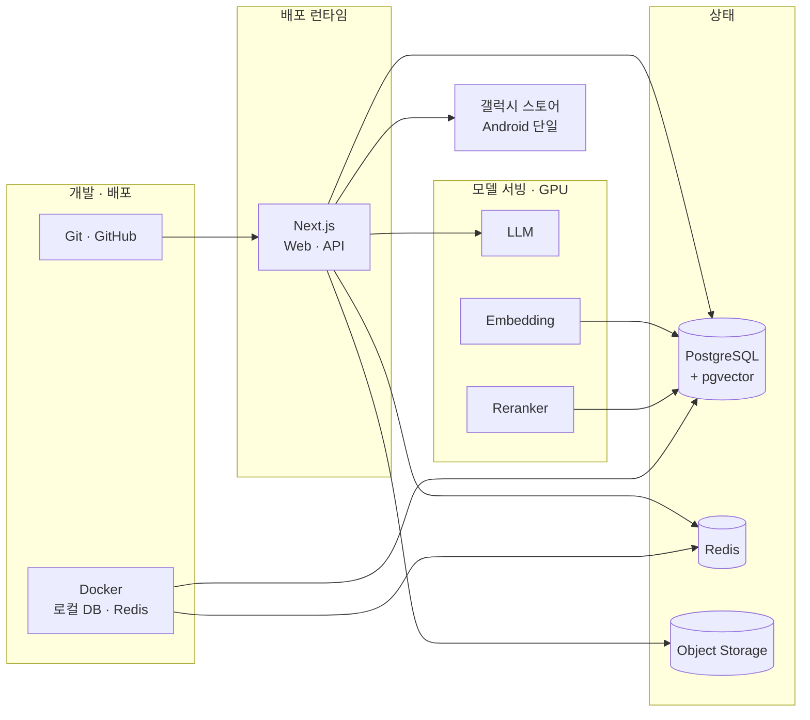

> **여기가 아직 미검증인 자리다.** 모델 3종의 실제 서빙 성능을 측정하지 않았다.
> 노트북 GPU 8GB 기준 동시 처리 1~4건이 유일한 근거이고, 이건 베타 규모에 한참
> 못 미친다. 「11-2. 알려진 위험」에 미검증으로 남아 있다.

## 19-3(파이프라인) — 일이 순서대로 어떻게 흐르는가

### 19-3-1(수업 등록) — 포스터 한 장에서 판매 가능 상태까지

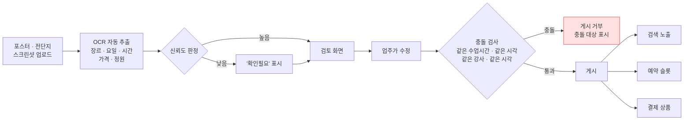

**검토 단계를 건너뛰는 경로는 만들지 않는다.** 가격·정원은 잘못 읽히면 되돌리기
어려운 값이라서다. 그리고 게시의 결과 3종(검색·슬롯·상품)은 **함께 생기거나 함께
실패한다** — 하나만 생긴 상태가 남으면 "검색에는 뜨는데 결제가 안 되는 수업" 이 된다.

### 19-3-2(예약·결제) — 금액이 경로를 가른다

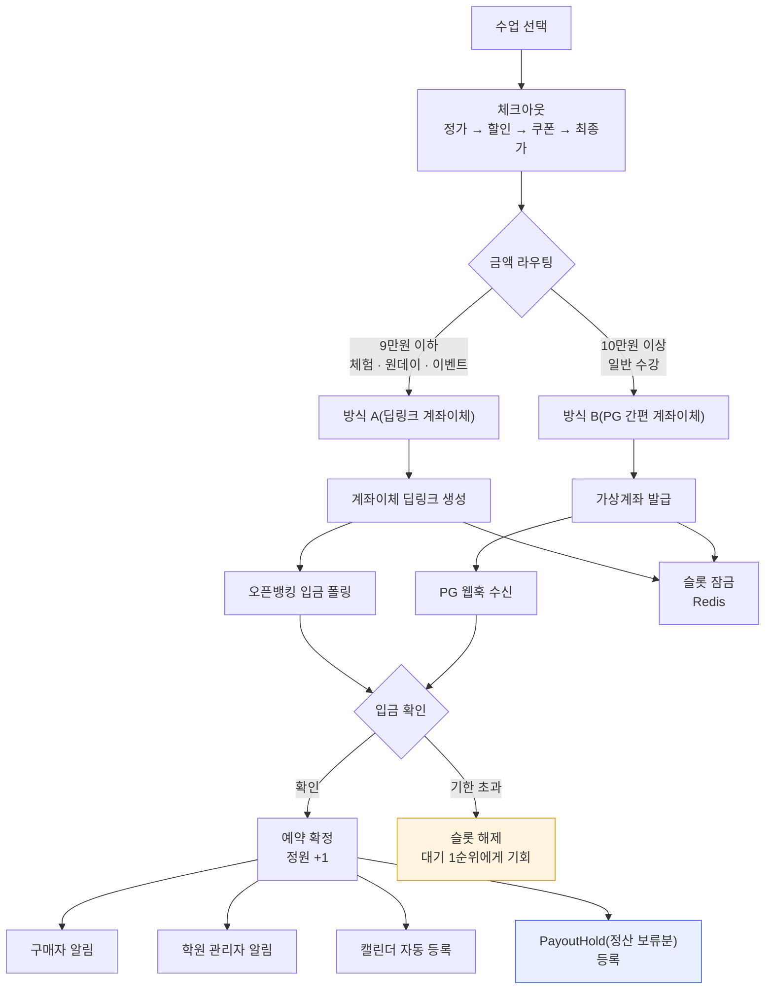

**같은 자리에 여러 명이 동시에 입금 대기를 잡을 수 있다.** 그때는 **먼저 입금이 확인된
쪽만 확정**하고 나머지는 자동 취소한다. 잠금이 없으면 정원 13/12 가 만들어진다.

파란 상자가 이번에 새로 붙은 자리다 — 결제가 끝나도 그 돈은 아직 **누구 것도 아니다.**

### 19-3-3(이행·정산) — 결제와 정산 사이의 시간

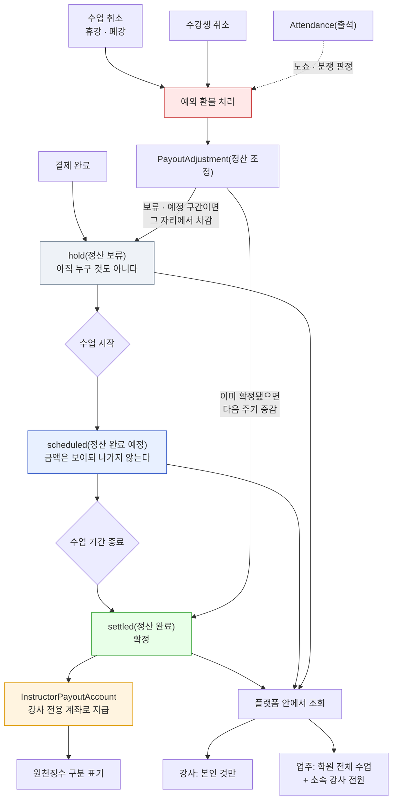

**강사는 프리랜서라 급여가 없다.** 월급도 시급도 없고, 실제로 진행해서 기간이 끝난
수업분에 대해서만 정산을 받는다.

**관문을 넘기는 것은 시각이다.** 수업이 시작되면 `scheduled(정산 완료 예정)` 로,
기간이 끝나면 `settled(정산 완료)` 로 간다. 출석 기록은 관문을 여는 스위치가 아니라
**노쇼와 분쟁을 가릴 때 꺼내 보는 근거**다(점선).

**취소는 늦게 온다.** 그래서 두 갈래로 나눈다 — 아직 보류·예정 구간이면 그 자리에서
빼고, 이미 확정돼 돈이 나갔으면 되돌리지 않고 **다음 주기에 증감으로 반영**한다.
지나간 정산을 소급해 고치면 강사 쪽 장부와 어긋나기 때문이다.

**정산은 전부 플랫폼 안에서 본다.** 강사는 본인 것만, 업주는 자기 학원의 모든 수업과
소속 강사 전원의 정산을 본다. 이 비대칭은 단방향이다 — 강사는 옆 강사를 보지 못한다.

### 19-3-4(취소·환불) — 이미 만들어져 있는 구간

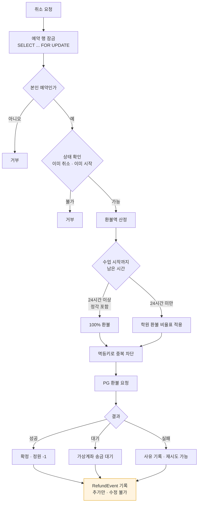

**이 구간만 실제로 구현돼 있다**(`backend/app/services/cancellation.py` ·
`refund_policy.py`). 금액은 전부 정수(원)로만 다루고 비율은 만분율 정수라 소수 오차가
없다. 반올림은 **회원에게 유리한 올림**이다.

### 19-3-5(AI 추천) — 문장 하나에서 실현 가능한 일정까지

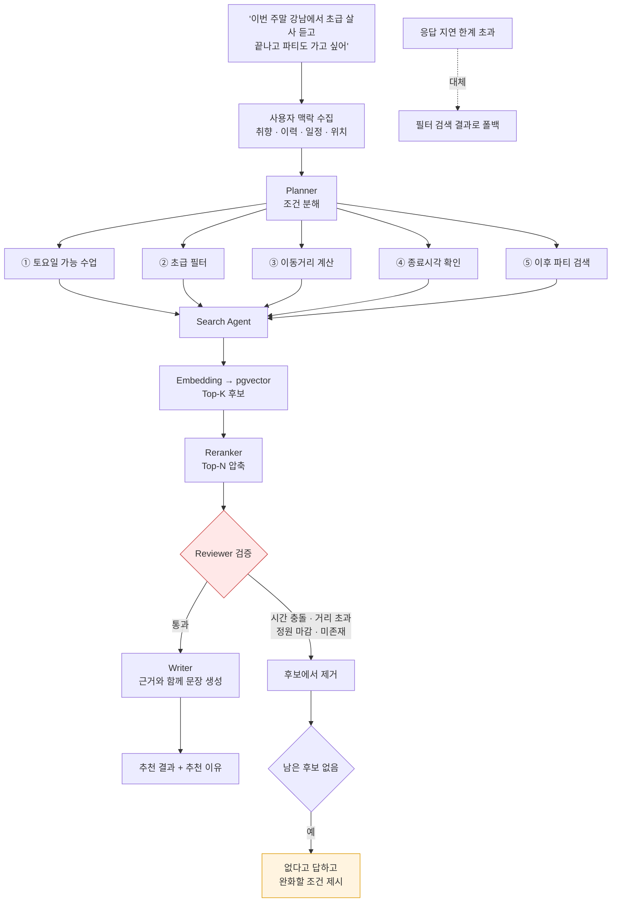

**Reviewer(붉은 상자)가 이 파이프라인의 존재 이유다.** 벡터 검색은 "비슷한 것" 을
가져올 뿐 "지금 갈 수 있는 것" 을 보장하지 않는다. 시간이 겹치거나 이미 마감됐거나
아예 존재하지 않는 수업이 섞이면, 사용자는 두 번째부터 추천을 믿지 않는다.
**없으면 없다고 답하는 것**이 지어내는 것보다 낫다.

### 19-3-6(알림) — 한 번 정해서 여러 갈래로

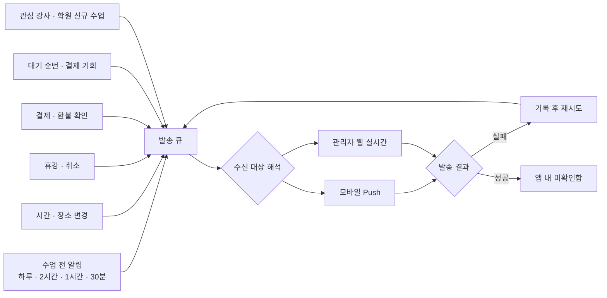

**SMS 를 쓰지 않는다.** 결제 확인조차 앱 내 알림으로 보낸다 — 결제대행사를 뺀 나머지
주변 기능은 무료·오픈 수단만 쓴다는 원칙 때문이다(`docs/payment-method-policy.md`).

### 19-3-7(사용자 문의·AI 응답) — 대부분을 모델 없이 답한다

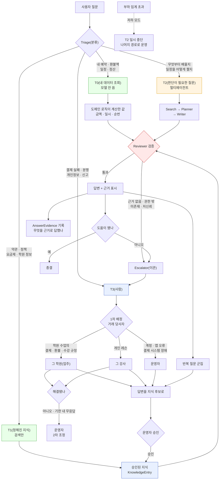

**초록 두 갈래가 이 설계의 핵심이다.** `T0(내 데이터 조회)` 와 `T1(정해진 지식)` 은
모델을 거치지 않는다. 실측상 GPU 1대의 동시 처리가 1~4건이라, 모든 질문을 모델에
보내면 저녁 피크에 대기열이 분 단위로 밀린다. 질문의 상당수는 애초에 생성이 필요
없는 조회다 — **"내 다음 수업 언제야"** 에 모델을 쓸 이유가 없다.

**금액을 모델이 만들지 않는다.** 환불 예상액을 물으면 취소 미리보기와 **같은 계산
로직**이 낸 값을 그대로 끼워 넣는다. 두 경로가 각자 계산하면 언젠가 반드시 어긋나고,
그 어긋남이 그대로 분쟁이 된다.

**AI 는 쓰기를 못 한다.** 취소·환불·예약을 실행하지 않는다. 해당 화면으로 가는 버튼을
제시하는 데까지이고, 누르는 것은 사용자다. 권한 검사도 모델이 아니라 시스템이 하므로,
사용자가 프롬프트를 어떻게 바꿔도 볼 수 있는 범위가 넓어지지 않는다.

**지식이 쌓이면 모델 부하가 준다(선순환).** 반복 질문을 모아 운영자가 승인하면
`T1(정해진 지식)` 으로 내려간다. 운영이 길어질수록 `T2` 로 가는 비율이 떨어진다 —
**운영이 인프라를 대신 감당하는 구조**다.

**답을 아는 사람에게 묻는다.** 환불 기준이 학원마다 다르므로(`Academy.refund_policy_tiers`)
플랫폼 운영자가 대신 답할 수 없다. 다만 **수업 시작 24시간 이상 전 전액 환불**은 학원과
무관한 플랫폼 고정 규칙이라(`backend/app/services/refund_policy.py`) 이쪽은
`T1(정해진 지식)` 이 답할 수 있다. 답변은 두 층을 구분해 제시한다 — 어디까지가 공통
규칙이고 어디부터가 그 학원 정책인지.

**답변 창구는 AI 없이도 살아 있어야 한다.** 스토어 심사와 전자상거래 고지에 필요한
것은 `T3(사람)` 경로이고, 나머지 셋은 그 위에 얹는 개선이다. 모델이 멈춰도 문의는
접수되고 답변된다.


# 20. 개발 우선순위

> **Phase 번호는 단독으로 쓰지 않는다** — `Phase 4(AI 추천)` 처럼 기능명을 붙인다
> (`core-rules.md` 「식별자·용어 표기 통일」). 번호만으로는 그게 무엇을 가리키는지
> 알 수 없어, 읽는 사람이 매번 이 목록으로 되돌아와야 하기 때문이다.


### Phase 1(기본 플랫폼)
- Next.js + React
- React Native
- Better Auth
- PostgreSQL
- Prisma
- 사용자/강사/업주 Role
- 기본 CRUD

### Phase 2(수업·일정)
- 강사 수업 등록
- 사용자 수업 검색
- 예약
- 일정
- 알림
- 댄스학원(학원)

### Phase 3(콘텐츠)
- 파티
- 공연
- 후기
- 이미지/영상
- 해당 장르 학원들의 파티,대회,공연 예매

### Phase 4(AI 추천)
- Embedding
- pgvector
- Reranker
- Qwen
- LangGraph
- Search/Planner/Writer/Reviewer

### Phase 5(운영 고도화)
- 업주 Dashboard
- 통계
- 정산
- 신고/관리
- 모니터링
- E2E 테스트

### Phase 6(AI 고도화)
- 개인화 추천
- 일정 기반 추천
- 사용자 행동 기반 Ranking
- 장기 사용자 Memory
- Agent 평가
- HITL
- 추천 품질 평가

---

## 핵심 방향

> **kdancex4의 핵심은 "AI 챗봇"이 아니라**
>
> **사용자 → 수업 → 강사 → 일정 → 파티 → 공연**
>
> **전체 K-댄스 활동을 AI가 연결하는 개인화 플랫폼이다.**

이 구조를 기준으로 Web, Mobile, 강사 페이지, 업주 관리자 페이지, AI Agent, RAG, 데이터베이스를 하나의 서비스 아키텍처로 연결한다.
