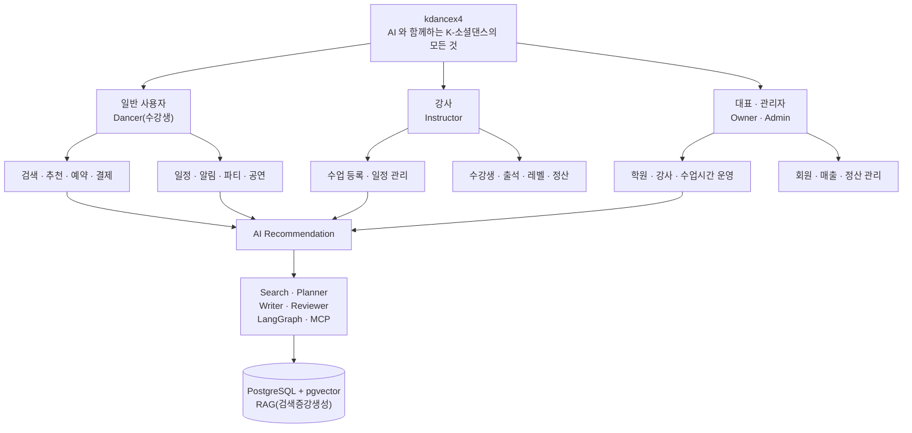

# kdancex4 서비스 개요

> 출처: 옛 `docs/planning/kdancex4_service_definition_and_tech_stack.md` 의 머리말 · 1장 · 2장 머리말 · 18장. 2026-11-13 파일을 나누면서 원문 그대로 옮겼다.
> 요구사항의 원본은 `specs/001-ai-dance-class-platform/spec.md` 다. 두 문서가 다르면 spec 이 맞다.

**기준일: 2026-09-17** · 2~5장 역할별 재구성 2026-09-25 · 약관 기준 정합성 재구성 2026-09-25 · 환불 경계(이벤트형 자동 실행·행사 일괄 취소·예매 수수료 예외) 반영 2026-09-26 (요구사항 원본은 `specs/001-ai-dance-class-platform/spec.md`, 약관은 `docs/legal/terms-of-service.md` · `docs/legal/merchant-terms.md` · `docs/legal/privacy-policy.md`)

> **서비스 한 줄 정의**
>
> **kdancex4는 AI와 함께하는 K-소셜댄스 플랫폼으로, 사용자의 취향과 일정에 맞춰 댄스 학원의 오프라인 수업·강사·파티·공연을 추천하고, 강사는 수업과 일정을 관리하며, 대표/관리자는 매장·댄스학원 운영과 수업·회원·매출 정보를 관리하는 Web + Mobile 서비스이다.**
>
> (2026-11-11 문장 맞춤 — 이전: 「온라인 댄스 수업·강사·파티·공연을 추천하고」. spec 은 온라인 수업 실시간 중계를 범위 밖으로 둔다. 「온라인」은 앱으로 신청·결제한다는 뜻이었고 수업 자체는 오프라인이다)

## 1. 서비스 전체 구조

## 2. 사용자별 서비스 정의

> **이 장의 자리 (2026-09-25 재구성).** 요구사항의 원본은 `specs/001-ai-dance-class-platform/spec.md` 다.
> 이 장(2~5장)은 그 요구사항을 **역할별로 모아 읽는 요약**이다. 항목마다 spec 의 FR 번호를 붙였다.
> 두 문서가 다르면 spec 이 맞다. 고칠 일이 생기면 spec 을 먼저 고치고 여기를 따라 고친다.
>
> **약관과의 관계 (2026-09-25).** 약관은 이 장의 규칙을 회원·학원·강사에게 약속하는 문서다. 약관에 조문만 있고 요구사항이 없던 것은 spec FR-250~FR-259(입점 심사·게시 제한 ~ 입점 약관 변경 통지)로 올렸고, 아래 표에는 `약관` 표시로 넣었다. 조문 번호는 출시용 간결판 기준이다(상세판은 `docs/legal/archive/terms-2026-09-25/`).

**표기** — `신규` 는 2026-09-25 역할별 재분석에서 새로 넣은 요구사항, `약관` 은 약관 조문에서 역반영한 요구사항, `이관` 은 이 문서에만 있다가 spec 으로 옮긴 요구사항, `Q4(개인정보 수집 방식)` 같은 번호는 답을 기다리는 질문이다(spec 「재분석이 남긴 질문」).

#### 역할별 재분석 요약 (2026-09-25)

| 역할 | 이관 | 신규 | 수정 | 질문 |
|---|---|---|---|---|
| 수강생 | 취향(음악·강사 스타일), 연령대, 경험 수준 구간, 사전 불참 표시 | 기간 단위 신청, 회차 옮기기, 대기 마감 시각, 영수증, 광고성 알림 동의 | 일정 충돌 "등록 불가" 표현 | Q4(개인정보 수집 방식)·Q6(일정 충돌 처리)·Q7(경험 수준 구간). Q5(딥링크 결제건 환불 주체)는 딥링크 폐지로 해당 없음 |
| 강사 | 소개 문구 생성, 공강 시간 수업 제안, 수업 공지, 대시보드 집계 | 회차 휴강과 폐강 구분, 계좌 변경 재확인, 나이 대신 연령대 | 무료 수업 수강생도 관리 대상, 도구 이름을 요구사항에서 뺌, AI 예시의 실명·연락처 출력 | Q7(경험 수준 구간)·Q10(소개 영상 의미) |
| 대표 | 강사 위임 권한 범위 | 강사 소속 해제 처리, 다른 학원 일정은 "불가 시간"으로만 | 매출·정산을 "확장 단계"로 미룬 문장 삭제, 환불을 학원 처리 방식으로 변경(2026-09-25) | Q9(파티 주최 주체)·Q11(환불 방식 변경의 뒤처리) |

## 18. 최종 제품 정의

### kdancex4

#### 사용자에게

**"내 취향과 일정에 맞는 카테고리(장르별) 소셜 댄스학원의 레벨에 맞는 수업 및 강사 추천 및 원하는 수업,파티,공연을 찾아주고 나의 취향 및 레벨과 일정에 맞는 수업을 추천해주는 AI 서비스"**

#### 강사에게

**"수업과 일정, 수강생을 효율적으로 관리하는 강사 플랫폼"**

#### 대표에게

**"댄스학원와 강사, 수업, 회원, 운영을 한 곳에서 관리하는 관리자 플랫폼"**

#### AI에게

**"사용자의 취향·일정·활동 데이터를 바탕으로 수업·강사·파티·공연을 연결하는 추천 Agent"**
