# kdancex4 — 사용자·강사·대표/관리자 서비스 정의 및 기술 스택
**기준일: 2026-09-17** · 2~5장 역할별 재구성 2026-09-25 · 약관 기준 정합성 재구성 2026-09-25 · 환불 경계(이벤트형 자동 실행·행사 일괄 취소·예매 수수료 예외) 반영 2026-09-26 (요구사항 원본은 `specs/001-ai-dance-class-platform/spec.md`, 약관은 `docs/legal/terms-of-service.md` · `docs/legal/merchant-terms.md` · `docs/legal/privacy-policy.md`)

> **서비스 한 줄 정의**
>
> **kdancex4는 AI와 함께하는 K-소셜댄스 플랫폼으로, 사용자의 취향과 일정에 맞춰 온라인 댄스 수업·강사·파티·공연을 추천하고, 강사는 수업과 일정을 관리하며, 대표/관리자는 매장·댄스학원 운영과 수업·회원·매출 정보를 관리하는 Web + Mobile 서비스이다.**

---

## 1. 서비스 전체 구조

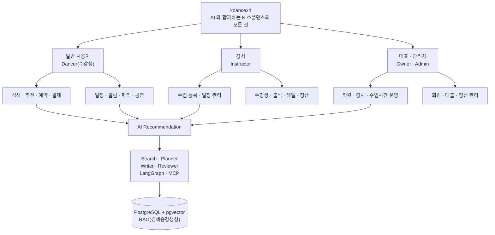

# 2. 사용자별 서비스 정의

> **이 장의 자리 (2026-09-25 재구성).** 요구사항의 원본은 `specs/001-ai-dance-class-platform/spec.md` 다.
> 이 장(2~5장)은 그 요구사항을 **역할별로 모아 읽는 요약**이다. 항목마다 spec 의 FR 번호를 붙였다.
> 두 문서가 다르면 spec 이 맞다. 고칠 일이 생기면 spec 을 먼저 고치고 여기를 따라 고친다.
>
> **약관과의 관계 (2026-09-25).** 약관은 이 장의 규칙을 회원·학원·강사에게 약속하는 문서다. 약관에 조문만 있고 요구사항이 없던 것은 spec FR-250~FR-259(입점 심사·게시 제한 ~ 입점 약관 변경 통지)로 올렸고, 아래 표에는 `약관` 표시로 넣었다. 조문 번호는 출시용 간결판 기준이다(상세판은 `docs/legal/archive/terms-2026-09-25/`).

**표기** — `신규` 는 2026-09-25 역할별 재분석에서 새로 넣은 요구사항, `약관` 은 약관 조문에서 역반영한 요구사항, `이관` 은 이 문서에만 있다가 spec 으로 옮긴 요구사항, `Q4(개인정보 수집 방식)` 같은 번호는 답을 기다리는 질문이다(spec 「재분석이 남긴 질문」).

### 역할별 재분석 요약 (2026-09-25)

| 역할 | 이관 | 신규 | 수정 | 질문 |
|---|---|---|---|---|
| 수강생 | 취향(음악·강사 스타일), 연령대, 경험 수준 구간, 사전 불참 표시 | 기간 단위 신청, 회차 옮기기, 대기 마감 시각, 영수증, 광고성 알림 동의 | 일정 충돌 "등록 불가" 표현 | Q4(개인정보 수집 방식)·Q6(일정 충돌 처리)·Q7(경험 수준 구간). Q5(딥링크 결제건 환불 주체)는 딥링크 폐지로 해당 없음 |
| 강사 | 소개 문구 생성, 공강 시간 수업 제안, 수업 공지, 대시보드 집계 | 회차 휴강과 폐강 구분, 계좌 변경 재확인, 나이 대신 연령대 | 무료 수업 수강생도 관리 대상, 도구 이름을 요구사항에서 뺌, AI 예시의 실명·연락처 출력 | Q7(경험 수준 구간)·Q10(소개 영상 의미) |
| 대표 | 강사 위임 권한 범위 | 강사 소속 해제 처리, 다른 학원 일정은 "불가 시간"으로만 | 매출·정산을 "확장 단계"로 미룬 문장 삭제, 환불을 학원 처리 방식으로 변경(2026-09-25) | Q9(파티 주최 주체)·Q11(환불 방식 변경의 뒤처리) |

---

## 2.1 수강생 (Dancer)

### 핵심 목적

**"나이·레벨·장르 취향과 일정에 맞는 수업·강사·파티·공연·대회를 찾고, 실제 참여까지 이어간다"**

### 요구사항

| 영역 | 요구사항 | spec |
|---|---|---|
| 가입·로그인 | 카카오·구글·네이버 소셜 로그인. 휴대폰 본인확인으로 사람 단위 계정 | FR-001 · FR-003 |
| 가입·로그인 | 나이·성별·연락처를 **필수**로 수집하고 수집 목적을 고지한다(2026-09-29 확정, Q4(개인정보 수집 방식)) | FR-002 |
| 대학생 인증 | 학교 이메일(`.ac.kr`) 인증, 가입 뒤에도 가능. **최초 첫 결제 1회 자동 50% 할인**, 인증·첫 결제 때 이벤트 팝업, 할인·환불 비용은 대표 부담(2026-09-25 변경) | FR-006~FR-008 · FR-118 |
| 미성년자 | 만 14세 미만은 직접 가입하지 않고 보호자 계정에 자녀로 등록해 보호자가 대신 신청·결제한다. 만 14세 이상 19세 미만은 법정대리인 동의 없이는 결제가 진행되지 않는다 | FR-009 · FR-009a |
| 가입·로그인 | 타인 명의·허위 인증·이용 정지자 재가입은 가입 거절 또는 사후 해지 `약관` | FR-257 |
| 약관 | 가입 때 약관 항목별 동의와 시각을 기록하고, 동의한 판본을 다시 볼 수 있다. 회사가 통신판매중개자임과 사업자 정보를 앱 안에서 확인할 수 있다 `약관` | FR-240 · FR-244 · FR-248 · FR-249 |
| 프로필·취향 | 경험 수준·선호 장르·지역·활동 가능 시간·이동 가능 거리 | FR-022 |
| 프로필·취향 | 선호 음악 스타일·선호 강사 수업 스타일 `이관` | FR-027 |
| 프로필·취향 | 경험 수준을 정해진 구간으로 받는다(입문 6개월 미만 · 초급 6개월~1년 · 초중급 1~2년 · 중급 2~4년 · 고급 4~6년 · 댄서 6년 이상) `이관` | FR-029 |
| 검색 | 날짜·지역·장르·세부장르·난이도·강사로 수업 검색. 원하는 시간대에 신청 가능한 수업만 보기 | FR-030 · FR-033 |
| 검색 | 한 강사가 여러 학원에서 여는 수업을 한 화면에서 보기 | FR-032 |
| 검색 | 권장 연령대로 수업 거르기(안내값이며 수강 자격을 막지 않는다) `이관` | FR-028 |
| 추천 | 취향·일정·위치 기반 수업·강사 추천, 추천마다 근거 문장. 입문자에게 입문 수업 우선 | FR-036 · FR-038~FR-040 |
| 추천 | 찜·좋아요·싫어요와 선택 이력으로 장르·학원·시간대·강사·지역별 추천을 다듬는다 | FR-024 · FR-043 |
| 추천 | 수업 → 파티 → 공연으로 이어지는 활동을 이동 시간까지 따져 제안 | FR-042 |
| 예약·정원 | 남·여 남은 자리를 보고 예약. 본인 성별 자리가 기본 선택이고 바꿀 수 있다 | FR-092 · FR-105 |
| 예약·정원 | 원데이·이벤트는 회차 하나, 정규·단기 과정은 기간 전체를 한 번에 신청 `신규` | FR-052a |
| 예약·정원 | 학원이 허용하면 같은 수업의 다른 회차로 자리 옮기기 `신규` | FR-109 |
| 대기 | 정원이 차면 수업 24시간 전까지 대기 신청, 내 순번 표시. 취소가 나면 순번대로 결제 기회 | FR-093~FR-095 |
| 대기 | 24시간 이내에는 새 대기를 받지 않고 결제 기회도 정해진 시각에 끝난다 `신규` | FR-108 |
| 대기 | 결제 취소가 1건 생길 때마다 **대기 1번 한 명에게만** 결제 기회 알림. 1번이 결제하면 다음 순번이 1번이 되어 알림을 받는다. 대기 신청·알림은 **멤버십 회원 전용**(가입 3개월 체험 포함) `신규` | FR-093 · FR-094 · FR-094a |
| 정원 | 전체·남·여 정원이 차면 결제 버튼과 쿠폰이 모두 비활성, 대기 신청만 가능 `신규` | FR-091a |
| 멤버십 혜택 | **1+1 쿠폰 · AI 에이전트 검색 · 대기자 알림**은 멤버십 회원 전용. 가입 후 3개월은 AI 검색과 대기자 알림을 체험(쿠폰 제외 — 체험 뒤 멤버십을 결제하면 결제할 때마다 1+1 쿠폰 1장) `신규` | FR-112c · FR-112d |
| 결제 | 체크아웃에 정가·할인·쿠폰·최종액을 항목별로 표시. 결제 확인은 앱 알림 | FR-114 · FR-117 |
| 결제 | 모든 결제는 PG. 가상계좌·간편 계좌이체·**신용·체크카드** 모두 가능(2026-09-25 딥링크 폐지·카드 확대) `신규` | FR-110 · FR-111 · FR-111a |
| 결제 | 결제 화면에 환불·취소 공지와 수단별 환불 방식이 함께 보인다. 입금 전에는 스스로 주문을 취소할 수 있다. 결제 흐름 전체는 spec 「결제 상세」 `신규` | FR-280~FR-299 |
| 결제 | 결제 수수료(PG·카드)는 수강생에게 더 받지 않는다 — 결제 수단에 따라 가격이 달라지지 않는다 `약관` | FR-125d |
| 결제 | 결제를 시작하면 결제 기한 동안 자리를 잡아 두고, 같은 자리에 여러 명이 입금 대기 중이면 먼저 입금이 확인된 사람만 확정 | FR-096 · FR-285 |
| 예매 수수료 | 이벤트·원데이·파티·공연·대회 결제 1명당 **2,000원**. 결제 화면에 수업료와 따로 표시, 플랫폼 몫, **취소해도 환불하지 않음** — 휴강·폐강·행사 취소·법정 청약철회만 환불(법률 검토). 영수증은 수업료(학원)와 따로 회사 명의 `약관` | FR-282a(예매 수수료 2,000원) · FR-282c(판매자별 영수증·정산 분배) |
| 멤버십 | 3개월 멤버십은 스스로 해지할 수 있다. 다음 결제일부터 청구하지 않는다 `신규` | FR-297 |
| 멤버십 | 멤버십(3개월·연)은 **결제 뒤 환불하지 않는다**. 해지만 가능하고 낸 기간은 끝까지 사용(2026-10-05 변경 — 이전: 14일 이내 전액 환불) `신규` | FR-297a |
| 쿠폰 | **1+1 = 수업 1달 정가 신청 + 본인 레벨 이하의 정규 수업 1개 1달 무료(정규 수업끼리만 — 원데이·이벤트·파티·공연·대회·개인 레슨 제외).** 한 신청에 1장, 정가 수업과 추가 수업을 한 번에 신청할 때만, 무료는 1달치뿐(2달 과정을 고르면 첫 1달만 무료). 개강일이 쿠폰 유효기간 안이고 정가 수업 개강일 앞뒤 30일 안인 수업 신청 때 사용, 다음 쿠폰 발급 전까지(3개월 안에 안 쓰면 소멸). 무료 범위는 입문→입문, 초급→입문·초급, 초중급→초중급 이하, 중급→중급 이하, 고급→고급 이하, 댄서→모든 레벨이며 세부 장르별 레벨로 판정한다. 대표(학원) 정산에는 추가 수업을 금액으로 넣지 않는다 — 결제 0원이라 매출·차액·공제 어디에도 계산하지 않고 정산 내역·대표 화면에 '1+1 쿠폰 사용' 여부만 표시한다. 참여 학원은 그 자리를 1달 무료로 내주는 것으로 참여한다 *(2026-10-11 변경 — 이전: 추가 수업 1달치 50% 할인)*. 베타 동안 **댄스스포츠 라틴만**. 참여하지 않은 학원은 '쿠폰 미적용' 표시·쿠폰 비활성·경고 팝업 `신규` | FR-121 · FR-121a~FR-121c · FR-122 |
| 멤버십 | 1+1 쿠폰은 **결제 즉시 지급**한다. **3개월 멤버십만** 결제(첫 결제·갱신)가 끝날 때마다 바로 1장. 연 멤버십에는 1+1 쿠폰이 없고 동반자 첫 수업 무료 쿠폰 1년 1장만 받는다. 쿠폰은 발급 후 3개월에 소멸. 멤버십 화면에 다음 쿠폰 날짜를 보여준다 *(2026-10-11 변경 — 이전: 3개월 유지마다 1장)* `신규` | FR-120 · FR-120a · FR-122 |
| 멤버십 | **3개월 멤버십 요금 3,000원**(2026-09-30 확정 월 1,000원 × 3, 2026-10-11 3개월 단위로 변경, Q13(멤버십 판매 주체·요금)). 3개월마다 자동 갱신하거나 3개월씩 직접 결제한다. **연 멤버십**: 3개월 멤버십 요금 × 4(12,000원)에서 **10% 할인** = 10,800원. 1년치를 한 번에 결제. 결제수단은 카드·간편결제·계좌이체 모두 가능하고, 카드·간편결제·계좌 자동이체면 1년마다 자동 갱신(FR-112(멤버십 결제수단)). 연 멤버십에는 1+1 쿠폰이 없고, 동반자 첫 수업 무료 쿠폰 1년 1장만 받는다. 멤버십은 **플랫폼 상품**이라 할인은 플랫폼이 부담하고, 멤버십 환불도 플랫폼이 받는다(Q13(멤버십 판매 주체·요금) 판매 주체 확정) `신규` | FR-112a · FR-112b · FR-297 |
| 결제 | 결제·환불 내역과 영수증 조회, 현금영수증 신청 `신규` | FR-138 |
| 취소·환불 | 환불은 문의로 요청하고 **대표만** 자기 환불 규정대로 처리한다(개인 레슨 포함). 문의 화면에서 해당 수업을 검색·선택해 요청하면 담당 강사가 확인하고 대표가 처리한다. 대표 연락처가 함께 보인다. 운영자·AI 는 처리하지 않는다. **이벤트·원데이·파티·공연·대회는 다르다** — 예약 상세에서 취소를 신청하면 시스템이 취소 규정대로 환불액을 계산하고 대표가 실행한다. 대표는 거절할 수 없고, 처리 기간(최대 3영업일)이 지나면 시스템이 자동 실행한다 | FR-098b · FR-098(대표 처리 환불 방식) · FR-295(수단별 환불 실행) |
| 취소·환불 | 학원 환불 규정은 모든 수업 공지와 결제 화면에 표시된다. 표시된 규정과 실제 운영이 다르면 표시된 쪽이 적용된다 | FR-099 · FR-241 · FR-242 |
| 취소·환불 | **원데이·이벤트·파티·공연·대회**는 대표·강사가 등록한 **환불 마감일**까지만 취소·환불할 수 있다(예: 10/30 개최 → 10/15 마감). 마감일까지는 인터파크식 취소 수수료 표를 따르고, 마감 뒤에 결제하면 "환불 불가 상품" 동의를 먼저 받는다 `약관` | FR-099c · FR-099d |
| 취소·환불 | 학원·강사 사정의 휴강·폐강은 환불 또는 보강을 고를 수 있다 | FR-055 · FR-065 |
| 출석 | 수업 전에 불참 예정을 스스로 표시. 자리를 반납하려면 취소를 거친다 `이관` | FR-104a |
| 일정 | 신청한 수업·파티·공연·대회를 한 캘린더에. 겹치거나 이동 시간이 부족하면 알림. 막지 않고 **경고 뒤 진행 여부를 묻는다**(Q6(일정 충돌 처리), 2026-09-30 확정) | FR-035 · US4 |
| 알림 | 수업 전 알림 시점 선택(하루 전·2시간 전·1시간 전·30분 전), 시간·장소 변경과 휴강 알림 | FR-140 · FR-141 |
| 알림 | 관심 강사·학원의 새 수업과 이벤트 알림 | FR-023 · FR-142 |
| 알림 | 광고성 알림 동의는 거래 알림과 따로 받고 밤에는 보내지 않는다 `신규` | FR-146 |
| 기록·후기 | 수강·참여 이력 조회. 실제로 수강한 사람만 후기 작성 | FR-175 · FR-177 |
| 문의 | 앱 안 문의 창구. AI 가 먼저 답하고 사람에게 물을 때는 **학원이나 수업을 검색해 대표를 고르면 그 대표에게 알림**이 간다. 앱 오류·계정 문의만 운영자가 받는다 | FR-176 · FR-203 · FR-203a |
| 개인정보 | 내 데이터 삭제 요청, 동의한 약관 판본 다시 보기. 위치는 저장하지 않는다 | FR-190 · FR-244 · FR-186 |
| 탈퇴 | 앱 안에서 탈퇴(계정 삭제). 남은 예약·결제는 약관대로 처리한 뒤 삭제. 1회성 혜택은 재가입해도 다시 받지 못한다 | FR-010 · FR-190 |
| 멤버십 | 자동 결제가 실패하면 정해진 횟수만큼 재시도하고 매번 알린다. 끝내 실패하면 멤버십이 멈춘다 `약관` | FR-113 |
| 출석 | 무단 불참(노쇼)이 반복되면 대기 순번에서 불이익 `약관` | FR-167 |
| AI | AI 답변·추천에 **AI 생성 결과임을 표시**. AI 답변은 계약 내용이 아니며 결제 화면과 학원 규정이 우선. 결제 실패·분쟁·개인정보·신고는 사람이 답하고, 언제든 사람을 부를 수 있다 `약관` | FR-258 · FR-247 · FR-201 |
| 이용 제한 | 약관 위반 시 사유 통지·소명 뒤 경고~해지. 정지돼도 기존 결제의 환불 청구권은 유지. 서비스 밖 거래 유도는 신고할 수 있다 `약관` | FR-254 · FR-255 |

### 이번 재분석에서 바뀐 것

- **보강** — 정규 과정을 회차마다 따로 결제하게 둘 수는 없다. 기간 단위로 신청하게 했다(FR-052a(회차·기간 신청 단위)). 결제 기회가 수업 직전까지 이어지면 받은 사람이 올 수 없으므로 대기 마감 시각을 정했다(FR-108(대기 마감)).
- **수정** — 기존 문구 "일정이 겹치면 등록 불가"는 spec US4(일정 충돌·알림) 의 "경고 뒤 진행 여부를 묻는다"와 맞지 않는다. **Q6(일정 충돌 처리)** 로 남겼다가 2026-09-30 에 **경고 후 진행 선택**으로 확정했다.
- **수정** — 기존 문구 "이름·이메일·성별·연락처 필수"는 강사 쪽 기술(권고 + 쿠폰 제한)과 서로 달랐다. **Q4(개인정보 수집 방식)** 로 남겼다가 2026-09-29 에 **필수**로 확정했다.

---

# 3. 강사 (Instructor)

## 3.1 핵심 목적

**"내 수업을 등록하고, 가능한 시간에 수강생을 모으고, 수강생과 일정을 효율적으로 관리한다"**

강사는 학원에 고용된 사람이 아니라 **프리랜서**다. 급여가 없고 실제로 진행해 기간이 끝난 수업분만 정산받는다(FR-127(강사 프리랜서)). 한 강사가 여러 학원에 동시에 속할 수 있다.

### 강사 프로필 (FR-025)

| 항목 | 내용 |
|---|---|
| 기본 정보 | 이름·프로필 이미지·소개 |
| 장르 | 댄스스포츠(라틴·스탠다드) / 아르헨티나 탱고 / 스윙 / 살사·바차타 — 4종 고정(FR-020(장르 4종)) |
| 세부 장르 | 라틴(차차차·쌈바·룸바·파소도블레·자이브) / 스탠다드(슬로우왈츠·탱고·비엔나왈츠·슬로우폭스트롯·퀵스텝) / 스윙 / 살사 / 바차타(FR-021(세부 장르)) |
| 경력 | 경력·자격·활동 이력 |
| 활동 지역 | 소속 학원·지역 |
| 소개 영상 | 수업 영상과 댄스 영상. 영상에 나오는 대표·강사의 초상권 동의를 받고, 해당 수업 홍보 용도로만 쓴다(2026-09-29 확정, Q10(강사 소개 영상)) |

> 세부 장르의 영문 표기 `Jave` 는 `Jive(자이브)` 의 오타라 고쳤다. 명칭은 FR-021(세부 장르) 과 `../policy/genre-taxonomy-policy.md` 를 따른다.

## 3.2 수업 관리

> **정원은 남·여 성별로 나눈다(2026-09-26 변경).** 신청 화면에서 남성은 남 자리, 여성은 여 자리가
> 기본으로 선택되고, 회원이 원하면 반대 자리로 바꿔 신청할 수 있다. 기본값은 휴대폰 본인확인 성별이다. 2026-09-21 에는 리드·팔로우
> 역할로 나누기로 했다가 사용자 결정으로 바꿨다(FR-092(성별 정원)). 남·여를 나누지 않는
> 솔로 수업은 단일 정원으로 운영한다(FR-092c(성별 구분 없는 단일 정원)).

### 수업 등록 (FR-050 · FR-061 · FR-099b)

```text
강사
 ↓
수업 생성 — 장르·세부장르 / 레벨 / 수업구분 / 수업명
 ↓
일시 / 장소 / 정원(최대 인원 필수, 남·여 정원) / 권장 연령대(선택)
 ↓
수강료 / 신청 방법 / 신청 단위(회차 또는 기간)
 ↓
환불·취소 공지 — 대표가 양식으로 쓴 공지가 자동으로 채워진다 (강사는 수정 불가, FR-099a·FR-099b)
 ↓
환불 마감일 — 원데이·이벤트·파티·공연·대회만, 필수 입력 (비면 등록·결제 불가, FR-099d)
 ↓
소개 문구 초안 생성(대화 모델) · 홍보 이미지 생성(강사가 쓴 문장 기준, 하루 3회) → 강사 검토·수정 (FR-061·FR-061a)
 ↓
공개 → 검색 노출 · 예약 슬롯 · 결제 상품이 함께 준비된다
 ↓
AI 추천 대상에 들어간다
```

소개 문구·이미지 생성(FR-061(수업 소개 문구 생성))은 **무엇을** 할지만 정한다. 홍보 이미지의 조건은 FR-061a(홍보 이미지 생성 조건)다.

| 항목 | 내용 |
|---|---|
| 입력 | 강사·대표가 원하는 이미지를 한국어로 적는다(최대 200자, 예시 버튼 제공). 시스템은 영어 번역과 "글자 없음" 조건만 덧붙인다 |
| 결과 | 글자 없는 배경 이미지. 수업명·일시·가격 글자는 앱이 위에 얹는다. AI 생성 표시(FR-258(AI 생성 표시)) |
| 횟수 | 계정마다 **하루 3회**(베타 임시, 정식 1회, 설정값). 버튼에 `남은 횟수 2/3 ●●○` 로 표시, 실패·거절은 세지 않는다. 입점 약관 제6조 ⑪ |
| 막는 입력 | 선정적·폭력적 내용, 실존 인물 흉내, 다른 회사 상표·로고 |
| 구현 선택 | Hugging Face FLUX.1-dev / SDXL(「11. 기술 스택 고정표」 Image Gen 행). 무료 월 약 80장 안에서 운영 |

### 수업 구분과 운영 형태

- 수업 구분(FR-051(수업 구분)): 정규 · 이벤트 · 원데이 · 파티 · 공연 · 대회 (축제·외부 행사는 대회로 표시)
- 운영 형태(FR-052(수업 운영 형태)): 위 수업 구분 여섯 가지. 개인 레슨은 학원에서 여는 10회 수강권이다(단기·그룹 레슨은 없다)
- 신청 단위(FR-052a(회차·기간 신청 단위) `신규`): 원데이·이벤트·파티·공연·대회는 회차 하나, 정규는 기간 전체

### 레벨 기준 — 두 가지가 있다

**경력 기반 레벨** (프로필의 경험 수준, FR-029(경험 수준 구간))

| 레벨 | 영어 | 경력 | 의미 |
|---|---|---|---|
| 입문 | Introductory | 6개월 미만 | 처음 배우거나 기본 동작을 익히는 단계 |
| 초급 | Beginner | 6개월~1년 | 기본 동작을 익히고 간단한 루틴을 수행하는 단계 |
| 초중급 | Upper Beginner | 1~2년 | 기본기를 바탕으로 리드앤팔로우를 익히는 단계 |
| 중급 | Intermediate | 2~4년 | 기술·리드앤팔로우·응용이 가능한 단계 |
| 고급 | Advanced | 4~6년 | 높은 숙련도와 다양한 응용이 가능한 단계 |
| 댄서 | Dancer | 6년 이상 | 무대·지도까지 가능한 최상위 단계 |

> **초급을 6개월~2년으로 넓혔다(2026-09-25 확정).** 원래 표는 초급이 1년에서 끝나 1~2년 구간이
> 비어 있었다. 4~5년 공백은 2026-09-29 에 **4년 초과부터 고급**으로 메웠다. 남은 것은 강사가 매기는
> 점수 레벨(아래)과 이 표의 관계 하나이고, **Q7(경험 수준 구간)** 에 남겨 두었다.
> **2026-10-11 현행: 6단계(입문·초급·초중급·중급·고급·댄서).** 위 표와 아래 점수 구간이 현행 값이고, 위 두 줄의 구간 숫자는 당시 기록이다.

**강사가 매기는 점수 레벨** (세부 장르별 0~10, FR-160(레벨 0~10 부여)·FR-161(레벨 등급 구간))

| 점수 | 등급 |
|---|---|
| 0~1 | 입문 |
| 2~3 | 초급 |
| 4~5 | 초중급 |
| 6~7 | 중급 |
| 8~9 | 고급 |
| 10 | 댄서 |

### 일정 관리

| 기능 | spec |
|---|---|
| 가능 시간·개인 일정 등록 | FR-053 |
| 일정 충돌 감지 — 학원이 달라도 같은 시각이면 거부 | FR-054 |
| 반복 수업 일정을 한 번에 생성 | FR-057 |
| 휴강·보강, 휴강한 수강생에게 환불 또는 보강 크레딧 선택지 | FR-055 · FR-059 |
| 반복 수업에서 "이 회차만 휴강"과 "이후 전부 폐강" 구분. 최종 결정은 강사가 한다 `신규` | FR-065 |
| 시간·장소 변경 시 예약자 전원에게 변경 전후 값 알림 | FR-056 |
| 대타(대체 강사) 요청 | FR-060 |
| 대표가 공개한 빈 강의실 시간에 수업 개설 제안 `이관` | FR-062 |

## 3.3 수강생 관리

**볼 수 있는 범위** — 강사는 자기 수업의 **결제 완료 수강생**만 본다. 무료 수업은 신청이 확정된 수강생을 결제 완료와 같게 본다(FR-005(역할별 데이터 범위), 2026-09-25 보완). 대표에게 관리 권한을 위임받은 강사는 학원 전체 수강생을 보지만 매출·정산·금액은 볼 수 없다(FR-081a(강사 위임 범위)).

```text
수업
 └─ 수강생
     ├─ 신청 · 결제 확정
     ├─ 불참 예정 표시 (수강생 본인 → 역할별 예상 인원에 반영, FR-104a)
     ├─ 출석 · 불참 기록 (노쇼·분쟁 판정 근거, FR-104)
     └─ 취소 → 환불
         ├─ 정규·일반 수업: 문의 → 대표만 규정대로 처리 (FR-098b(환불 요청 경로))
         └─ 이벤트·원데이·파티·공연·대회: 예약 상세 취소 신청 → 시스템 계산 → 대표 실행,
            처리 기간(최대 3영업일)이 지나면 시스템 자동 실행 (FR-098(대표 처리 환불 방식) 예외)
```

| 기능 | spec |
|---|---|
| 수강생 명단·신청 상태·남·여 인원 | FR-090 · FR-092 |
| 출석 관리. 수업 끝난 뒤 수정하려면 사유 필요 | FR-104 |
| 대기자 관리(24시간 전까지 대기 신청, 순번대로 결제 기회, 응답 없으면 다음 순번) | FR-093~FR-095 · FR-108 |
| 역할 불균형 경보와 부족한 역할 한정 모집 | FR-107 |
| 현장 등록 인원 반영 | FR-106 |
| 내 수업 수강생에게 공지 `이관` | FR-063 |
| 연락처는 가려서 보여주고 전체 열람은 사유·열람자를 남긴다 | FR-187 |
| 나이 대신 연령대로 표시 `신규` | FR-168 |

> **바로잡은 것** — 기존 문구는 "계좌이체로 결제한 건은 즉시 환불이 어려우니 담당 강사에게 환불을 문의하라"였다.
> 강사는 결제금을 받는 쪽이 아니라서 환불할 수 없다. 모든 수업 결제는 PG 로 받으므로(2026-09-25 딥링크 폐지) 환불도 대표가 대표 화면에서 PG 환불을 실행한다. 플랫폼이 환불하는 것은 멤버십뿐이다.
> 예외가 둘 있다. 이벤트·원데이·파티·공연·대회 취소 신청을 대표가 처리 기간(최대 3영업일) 안에 실행하지 않으면 시스템이 계산된 금액으로 PG 환불을 실행한다(FR-295(수단별 환불 실행)). 대표가 행사를 통째로 취소하면 결제자 전원에게 PG 로 일괄 환불한다(FR-099e(행사 일괄 취소)). 어느 쪽도 회사가 금액을 새로 정하지 않는다.

## 3.4 강사 대시보드와 AI 지원

**대시보드** (FR-058(강사 일정 대시보드) · FR-064(강사 대시보드 집계))

```text
오늘의 수업 · 이번 주 · 한 달 · 1년(달력)
요일별 · 학원별 신청 인원
남·여 남은 자리(본인 성별 자리가 기본 선택, 바꿀 수 있음)
대기자 · 취소 인원
관심 등록한 사용자 수
정산 — 보류분 · 예정분 · 완료분 (FR-130)
```

**AI 지원**

| 기능 | spec |
|---|---|
| 수업 제목·소개 문구·홍보 이미지 초안 생성, 강사 검토 후 게시. 이미지는 강사가 쓴 문장 기준·하루 3회 | FR-061 · FR-061a |
| 반복 일정 자동 생성·일정 충돌 탐지 | FR-057 · FR-054 |
| 빈 강의실 시간대와 대타 요청 찾기 | FR-062 · FR-060 |
| 수강 이력·출석률로 개인별·단체별 레벨 분포 그래프 | FR-163 |
| 개강 조건을 주면 수강생 후보와 선정 근거 제시 | FR-164 |
| 후보의 연락처는 수강생이 동의했을 때만 보여주고 조회를 기록 | FR-165 |

**질문 예시** — 강사가 "토요일 아침 9시에 룸바 고급반 6명을 새로 열려고 해. 누구를 추천해?"라고 물으면 이렇게 답한다.

> "룸바 레벨 8 이상이면서 최근 1년 동안 출석률이 90% 이상인 수강생은 7명입니다.
> 토요일 오전이 가능하다고 표시한 6명을 추천합니다 — A 수강생(룸바 10 · 쌈바 8, 금요일반 1년 수강), …
> 연락처는 제공에 동의한 4명만 볼 수 있습니다. 명단을 보시겠어요?"

> 기존 예시는 실존 인물 이름을 쓰고 동의와 상관없이 이름·성별·나이·연락처 명단을 내보냈다.
> 개인정보 요구사항(FR-165(후보 연락처 동의)·FR-168(연령대 표시)·FR-187(연락처 마스킹))과 어긋나서 위 예시로 바꿨다.

## 3.5 정산

프리랜서 강사의 정산은 3단계로 익는다 — 수업 시작 전 `보류`, 수업 중 `정산 완료 예정`, 기간이 끝나면 `정산 완료`(FR-128~FR-130(정산 3단계 ~ 정산 단계별 금액)). 강사는 본인 정산만 보고 개인 레슨분은 학원 수업분과 따로 계산한다(FR-135(정산 조회 범위) · FR-135a(개인 레슨 별도 정산)). 정산금은 강사 전용 계좌로 나가며 계좌를 바꿀 때는 본인확인을 다시 거친다(FR-133(강사 전용 계좌) · FR-139(강사 계좌 변경 재확인) `신규`). 지급액에는 원천징수 항목을 따로 표기한다(FR-135d(원천징수 표기)). 강사 사정의 휴강·불참으로 생긴 손해는 강사와 학원 사이에서 해결하고, 회원에게는 학원이 판매 당사자로서 책임진다(입점 약관 제5조). 자세한 상태 전이는 「16-4(이행과 정산)」에 있다.

---

# 4. 대표 / 댄스학원 관리자 (Owner)

## 4.1 핵심 목적

**"학원의 수업·강사·회원·시설·매출·이벤트를 한곳에서 관리한다"**

### 대표 대시보드

```text
┌────────────────────────────────────┐
│          Studio Dashboard          │
├────────────────────────────────────┤
│ 오늘 수업 │ 예약 │ 출석 │ 매출 │ 취소 │
├────────────────────────────────────┤
│ 강사 일정 │ 강의실 │ 회원 │ 이벤트  │
├────────────────────────────────────┤
│ 공지 │ 알림 │ 후기 │ 통계 │ 정산     │
└────────────────────────────────────┘
```

## 4.1a 입점과 약관 `약관`

학원과 서비스의 관계는 **입점 약관**(`docs/legal/merchant-terms.md`)이 정한다. 회사는 통신판매중개자이고 수업의 판매 당사자는 학원이다(FR-240(통신판매중개자 고지)).

| 단계 | 내용 | spec |
|---|---|---|
| 입점 심사 | 사업자 정보·정산 계좌·등록 형태 증빙을 내고 운영자 확인을 거친다. 거절·게시 제한은 정해진 사유로만 하고 사유를 알린다 | FR-250 · FR-085 |
| 입점 동의 | 수수료 5%(1년 면제)·결제 수수료와 카드 수수료 대표 부담·1+1 할인권 참여 조건·콘텐츠 무상 이용 허락을 항목별로 동의하고 시각을 남긴다 | FR-251 · FR-125b |
| 약관 변경 | 7일 전 공지, 학원에 불리하면(수수료 인상 포함) 30일 전 개별 통지. 동의하지 않으면 해지할 수 있다 | FR-259 · FR-316 |
| 이용 제한 | 의무 위반·문의 미응답 반복·서비스 밖 거래 유도·허위 수업은 사유 통지 → 소명 → 경고·게시 제한·정산 보류·해지 | FR-254 · FR-255 |
| 해지 | 해지돼도 이미 결제된 수업은 끝까지 제공·정산. 회사가 해지하면 결제건 처리 방안을 먼저 정한다 | FR-256 |

학원·강사의 의무(입점 약관 제6조): 수업 정보는 사실대로, 환불·취소 공지와 환불 마감일은 등록 필수, 문의·환불 요청은 기한 안에 답, 출석은 사실대로, 수강생 개인정보는 수업 운영·환불 처리에만, AI 초안은 검토 뒤 게시.

## 4.2 학원 정보 (FR-070)

| 항목 | AI·검색에서 쓰이는 곳 |
|---|---|
| **등록 형태**(학원·교습소·신고 체육시설·미등록)와 증빙, 업종코드(참고) `신규` | 정규 과정 환불 템플릿 자동 선택(FR-086(등록 형태별 정규 과정 환불 템플릿)), 학원 상세에 표시(FR-088(등록 형태 표시)) |
| 학원·지점 등록, 주소와 지도 위치 | 지역·강사·시간대별 학원 추천, 지도 표시 |
| 운영시간 | "이번 주 월요일반 정상 운영해?" 같은 질문에 대한 답(문의 `T0`·`T1` 경로) |
| 연락처 · 강사진 소개 · 시간대별 수업 | 학원 상세 화면 |
| 사진·영상 · 시설 정보(락커룸 대여비 등) | 학원 상세 화면 |
| 주차 정보(무료·유료, 만차 시 대안) · 접근성 | 학원 상세 화면, 문의 답변 |
| 환불·취소 공지(등록 필수 — 없으면 수업 게시 불가, 정해진 양식으로 작성 FR-099a(환불·취소 공지 양식)) | 모든 수업 공지와 결제 화면에 표시(FR-099(환불 규정 등록·표시) · FR-246(규정 없는 학원 게시 차단)), 환불 문의 답변의 근거(FR-206(학원 환불 규정 근거)) |

## 4.3 강사 관리

| 기능 | spec |
|---|---|
| 강사 등록·승인, 프로필 관리 | FR-011 · FR-071 |
| 담당 수업·강의실 배정, 휴무·대체 강사 | FR-071 · FR-060 |
| 강사에게 관리 권한 위임 — 전체 수강생 조회·수업 등록과 취소·인원 관리까지만. 매출·정산·금액은 대표 고유 권한 `이관` | FR-081 · FR-081a |
| 강사의 다른 학원 일정은 "불가 시간"으로만 보인다 `신규` | FR-083 |
| 강사가 소속에서 빠질 때 남은 회차를 대체 강사·휴강·폐강으로 먼저 처리 `신규` | FR-082 |
| 소속 강사 전원의 정산 조회·관리 | FR-135 |

## 4.4 강의실 충돌 금지

학원은 대개 강의실 하나로 운영한다. 그래서 **같은 강의실·같은 시각에 두 수업을 게시할 수 없다**(FR-072(강의실 중복 배정 거부)). 먼저 게시된 수업이 취소돼야 그 시간에 다른 수업을 올릴 수 있다. 강사 한 사람의 일정 충돌(FR-054(강사 일정 충돌 거부))과는 다른 규칙이다 — 이쪽은 공간을, 저쪽은 사람을 본다.

## 4.5 수업 운영

| 기능 | spec |
|---|---|
| 전체 수업 조회·등록·수정·삭제, 강사 배정 | FR-071 |
| 포스터 한 장으로 수업 등록(자동 추출 → 검토 필수 → 게시) | FR-073~FR-076 |
| 정원·수강료·반복 일정·휴강·보강 | FR-050 · FR-055 · FR-057 |
| 예약 현황·대기자·취소 | FR-090 · FR-093 |
| 환불·취소 공지 작성 — 양식 항목: 취소 가능 시점 · 시점별 환불 기준 · 환불 불가 사유 · 처리 기간 · 요청 방법 · 대표 연락처. 강사가 수업을 등록하면 자동으로 들어간다 `신규` | FR-099a · FR-099b |
| 수업 홍보 이미지 생성 — 대표도 강사와 같은 조건(하루 3회, 입력 문장 기준) `약관` | FR-061a |
| 이벤트·원데이·파티·공연·대회 상품의 **취소 수수료 규정**(인터파크와 같은 구조) — 결제 당일 자정 전 무료, 10일 전까지 10% 이내, 9~7일 10%, 6~3일 20%, 2일 전~취소 기한 30%, 기한 뒤 불가. 결제 후 7일 이내 전액이되 날짜 규정이 우선. 결제 수단과 무관, 정규 과정 제외. **원데이·이벤트·파티·공연·대회는 등록 때 환불 마감일 필수 입력 → 결제 시스템이 집행**(예: 10/30 개최 → 10/15 마감, 이후 불가, FR-099d(환불 마감일 필수 입력·결제 적용)). 정규·일반 수업 제외(대표 문의). ⚠ 공정위 기준과 다른(환불 범위가 좁은) 항목은 법률 검토 필요 `신규` | FR-099c |
| 환불 요청 처리 — 대표 고유 업무. 등록한 환불 규정대로 환불 여부와 금액을 정한다. 개인 레슨 환불도 대표가 받는다. **이벤트·원데이·파티·공연·대회 취소 신청은 다르다** — 시스템이 계산한 환불액과 근거(취소 시점 구간·수수료율)가 미리 채워진다. 대표는 금액을 올리기만 할 수 있고 내리거나 거절할 수 없다. 처리 기간(최대 3영업일) 안에 실행하지 않으면 시스템이 자동 실행한다 `신규` | FR-098b · FR-293(대표 환불 입력) · FR-295(수단별 환불 실행) |
| 행사 일괄 취소 — 이벤트·원데이·파티·공연·대회 회차를 통째로 취소한다. 결정은 대표만 하고 강사는 요청만 한다. 사유는 ① 불가항력 ② 대표 개인 사정·학원 운영상 이유 가운데 고르고 한 줄 설명을 적는다. 연기 참가 선택지 없이 결제자 전원에게 곧바로 전액(예매 수수료 포함)을 PG 로 일괄 환불한다. 환불 마감일이 지났어도 같다. 학원 계좌로 직접 송금하지 않는다. 돌려받지 못한 PG 수수료는 불가항력이어도 대표 부담(예매 수수료 몫만 불가항력이면 플랫폼) `신규` | FR-099e(행사 일괄 취소) |
| 출석 — 강사 기록에 수강생 불참 예정 표시가 더해진다 | FR-104 · FR-104a |
| 수강생의 회차 옮기기 허용 여부 설정 `신규` | FR-109 |
| 빈 강의실 시간대 공개, 강사의 개설 제안 승인 `이관` | FR-062 |
| 학원 공지 직접 작성 | FR-078 |

### 환불·취소 공지 양식 (FR-099a)

대표가 학원 설정에서 한 번 채우면, 강사가 수업을 등록할 때 아래 모양 그대로 수업 등록 페이지와 수업 상세 화면에 들어간다. 값은 예시다.

```text
[환불·취소 안내]  ○○댄스학원
1. 취소 가능 시점   수업 시작 전까지 앱 문의로 요청
2. 환불 기준        수업 7일 전까지 100% · 3일 전까지 50% · 그 이후 환불 없음
3. 환불 불가        수업 시작 후 요청 · 무단 불참
4. 처리 기간        요청 접수 후 영업일 3일 이내 대표 답변
5. 요청 방법        앱 > 문의 > 해당 수업 검색·선택 > 환불 요청
                    (담당 강사 확인 → 대표가 환불 처리)
6. 대표 연락처      010-0000-0000
```

- 강사는 이 공지를 쓰거나 고치지 않는다. 대표만 학원 설정에서 바꾼다.
- 바꾼 공지는 그 뒤에 등록·게시되는 수업부터 들어가고, 이미 결제한 수강생에게는 결제할 때의 공지가 적용된다(FR-245(결제 시점 정책 적용)).
- 이벤트·원데이·파티·공연·대회는 처리 기간을 3영업일보다 길게 적을 수 없다(FR-099a(환불·취소 공지 양식)). 달라지는 항목만 적으면 아래와 같고, 나머지 항목은 위 예시와 같다.

```text
[환불·취소 안내 — 이벤트형]  ○○댄스학원 원데이 클래스
1. 취소 가능 시점   환불 마감일(10/15)까지. 그 뒤에는 취소·환불 불가
2. 환불 기준        취소 수수료 규정(FR-099c) 표대로 시스템이 계산
4. 처리 기간        취소 신청 후 3영업일 안에 대표가 실행. 지나면 자동 환불
5. 요청 방법        앱 > 예약 상세 > 취소 신청
```

## 4.6 회원 관리

| 기능 | spec |
|---|---|
| 회원 목록 · 수강 이력 · 예약 이력 · 출석 이력 · 관심 장르 · 후기 · 문의 | FR-079 |
| 대학생 혜택 사용 현황 | FR-006d |
| 1+1 쿠폰 참여 여부 선택 — 참여하면 추가 수업 자리를 1달 무료로 내주고(정산에는 금액 없이 '1+1 쿠폰 사용' 여부만 표시), 참여하지 않으면 수강 신청 화면에 '쿠폰 미적용'으로 표시 `신규` | FR-121c |

> 대학생 할인 같은 할인 차액은 학원이 부담한다(FR-119(쿠폰·할인 차액 대표 부담)). 1+1 추가 수업은 결제가 0원이라 정산에 금액으로 넣지 않는다.

## 4.7 매출·정산

| 기능 | spec |
|---|---|
| 수업별·강사별·기간별 매출 | FR-126 |
| 결제 상태 · 환불 · 취소 | FR-101 · FR-103 |
| 학원 정산 — 매월 5일(spec 전제 5, 입점 약관 제8조 ①), 총 결제액·수수료(5%, 입점 1년 면제 — 2026-09-25 변경)·실지급액·쿠폰 건수·신규 회원 수 | FR-124 · FR-125 |
| 정산 보류 — 처리 안 된 분쟁·환불 요청분, 이상 거래 의심분, 계좌·서류 미확인, 행정기관·법원 요청. 사유와 금액을 알리고 풀리면 다음 정산에 지급 `약관` | FR-252 |
| 상계 — 학원이 회사에 줄 돈(5:5 배분금·배상금·확정 뒤 환불 차액)을 정산금에서 빼고, 남으면 다음 정산으로 넘긴다. 내역에 따로 표시 `약관` | FR-253 |
| 플랫폼 몫 — **판매 수수료 5%**(실제 제공된 판매만, 취소 건은 환급) + 정규 과정을 제외한 상품의 **취소 수수료 5:5**(수업 없이 남은 금액, 1년 면제 기간에도 적용). 노쇼는 판매로 보아 판매 수수료만. 정규 과정 중도 환불은 남은 금액에 5%. 모든 금액 변화는 학원 정산 원장에 기록 `신규` | FR-125e |
| 예매 수수료 — 이벤트·원데이·파티·공연·대회 결제 1명당 **2,000원**, 플랫폼 귀속, 학원 정산·5% 수수료·5:5 배분과 별개, **취소해도 환불하지 않음**. 휴강·폐강·행사 취소·법정 청약철회만 환불(플랫폼 몫에서 나가 수익 0). 그 2,000원 몫의 PG 수수료는 불가항력·청약철회면 플랫폼, 대표 개인 사정·학원 운영상 이유면 대표 부담(상계). 그 결제의 PG·카드 수수료는 금액 비율로 나눠 예매 수수료 몫은 플랫폼 부담 `신규` | FR-282a(예매 수수료 2,000원) · FR-282b(예매 수수료 결제 수수료 안분) |
| 카드·PG 결제 수수료 — 수업 결제분은 **대표가 부담**. 정산에서 플랫폼 수수료와 따로 실비 공제(수수료 면제 기간에도). 입점 때 고지·동의 `신규` (Q12(정규 과정 카드 수수료 부담) 확정) | FR-125a · FR-125b |
| 강사 정산 — 보류·예정·완료·조정, 소속 강사 전원 | FR-128~FR-135e |
| 결제·환불 조작의 감사 기록 | FR-101 · FR-185 |

> **지운 문장** — 기존에는 이 절을 "실서비스 확장 단계에서 고려할 영역"이라고 적었다.
> 2026-09-21 에 정산이 spec 요구사항(FR-127~FR-135e(강사 프리랜서 ~ 강사 정산 내역))으로 확정돼 더는 맞지 않는다.

## 4.8 운영 알림 (FR-080 · FR-145)

신청 급증 · 정원 마감 · 취소 급증 · 강사 일정 변경 · 강의실 충돌 · 결제 실패 · 환불 요청 · 신규 후기 · 문의 도착(수강생이 이 학원을 골라 보낸 문의) · 문의 미응답(기한이 지나면 대표에게 다시 알린다. 운영자에게 넘어가지 않는다). 관리자 웹에도 같은 알림이 실시간으로 뜬다.

---

# 5. 이벤트 · 원데이 · 파티 · 공연 · 대회

kdancex4의 차별적인 콘텐츠 축이라 별도 도메인으로 관리한다. 정규·일반 수업과 달리 **한 번 열리고 끝나는 상품**이라 결제·환불 규칙이 따로 있다 — 등록 때 환불 마감일을 반드시 넣고, 결제 시스템이 그 날짜로 취소를 막는다(FR-099d(환불 마감일 필수 입력·결제 적용)). 전 학원의 파티·공연·대회는 한 피드에 모은다(FR-150(파티·공연·대회 피드)). *(2026-09-25 장 제목 변경 — 이전: 파티 · 공연 · 대회)*

| 구분 | 요구사항 | spec |
|---|---|---|
| 이벤트 | 학원이 여는 단발성 행사. 회차 하나를 신청·결제한다. 환불 마감일 필수, 취소 수수료 규정·예매 수수료·5:5 배분 적용 | FR-052 · FR-052a · FR-099c · FR-099d · FR-282a · FR-125e |
| 원데이 | 하루짜리 수업. 회차 하나를 신청·결제한다. 환불 마감일 필수, 취소 수수료 규정·예매 수수료 적용 | FR-052 · FR-052a · FR-099c · FR-099d |
| 파티 | 장르·날짜·지역별 검색, 참가 신청과 결제, 일정·장소·주최자 표시 | FR-151 · FR-152 · FR-155 |
| 파티 | 학원은 입점만으로, 개인·동호회는 플랫폼 승인을 받으면 주최할 수 있다(2026-09-29 확정, Q9(파티 주최 주체)). 승인받은 주최자의 정산·수수료는 학원과 동일 — 플랫폼이 대신 내주는 돈은 없다(2026-09-30 확정) | FR-155 · FR-282d |
| 공연 | 공연 검색·추천·일정·장소, 출연자와 장르 표시 `이관` | FR-150 · FR-157 |
| 공연 | 외부 예매가 필요하면 예매 링크로 보낸다(앱 안 결제 없음) | FR-153 |
| 대회 | 참가 신청에 종목·부문·파트너 정보. 파티와 같은 양식을 쓰지 않는다 `신규` | FR-156 |
| 공통 | 관심 등록한 항목의 일정 확정·변경 알림. 같은 업로드 양식으로 등록 | FR-154 · FR-077 |
| 앱 결제 공통 | 앱 안에서 결제하는 이벤트·원데이·파티·공연·대회에 적용 — **환불 마감일 필수**(FR-099d(환불 마감일 필수 입력·결제 적용)), **취소 수수료 규정**(FR-099c(이벤트·원데이·파티·공연·대회 취소 규정)), **예매 수수료 2,000원**(FR-282a(예매 수수료 2,000원)), 취소로 남은 금액 **5:5 배분**(FR-125e(취소 수수료 5:5·판매 수수료 5%)). `약관` | FR-099c · FR-099d · FR-282a · FR-125e |
| 외부 예매 공연 | 예매 링크로 보내는 공연(FR-153(외부 예매 연결))은 앱 결제가 없어 위 규칙이 적용되지 않는다. 환불은 외부 예매처 규정을 따른다 | FR-153 |

### 사용자 여정

```text
수업 추천
   ↓
수업 참여
   ↓
비슷한 장르 추천
   ↓
강사 추천
   ↓
관련 파티 추천
   ↓
관련 공연·대회 추천
   ↓
다음 수업 추천
```

### 확장 후보 (요구사항 아님)

역할별 재분석에서 나온 아이디어다. 필요가 확인되면 spec 에 FR 로 올린다(spec 「다음 확장 후보」와 같은 목록).

| 대상 | 후보 |
|---|---|
| 수강생 | 정규 과정 일시정지(부상·출장) · 역할이 모자란 수업에 반대 역할 파트너 찾기 |
| 강사 | ~~개인 레슨 요청·수락형 예약~~(FR-052c(개인 레슨 10회 수강권)로 대체됨) · 수업 진도 공유 · 스윙 세부장르 확장(린디합·발보아 등) |
| 대표 | 학원 직원(매니저) 계정 · 정산 내역 내보내기(세무용) · 다지점 통합 대시보드 |

---

# 6. AI 추천 시스템

## AI가 해결해야 하는 문제

단순히 "인기 수업"을 보여주는 것이 아니라:

> **사용자가 지금 참여할 수 있고, 좋아할 가능성이 높은 수업/강사/파티/공연을 찾아주는 것**

### 추천 입력 데이터

```text
사용자 프로필
+ 선호 장르
+ 좋아요/싫어요
+ 수강 이력
+ 검색 이력
+ 일정
+ 지역
+ 이동 가능 거리(AI 멀티 에이전트 네이버 지도 검색 조회)
+ 경험 수준
+ 관심 강사
+ 관심 댄스학원
+ 파티/공연 활동
```

### 추천 Pipeline

```text
User Context
     ↓
Embedding
     ↓
PostgreSQL + pgvector
     ↓
Top-K Retrieval
     ↓
NVIDIA Reranker
     ↓
Top-N Candidates
     ↓
LangGraph
     ↓
Search Agent
     ↓
Planner
     ↓
Reviewer
     ↓
Writer
     ↓
Personalized Recommendation
```

---

# 7. AI Agent 역할

## Search Agent

**수업·강사·파티·공연 후보를 검색하고 관련 정보를 수집**

- DB 검색
- 벡터 검색
- 외부 데이터 검색
- 일정 조건 검색
- 위치 조건 검색

## Planner

**사용자의 조건을 분석하여 어떤 콘텐츠를 추천할지 계획**

예:

```text
"이번 주말 서울에서
초급 살사 수업을 듣고
끝나고 파티도 가고 싶어"
```

↓

```text
① 토요일 가능한 수업 검색
② 초급 필터
③ 이동거리 계산
④ 수업 종료시간 확인
⑤ 이후 가능한 파티 검색
⑥ 일정 충돌 검사
```

## Writer

**최종 사용자에게 자연스럽게 추천 내용을 생성**

예: 이번주 강남의 토요일 살사 저녁에 수업과 파티 가능한 학원 추천해줘

> "이번 주 토요일 17시 강남 ○○학원에서 리나 강사의 초급 살사 수업이 있습니다. 끝나고 19시 같은 건물 파티(입장료 1만 원)에 갈 수 있습니다. 파티 전 워크숍은 두 개예요 — 19시 해외 강사 Luis 의 바차타(2만 원), 20시 Lucy 의 살사 소셜반(1만 원, 정원 남 20·여 20 중 남은 자리 남 2·여 6). 수강 신청 화면으로 이동할까요?" *(AI 생성 답변 표시 — FR-258(AI 생성 표시))*

> **예시를 고쳤다(2026-09-25).** 원래 예시는 파티 입장료를 "카드 1만 2천 원 / 현금 1만 원"으로 나눠 적었다. 카드로 내면 더 받는 것은 여신전문금융업법상 금지이고, 약관도 "결제 수수료를 회원에게 더 받지 않는다"고 약속한다(FR-125d(PG 결제 수수료 대표 부담)). 정원은 한때 역할(리드·팔로우)로 바꿨다가 2026-09-26 다시 남·여 성별로 정했다(FR-092(성별 정원)).

## Reviewer

**추천 결과의 오류와 조건 충족 여부 검증**

- 시간 충돌
- 거리
- 영업/운영 여부
- 정원
- 중복 추천
- 존재하지 않는 정보
- 사용자 조건 누락

## Triage(분류)

**들어온 질문이 어느 경로로 가야 하는지 가른다. 사용자 문의(Q&A)의 첫 관문이다.**

모든 질문을 LLM 에 보내면 GPU 1대로는 감당이 안 된다 — 실측으로 동시 처리가 1~4건
수준이다(`docs/guide/kdance-beta-infra.html`). 그래서 **대부분의 질문을 모델 없이 처리하도록
먼저 갈라내는 것**이 이 역할의 존재 이유다.

| 등급 | 무엇을 묻는가 | 어떻게 답하나 | 모델 |
|---|---|---|---|
| `T0(내 데이터 조회)` | 내 예약·결제·환불액·일정·대기 순번·정산 | 저장값과 도메인 계산 결과를 그대로 읽어준다 | 안 씀 |
| `T1(정해진 지식)` | 약관·환불 정책·요금제·학원 정보 | 승인된 답변을 찾아 제시 | 검색만 |
| `T2(판단이 필요한 질문)` | 무엇부터 배울지, 일정을 어떻게 짤지 | 멀티에이전트가 생성 | 씀 |
| `T3(사람)` | 결제 실패·분쟁·개인정보·신고, 그리고 확신 못 한 것 | 사람이 답한다 | 안 씀 |

## Escalator(이관)

**모델이 답하면 안 되는 것과 답하지 못한 것을 사람에게 넘긴다.**

이관 사유는 넷이다.

- **민감** — 결제 실패·환불 분쟁·개인정보·신고. 애초에 모델을 거치지 않는다
- **저신뢰** — 근거를 찾지 못했거나 확신이 기준에 못 미친다
- **사용자 요청** — 언제든 사람을 부를 수 있다. AI 를 거쳐야만 사람에게 닿는 구조를 만들지 않는다
- **불만족** — 답변이 도움이 안 됐다고 표시하면 대화 맥락 그대로 넘긴다

**사람 문의는 문의자가 고른 대표에게 간다(2026-09-25 변경, 핵심 규칙).** 결제와 환불 정책이
학원마다 다르기 때문에 플랫폼 운영자가 대신 답할 근거가 없다. 문의자는 문의 화면에서 학원이나
수업을 검색하거나 자기 예약에서 고르고 그 학원의 대표에게 알림이 간다(spec FR-203(대표 선택 문의)).

| 문의 내용 | 받는 사람 |
|---|---|
| 학원·수업에 관한 모든 문의 (결제·환불·수강 규정·운영·보강·정원·출석·레벨) | **문의자가 고른 학원의 대표** |
| 개인 레슨에 관한 문의 | **그 레슨의 소속 학원 대표** |
| 앱·웹 시스템 문의 (계정·로그인·앱 오류·개인정보 삭제·신고·결제 시스템 장애) | 운영자 |
| 멤버십(3개월·연) 결제·해지·환불 — 플랫폼 상품 | 운영자 (2026-09-25 추가) |
| 입점·정산 보류·이용 제한에 대한 학원·강사의 소명 | 운영자 (FR-252(정산 보류) · FR-254(이용 제한 절차), 2026-09-25 추가) |

운영자는 **앱·웹 시스템만 관리한다.** 학원 문의의 2차 조정자가 아니고 대표가 답하지 않은 문의를
대신 받지도 않는다(spec FR-204(운영자 역할 한정)). Escalator 가 사람에게 넘길 때는 학원 질문이면 대표를 고르는
화면으로, 시스템 질문이면 운영자 문의로 보낸다(spec FR-203a(AI 이관 경로)).

> **"모른다"가 틀린 답보다 낫다.** 돈이 걸린 질문에 그럴듯한 추측을 내놓으면 그 자체가
> 분쟁이 된다.

---

# 8. LLM / RAG 기술 구조

## LLM

**Qwen 3.5 9B**

Search / Planner / Writer / Reviewer가 동일한 모델을 공유하는 구조를 기본으로 한다.

```text
                 Qwen 3.5 9B
                      │
             Model Provider
                      │
       ┌──────────────┼──────────────┐
       ↓              ↓              ↓
    Search          Planner        Writer
       │              │              │
       └──────────────┼──────────────┘
                      ↓
                  Reviewer
```

> 논리적으로는 여러 Agent이지만, 모델 프로세스를 Agent마다 별도로 띄울 필요는 없다.

---

# 9. Embedding / Vector Search

### Embedding

**Nemotron-3-Embed-1B-BF8**

텍스트/콘텐츠를 벡터로 변환한다.

```text
수업 설명
강사 소개
공연 설명
파티 정보
사용자 취향
       ↓
Embedding
       ↓
Vector
       ↓
pgvector
```

### BF16 / BF8

- BF16: 원본에 가까운 높은 정밀도
- BF8: VRAM 사용량을 줄이는 양자화 계열 표현
- 로컬 GPU 환경에서는 VRAM과 품질의 균형을 고려해 선택

---

# 10. Reranker

**llama-Nemotron-Rerank-VL-1B-v2** — 개발·베타는 NVIDIA 호스팅 API(`https://ai.api.nvidia.com/v1/retrieval/nvidia/llama-nemotron-rerank-vl-1b-v2/reranking`)로 부르고, 운영은 공식 FP8판을 vLLM 으로 자체 서빙한다. 텍스트판 1B-v2 는 호스팅이 2026-08-25 에 끝나 VL 로 바꿨다(11-2 「임베딩·리랭커 배치」).

Vector Search가 가져온 후보를 다시 정렬한다.

```text
Embedding
   ↓
pgvector
   ↓
Top-K
   ↓
Reranker
   ↓
Top-N
```

Vector Search만 사용하는 것보다 사용자 질문과 후보 콘텐츠의 의미적 관련성을 추가로 판단하는 구조다.

---

# 11. 기술 스택 고정표

**확정 기준일: 2026-09-20** (AI 패키지 3종은 2026-09-24 패치 갱신). 아래 버전은 npm 레지스트리·Docker Hub·peerDependencies 를
실제 조회해 확인한 값이다. 추정치가 아니다.

원칙은 **호환되는 선에서 최신**이다. "최신"과 "의존성 호환"이 충돌하면 호환이 이긴다.

**에이전트 서버는 Next.js 와 별도 프로세스인 Python 서버다**(`CLAUDE-decisions.md`
ADR-004, 경계는 「11-3. 백엔드 교체」). `Agent 서버`·`Agent`·`Agent Core`·`LLM 연결`·`Chunking`·`Queue` 행은
2026-09-24 PyPI 조회값이다 — 아직 설치해 보지 않았다. 나머지 행(웹·앱·DB)은 TypeScript 쪽이다.

| 영역 | 기술 | 버전/기준 | 역할                            |
|---|---|---|-------------------------------|
| Web | Next.js | 16.3.5 | Web/App Router, 서버 기능         |
| UI | React | 19.3.0 | Web UI                        |
| Mobile | Expo SDK | 58.0.0-preview.6 | 모바일 툴체인 · RN 앵커 |
| Mobile | React Native | 0.88.0-rc.1 | Android/iOS App (Expo SDK 핀) |
| Language | TypeScript | 6.0.3 | 타입 안정성                        |
| Runtime | Node.js | 24.22.0 LTS (Krypton) | Next.js/Prisma 실행환경           |
| CSS | Tailwind CSS | 4.3.3 | UI 스타일                        |
| UI System | shadcn/ui | 4.21.0 | 디자인 시스템                       |
| Client State | Zustand | 5.0.15 | UI 상태                         |
| Server State | TanStack Query | 5.103.1 | API/cache                     |
| Auth | Better Auth | 1.7.5 | 인증                            |
| Auth 대안 | Clerk | 보류 | 관리형 인증                        |
| ORM | Prisma | 8.0.0-rc.15 (CLI) / @prisma/orm-postgres 8.0.0-rc.11 (런타임) | DB 접근                         |
| DB | PostgreSQL | 18.6 | 관계형 DB                        |
| Vector | pgvector | 0.8.6 (`pgvector/pgvector:0.8.6-pg18`) | RAG                           |
| AI UI | Vercel AI SDK | 7.0.113 (`ai`) | Streaming/Tool/UI             |
| Agent 서버 | Python · FastAPI · uvicorn | 3.12 · 0.141.1 · 0.53.0 | 에이전트 서버 런타임(ADR-004) — `backend/` 와 같은 Python 3.12·uv. 스키마는 pydantic 2.13.5 |
| Agent | LangGraph (Python) | 1.2.12 (`langgraph`) | Agent workflow — T2 그래프, 베타 체크포인터는 메모리(`langgraph-checkpoint` 4.2.0) |
| Agent Core | LangChain Core (Python) | 1.6.4 (`langchain-core`) | LangGraph 가 `<2,>=1.4.7` 로 요구 |
| LLM 연결 | LangChain OpenAI · OpenAI SDK (Python) | 1.6.6 (`langchain-openai`) · 3.19.2 (`openai`) | llama-server·NVIDIA 호스팅 호출. **`response_format` 은 `json_schema` 로**(11-2) — `json_object` 는 코드블록이 온다 |
| Chunking | LangChain Text Splitters (Python) | 1.1.2 (`langchain-text-splitters`) | 긴 설명문 청킹 |
| Queue | Redis Streams (`redis` 8.1.0) | 기존 `kdance-redis` | 포스터 작업 큐. Next.js 가 넣고 Python 워커가 동시 1건으로 꺼낸다 — 언어 중립이라 BullMQ(Node 전용) 대신 고름. 후보 |
| Date/Time | temporal-polyfill | 1.0.5 | Node 24 LTS 에 없는 `Temporal` 보충 — Prisma 8 timestamptz 필수 |
| Schema | zod | 4.6.5 | Next.js 쪽 `ai`·MCP SDK·Better Auth 가 공유 — 표에 없으면 3.x 가 섞여 깨진다. 에이전트 쪽(pydantic)과는 JSON Schema 로 맞춘다 |
| LLM | Qwen | 3.5 9B | 기본 LLM                        |
| Embedding | Nemotron | 3-Embed-1B-BF8 (8비트. 정식 모델명 `nvidia/nemotron-3-embed-1b`) | 임베딩 — **개발·베타: NVIDIA 호스팅** / 운영: vLLM GPU. 11-2 「임베딩·리랭커 배치」 |
| Reranker | NVIDIA Nemotron | llama-Nemotron-Rerank-**VL**-1B-v2 (운영: 공식 FP8 `-fp8`) | 후보 재정렬 — **개발·베타: NVIDIA 호스팅** / 운영: FP8 vLLM GPU. 1B-v2(텍스트판)는 호스팅 종료·llama.cpp 미지원·FP8 없음으로 대체 |
| Image Gen | Hugging Face Inference Providers · FLUX.1-dev / SDXL | `black-forest-labs/FLUX.1-dev` · `stabilityai/stable-diffusion-xl-base-1.0` | 수업 홍보 이미지(글자 없는 배경). 에이전트 서버가 호출. **FLUX.1-dev 는 비상업 라이선스** — 11-2 「이미지 생성」 · FR-061a(홍보 이미지 생성 조건) |
| Payment(PG) | 포트원(PortOne) 경유 PG — **미정(계약 전)** | 선정 필요 | 모든 유료 결제의 유일한 경로(FR-110(PG 단일 결제 경로)). 가상계좌·간편 계좌이체·신용·체크카드·멤버십 자동 결제. 포트원은 결제 정책 문서의 옛 방식 B 후보였고 계약·버전은 정하지 않았다. **선정 조건: 판매자별 영수증 발급과 정산 분배(지급대행) 지원을 우선**(FR-282c(판매자별 영수증·정산 분배)). 약관 제5조·개인정보 처리방침 위탁 `[결제대행사]` |
| 본인확인 | 휴대폰 본인확인 — **미정** | 선정 필요 | 1인 1계정·미성년자 확인·가입 거절 판정(FR-003(본인확인 계정 식별) · FR-257(가입 거절 사유)). 개인정보 처리방침 위탁 `[본인확인 기관]` |
| Push | 앱 푸시 발송 — **미정** | 선정 필요 | 결제·환불·대기·약관 변경 알림. SMS 는 쓰지 않는다(19-3-6). 국외 이전 대상이면 개인정보 처리방침 4절에 적는다 |
| Map | 지도·경로 API — **미정** | 선정 필요 | 주변 수업 검색·이동 시간 계산. 위치는 저장하지 않는다(FR-186(위치 미저장)). 위치기반서비스 사업 신고 필요 여부는 법률 검토 |
| Protocol | MCP | 1.30.1 (`@modelcontextprotocol/sdk`, Next.js 도구 서버) · 2.2.0 (`mcp`, Python 클라이언트) | 에이전트가 데이터를 읽는 유일한 통로(ADR-004) |
| Storage | Cloudflare R2 | latest | 이미지/영상/파일                     |
| Deploy | Vercel | latest | Web/Edge/배포                   |
| Dev AI | Claude Code | latest | AI Coding Agent               |
| Container | Docker | latest stable | 개발/배포 환경                      |
| VCS | Git/GitHub | latest | 형상관리                          |

## 11-1. 버전을 이렇게 정한 이유

### React Native 0.88.0-rc.1 — 앵커를 Expo 58 preview 로 옮겼다

RN 버전은 직접 고르는 값이 아니다. Expo SDK 가 고정한다. 그래서 고를 수 있는 건
**어느 SDK 를 앵커로 둘 것인가** 뿐이다.

```
Expo SDK 58.0.0-preview.6  →  react-native 0.88.0-rc.1   ← 채택
```

핀은 패키지 안의 `bundledNativeModules.json` 에 들어 있다. 58 preview 의 실제 값은
`react-native` 0.88.0-rc.1, `react` 19.3.0, `react-native-worklets` 0.12.2 다
(2026-09-25 preview.3 → preview.6 갱신. preview.3 때는 rc.0 · 19.2.3 이었다).

**RN 의 안정 최신인 0.87.1 은 Expo 를 쓰는 한 도달할 수 없는 값이다. 0.87 을 쓰려면 Expo 를
버려야 하고, 그러면 EAS 빌드와 `expo-*` 모듈 전체를 잃는다. 그 대가가 크다고 보아
58 preview 를 택했다. 58 안정판이 나오면 그리로 옮긴다.

**peer 는 이걸 막아주지 않는다.** `expo` 의 `react-native` peer 는 `*` 이고
`expo-modules-core` 도 마찬가지다. RN 을 아무 버전이나 깔아도 `npm install` 은
경고 없이 통과한다. 네이티브 호환성은 npm 버전 범위로 표현되지 않기 때문이다.
그래서 설치 성공을 호환 근거로 삼으면 안 된다 — 버전 정책의 함정 ③ 이 이 자리다.

**모바일의 React 도 preview.6 부터 19.3.0 이다.** 웹(admin-web)과 같아졌다. preview.3 까지는
19.2.3 이라 웹과 달랐다. React 버전은 우리가 고르는 값이 아니라 Expo 가 preview 마다 바꾸는 값이다.
그래서 "RN 을 올리면 React 도 따라 오른다"고 기대하지 말고, 올릴 때마다
`bundledNativeModules.json` 을 다시 읽는다.

### Prisma 8 RC — `@prisma/client` 를 쓰지 않는다

Prisma 8 은 런타임 패키지 이름이 바뀌었다. `@prisma/client` 는 7 계열까지의 이름이고
(최신 7.10.0), 8 의 런타임은 **`@prisma/orm-postgres`** 다. 8 을 찾으면서
`@prisma/client` 만 보면 "8 이 없다"는 잘못된 결론에 이른다.

또한 8 부터 CLI 가 ORM 을 넘어 플랫폼(`auth`/`project`/`postgres`/`bucket`/`branch`/
`git`/`service`/`deploy`/`dev`)으로 확장됐고, ORM 은 `prisma orm` 서브커맨드로 들어갔다.

```
prisma orm init --target postgres --authoring psl
  → src/prisma/contract.prisma   (PSL 데이터 계약)
    prisma.config.ts
    src/prisma/db.ts
prisma contract emit
  → contract.json + contract.d.ts 생성
```

접근 방식도 `new PrismaClient()` 가 아니라 계약 기반이다.

```typescript
import postgres from '@prisma/orm-postgres/runtime';
import type { Contract } from './contract.d';
import contractJson from './contract.json' with { type: 'json' };

export const db = postgres<Contract>({ contractJson, url: process.env['DATABASE_URL']! });
```

`@prisma/orm-postgres` 는 `"type": "module"` 인 ESM 패키지다. 다만 **소비하는 쪽까지 ESM 일 필요는 없었다** — CommonJS 기본값인 admin-web 에서 그대로 import 된다(2026-09-20 실측). `prisma.config.ts` 를 Node 가 직접 실행할 때는 다를 수 있어 스캐폴딩 단계에서 확인한다.

**AI 코딩 에이전트 지원이 8 을 택한 이유 중 하나다.** `prisma init --skills=claude` 가
에이전트용 스킬 파일을 깔고 postinstall 훅으로 동기화하며, CLI 출력이 전부 구조화 JSON
(`{"kind":"result","envelope":{...,"nextActions":[...]}}`)이라 에이전트가 바로 파싱한다.

### pgvector 는 부동 태그를 쓰지 않는다

`pgvector/pgvector:pg18` 은 내용이 바뀌는 부동 태그라 재현성이 없다.
`0.8.6-pg18` 로 고정해 PostgreSQL 18.6 + pgvector 0.8.6 을 확정한다.

### AI 스택은 라인 자체를 올렸다

`ai` 6.x(6.0.286 까지)와 `@langchain/langgraph` 1.2.x(1.2.9 까지)는 구세대 에이전트
API 다. AI SDK 7 은 agent 루프와 tool 호출 구조가 6 과 다르고, LangGraph 1.4 는 1.2 에서
두 마이너 앞선다. 에이전트 기능을 쓰려면 이 둘은 올려야 한다.

**2026-09-24 패치 갱신.** 라인은 그대로 두고 패치만 올렸다 — `@langchain/langgraph` 1.4.16 → 1.4.17,
`ai` 7.0.107 → 7.0.113, `@modelcontextprotocol/sdk` 1.30.0 → 1.30.1. `@langchain/core` 1.2.12 와
`zod` 4.6.5 는 이미 최신이다. `1.4.18-rc.0` 은 안정판이 있으니 쓰지 않았다.

- peer 범위: LangGraph 1.4.17 이 `@langchain/core ^1.1.48` · `zod ^3.25.32 || ^4.2.0` 을 요구한다. 1.4.16 과 같고, 바뀐 것은 내부 의존성 `langgraph-sdk ~1.11.1 → ~1.11.2` 하나다
- 중복 설치 없음: `npm ls` 에서 `@langchain/core@1.2.12`·`zod@4.6.5` 가 전부 deduped 다. core 가 두 벌 깔리면 LangGraph 의 `instanceof` 검사가 깨지므로 이 확인이 핵심이다
- 검증: `npm run build` 성공, Node 에서 `StateGraph` 컴파일·`invoke` 와 `ai`·MCP SDK·zod import 확인. **admin-web 코드는 아직 이 패키지들을 import 하지 않는다** — 빌드 통과는 타입 충돌이 없다는 뜻까지만이다

**같은 날 에이전트를 별도 Python 서버로 떼기로 했다(ADR-004 — 중간에 TypeScript 안(ADR-003)을 거쳤다).** 위 `@langchain/langgraph`·`@langchain/core` 는 에이전트 런타임에서 빠진다. admin-web `package.json` 에는 아직 남아 있고, 제거는 에이전트 서버를 만드는 회차에서 한다. `ai`·MCP SDK·zod 는 채팅 UI·도구 서버용으로 admin-web 에 남는다.

## 11-2. 알려진 위험

| 항목 | 내용 | 상태 |
|---|---|---|
| Better Auth × Prisma 8 | 레지스트리 조회 결과 `better-auth@1.7.5` 와 `@better-auth/prisma-adapter@1.7.5` 의 peer 가 둘 다 `prisma: ^5.0.0 \|\| ^6.0.0 \|\| ^7.0.0` 이다. **8 이 범위 밖이다.** `peerDependenciesMeta` 가 전부 `optional: true` 지만 **`npm install` 은 실제로 차단된다** — `optional` 은 "없어도 된다"는 뜻이지 "있으면 아무 버전이나 된다"가 아니다. Prisma 8 이 설치돼 있으면 npm 이 범위를 검사해 ERESOLVE 로 거부한다(2026-09-20 실측). 구조도 안 맞는다 — Prisma 8 은 계약 기반(`postgres<Contract>({contractJson, url})`)인데 어댑터는 `new PrismaClient()` 를 전제한다. 두 패키지 모두 최신이 1.7.5 라 올려서 풀 수 없다 | **비호환 확정** |
| Better Auth 설치 해결 | `package.json` 에 `"overrides": {"better-auth": {"prisma": "$prisma"}}` 를 넣어 해결했다. better-auth 가 선언한 `prisma` peer 범위를 루트 버전으로 덮어쓴다. 우리는 prisma 어댑터를 쓰지 않으므로 그 제약이 우리 구성에 해당하지 않는다. 플래그 없는 `npm install` 이 exit 0 으로 통과한다(2026-09-20 실측). `--legacy-peer-deps` 보다 낫다 — `package.json` 에 남아 다른 PC·CI 에서도 동작하고, peer 검증을 이 한 건에만 끈다 | **해결** |
| Better Auth 어댑터 경로 | `@better-auth/prisma-adapter` 는 optional peer 가 아니라 `better-auth` 의 **정식 dependency** 라 항상 설치된다. 막을 수 없고, 설정에서 고르지 않으면 쓰이지 않는다. 대신 `kysely` 가 better-auth 의 직접 의존성이고 `@better-auth/kysely-adapter` 가 `createKyselyAdapter`·`getPostgresSchema` 를 내보낸다 — **Postgres 직결이 임시방편이 아니라 정식 지원 경로다**(2026-09-20 실측) | **경로 확정** |
| Better Auth 런타임 | 2026-09-24 `kdance_test` 의 임시 스키마에서 스모크 테스트 10항목 통과 — Kysely 경로(`pg.Pool` 을 `database` 로 전달)로 테이블 4개(`user`·`session`·`account`·`verification`) 생성, 재실행 시 추가 변경 없음, 회원가입·비밀번호 해시 저장·로그인·세션 쿠키 조회·틀린 비밀번호 거부·로그아웃 후 세션 무효·`public` 스키마 침범 없음. `pg@8.22.0` 은 `@prisma/orm-postgres` 가 이미 가져온 드라이버라 **Prisma 8 과 Better Auth 가 같은 드라이버를 쓴다.** 남은 것: Prisma 8 계약과 인증 테이블의 관계(마이그레이션 충돌·`user` 외래키)는 확인 안 했다 — Phase 3(구현 계획)에서 정한다 | **스모크 통과** |
| Prisma 8 | RC 다. 안정판 전까지 breaking change 가 올 수 있다 | 감수 |
| Expo 58 preview | preview 이고 RN 0.88 도 RC 다. 안정판 전까지 breaking change 가 올 수 있다. 58 안정판이 나오면 옮긴다 | 감수 |
| TypeScript 6.0.3 | 7.0.2 에서 **6.0.3 으로 내렸다**(2026-09-23). `typescript-eslint@8.70.0` 의 peer 가 `>=4.8.4 <6.1.0` 이라 7 을 받지 않고, Expo 58 도 `~6.0.3` 을 기대한다. 설치된 전 패키지의 TS peer 를 대조한 결과 **7 을 요구하는 패키지는 0개**다 — Next.js 16.3.5 는 peer 선언이 없고 코드상 최소 5.1.0, AI SDK·LangGraph·MCP SDK·Better Auth·Prisma 8 도 6.0.3 을 받는다. 6.x 안정판은 6.0.2·6.0.3 둘뿐이라 최신 패치인 6.0.3 을 쓰고, `typescript-eslint` 상한을 넘지 않게 `~6.0.3` 으로 고정한다. 검증: admin-web `next build` 성공, mobile `tsc --noEmit` exit 0, `expo install --check` 의 TS 경고 소멸. 예외: `capnp-es@0.0.14`(Prisma 경유 optional)는 `^5.7.3` 이라 6·7 모두 벗어난다 — 전부터 있던 경고다 | **적용** |
| admin-web lint | TS 를 6.0.3 으로 내린 뒤에도 `npm run lint` 는 실패한다. 남은 원인은 `eslint.config.mjs` 가 `FlatCompat` 으로 `next/core-web-vitals` 를 감싸는 옛 방식이라 생기는 순환 참조(`Converting circular structure to JSON`)다. Next 16.3 문서(`dist/docs/.../03-eslint.md`)는 `eslint-config-next/core-web-vitals` 를 직접 import 하는 방식을 쓴다. 원인이 두 겹이었고 TS 쪽 하나만 풀렸다 | **미해결** |
| Temporal 부재 | Prisma 8 Postgres 타깃은 `timestamptz` 를 `Temporal.Instant` 로 읽고 쓴다. 런타임 가드가 `typeof Temporal === "undefined"` 면 `RUNTIME.TEMPORAL_UNAVAILABLE` 로 던진다(`orm-target-postgres/dist/*.mjs` 실측). **`globalThis.Temporal` 은 Node 26.8.2+ 에만 있고 우리는 24.21.0 LTS 다.** 이 프로젝트는 `starts_at`·`paid_at`·`cancelled_at`·`created_at`/`updated_at` 이 전부 timestamptz 라 첫 읽기/쓰기에서 죽는다 | **해결** |
| Temporal 대응 | `temporal-polyfill@1.0.5` 를 도입했다(2026-09-20). 가드가 맨 식별자 `Temporal` 을 보므로 `import 'temporal-polyfill/global'` 로 전역에 심으면 통과한다 — 실측: 주입 전 `undefined` → 주입 후 `object`, `Temporal.Instant.from()` 왕복 정상. **Node 26 은 아직 LTS 가 아니라(2026-09-20 기준 v26.9.0 LTS:False) 런타임 업그레이드 대신 폴리필을 택했다.** 26 이 LTS 가 되면 폴리필만 걷어낸다. **2026-10-19 재확인**: 최신 v26.12.0 도 LTS:False, 공식 일정표상 LTS 전환은 **2026-10-28** — 같은 날 런타임은 24 라인 최신 24.22.0 으로 올렸다(`next build` 성공·mobile `tsc` 통과·폴리필 주입 정상) | **적용** |
| Temporal 대안 | 쓰지 않았지만 기록한다 — Prisma 8 은 코덱을 쌍으로 제공한다(`timestampTemporalColumn` ↔ `timestampStringColumn`, `date`/`time` 도 동일). 문자열 코덱은 Temporal 없이 동작하는 **정식 경로**다. 폴리필이 문제를 일으키면 이쪽으로 옮길 수 있다 | 대안 확보 |
| 폴리필 주입 시점 | 폴리필은 **Prisma 코드가 처음 돌기 전에** 로드되어야 한다. Next.js 에서는 `instrumentation.ts` 같은 최초 진입점이 후보다. 어디에 넣을지는 Phase 3(구현 계획)에서 정한다 | **미검증** |
| Python ↔ AI SDK 스트림 | 에이전트가 Python 이라(ADR-004) `@ai-sdk/langchain` 어댑터는 쓰지 않는다. 대신 Python 서버의 스트림을 AI SDK 7 `useChat` 에 붙이는 방법이 남는다 — Python 이 AI SDK UI 스트림 형식을 직접 내보낼지, Next.js 가 중간에서 변환할지 확인하지 않았다. **구현 첫 단계에서 검증한다** | **미검증** |
| AI SDK → llama-server 구조화 출력 | `@ai-sdk/openai-compatible@3.0.55` 로 포스터 구조화 추출을 시험했다(2026-09-24, 비전 CPU 구성). `supportsStructuredOutputs` **끔**: `json_object` 만 가서 마크다운이 돌아와 파싱 실패. **켬**: `json_schema` 가 가서 순수 JSON·zod 통과, 17/18(날짜만 원문 형식). 날짜를 zod `regex` 로 걸면 llama-server 가 `pattern` 을 생성 때 강제하지 않아 zod 가 거부(틀린 값이 저장되지 않는 쪽으로 실패). **프롬프트에 "날짜 YYYY-MM-DD·시각 HH:MM·금액 정수" 를 적으니 18/18, 2회 연속**, 28.1~28.6초. 규칙: 형식은 프롬프트로 유도하고 zod 로 검증한다  에이전트가 Python 으로 바뀌어도(ADR-004) 같은 llama-server 라 **`json_schema` 로 보내고, pattern 은 모델이 아니라 pydantic 이 검증한다**는 규칙은 그대로다. Python 클라이언트 경로 자체는 아직 돌려 보지 않았다 | **실측(서버) · Python 경로 미검증** |
| 임베딩·리랭커 배치 | 2026-09-24 실측으로 정했다. **원칙: 개발은 원본 품질로, 로컬 GPU 는 채팅·비전 전용.**<br>① **로컬 llama.cpp 임베딩은 원본과 다르다** — NVIDIA 호스팅 `nemotron-3-embed-1b` 를 기준으로 로컬 GGUF 벡터 일치(코사인) 평균 0.82·최소 0.52. 원인은 양자화가 아니다(Q8_0 과 BF16 은 거의 같음). 모델은 양방향 어텐션(`is_causal: false`)인데 llama.cpp 가 단방향으로 돌리고, 이 빌드에는 바꿀 옵션이 없다. BOS 를 꺼도 0.84. 원본은 살사 0.53·요가 0.34 로 벌리는데 로컬은 0.38·0.36 으로 붙는다. 호출 규칙: `query: `·`passage: ` 접두어 필수(빼면 요가가 1위).<br>② **리랭커 1B-v2 는 막혔다** — NVIDIA 호스팅 410 Gone(2026-08-25 종료), llama.cpp 미지원(PR #24083 OPEN, 공식 build 11151 에서도 텐서 수 불일치), 공식 FP8 없음. **VL-1B-v2 호스팅은 정상**: 후보 5개 452~463ms, 정답 −2.60 · 나머지 −6.90 이하. 공식 FP8판(`-fp8`, W8A8 정적, 가중치 약 2.4GB)은 vLLM·GPU 전용이라 CPU 에서는 이득이 없다.<br>③ **재측정(반영 후)**: GPU 에는 Qwen + 비전(A)만. 채팅 10건 단독 p95 6.63초. **최악 부하(채팅 10 + 포스터 1 + 호스팅 임베딩·리랭크 10명 동시)**: 채팅 p95 **6.98초**(반영 전 24.28초), 포스터 12.6~16.3초·18/18, 호스팅 10명 전원 성공·임베딩 최대 1.34초·리랭크 최대 0.48초·합계 최대 1.83초, VRAM 최고 7,903/8,188MiB, 재시작 0.<br>**단계별 배치**: 개발·베타 — 둘 다 NVIDIA 호스팅(2026-09-24 사용자 결정). **전제: 베타 기간의 실제 사용자는 개발자 본인뿐(혼자 시험)이다** — 약관이 허용하는 "limited trial purposes" 범위로 본다. **다른 사람이 실제로 쓰기 시작하면 운영에 가까워지므로 그 시점에 재검토한다.** 운영 — 둘 다 vLLM 도커(GPU), 리랭커는 FP8. **베타 호스팅의 알려진 위험**: ① NVIDIA 체험 약관 1.2항이 "production" 사용을 금지한다 — 실사용자 베타가 여기에 해당할 수 있다(해석은 NVIDIA 확인 사항) ② 1B-v2 처럼 예고 없이 종료될 수 있다 ③ 입력(사용자 검색어·수업 설명)이 NVIDIA 로 나가고 약관상 세션 지표·로그가 수집된다 ④ 한도 분당 약 40회로 알려져 있다(약관 원문에는 수치 없음) — 베타 10명 동시 T2 는 임베딩 10 + 리랭크 10 = 20회라 들어간다(실측 10명 전원 성공). **대비책(에이전트 서버)**: 리랭커 실패 → 벡터 순위 그대로, 임베딩 실패 → SQL 조건 검색만으로 답한다(다른 임베딩 모델로 바꾸지 않는다 — 벡터가 호환되지 않는다). 엔진이 바뀌면 벡터를 다시 만든다(벡터에 모델·엔진 기록). 키는 저장소 밖 `~/.config/kdance/nvidia.env` | **개발·베타 배치 확정(위험 인지) · 운영은 방향만** |
| LLM 3종 | 2026-09-20 에는 npm 밖이라 검증하지 못했다. **2026-09-24 전부 실측**: Qwen 3.5 9B(llama-server 10슬롯·비전) · Nemotron 3-Embed-1B-BF8(NVIDIA 호스팅 `nemotron-3-embed-1b`) · 리랭커는 1B-v2 호스팅 종료로 **Rerank-VL-1B-v2**(NVIDIA 호스팅)로 교체 — 상세는 이 표의 비전·임베딩·리랭커 행 | **실측** |
| Qwen 3.5 9B 비전 입력 | 모델 파일(Ollama `qwen3.5:9b`, Q4_K_M) 안에 비전 인코더가 들어 있다 — GGUF 텐서 `v.*` 441개·27블록, Ollama capability `vision` 표시. 합성 한국어 포스터 1장으로 구조화 추출을 시험했다(Ollama 0.33.3, `format: json`, `think: false`, temperature 0): **18개 항목 전부 정확**(학원명·주소·수업명·강사·날짜·시간·수강료·남녀 정원·파티 시간·카드/현금 입장료·워크샵·환불 규정·연락처·인스타). 시간은 첫 호출 18.3초(로딩 7.3초 포함), 이후 9.5초이고 이미지 1장이 입력 약 1,180토큰이다(2026-09-24). **포스터 OCR 에 별도 라이브러리가 필요 없을 가능성이 크다.** 남은 것: ① 실제 사진 포스터로는 재지 않았다 ② 지금 `kdance-llm`(llama-server)은 `vision: False` 다 — llama-server 는 비전 부품을 `--mmproj` 별도 파일로 받는데 Ollama 는 본체에 합쳐 저장한다 ③ 서빙 구성은 아래 행 | **모델 지원 확인** |
| Qwen 비전 서빙(`--mmproj`) | 2026-09-24 실측. llama-server 는 비전 부품을 `--mmproj` 별도 파일로 받는다. `unsloth/Qwen3.5-9B-GGUF` 의 `mmproj-F16.gguf`(0.92GB, Apache 2.0, 원본 `Qwen/Qwen3.5-9B`, sha256 `f70dc350…` HF 값과 일치)를 `~/models/qwen3.5-9b/` 에 받아, compose 원본은 두고 임시 override 로 `LLAMA_ARG_MMPROJ` 만 더해 10슬롯 그대로 시험했다. 캐시 끔(`cache_prompt: false`), 합성 포스터 1장, 각 구성 1회씩이라 편차가 있다.<br>· **기준선(비전 없음)**: VRAM 6,735MiB · 텍스트 동시 10건 완료 p95 5.61초 · 89.5 tok/s<br>· **A. 비전 GPU**: VRAM 7,869MiB(**+약 1.1GB, 남는 공간 약 320MB**) · 포스터 11.2~11.7초 · 18/18 정확 · 텍스트 동시 10건 p95 6.5~7.3초 · 텍스트 10건과 포스터를 동시에 넣어도 VRAM 최고 7,911MiB·에러 0<br>· **B. 비전 CPU(`LLAMA_ARG_MMPROJ_OFFLOAD=false`)**: VRAM 6,787MiB(기준선과 거의 같음) · 포스터 **25.8~26.4초** · 18/18 정확 · 텍스트 p95 6.73초<br>**둘 다 8GB 에 들어간다.** A 는 빠르지만 여유가 320MB 뿐이고, B 는 포스터가 2배 넘게 느린 대신 GPU 여유를 그대로 둔다. 포스터 등록은 실시간 요청이 아니라 뒤에서 도는 작업이라 **베타는 B 가 안전한 쪽**이다. **JSON 모드가 먹지 않았다** — `response_format: {type: json_object}` 를 줘도 출력이 ```` ```json ```` 코드블록에 싸여 왔다. 호출 쪽에서 감싸개를 벗기거나 `json_schema` 로 강제할지 확인해야 한다. **베타는 B 로 compose 에 반영했다**(`infra/docker-compose.yml` — `--mmproj` + `--no-mmproj-offload`, `${HOME}/models/qwen3.5-9b` 읽기 전용 마운트). 반영 뒤 재확인: `vision: True`, VRAM 6,836MiB, 포스터 24.7~25.5초 18/18, 텍스트 동시 10건 p95 7.51초·에러 0. **mmproj 파일이 없으면 컨테이너가 뜨지 않는다** — 새 PC 에서는 먼저 받는다: `mkdir -p ~/models/qwen3.5-9b && curl -L -o ~/models/qwen3.5-9b/mmproj-F16.gguf https://huggingface.co/unsloth/Qwen3.5-9B-GGUF/resolve/main/mmproj-F16.gguf` 후 `sha256sum` 이 `f70dc350…ae029f` 인지 본다.<br>**베타 이후(GPU 서버로 옮길 때)**: ① `--no-mmproj-offload` 를 지워 비전을 GPU 에 올린다(같은 인스턴스, 모델 한 벌) ② 포스터 처리는 작업 큐로 받아 **동시 1건**으로 제한한다 — 채팅 슬롯을 몰아 쓰지 않게 ③ 출력은 `json_schema` 로 강제한다 ④ 서버에서 A 구성을 다시 잰다. 채팅 p95 가 포스터 때문에 목표를 넘기면 그때 비전 전용 인스턴스를 따로 띄운다 <br>**2026-09-24 A 로 되돌렸다** — B 에서는 CPU 가 이미지를 읽는 동안 채팅 슬롯이 멈췄다(채팅 10 + 포스터 1: 채팅 p95 **24.28초**, 채팅만 6.49초). 임베딩을 GPU 밖(NVIDIA 호스팅)으로 빼서 A 의 VRAM 을 확보했다 — 아래 「임베딩·리랭커 배치」 | **A 적용(비전 GPU)** |

| 이미지 생성(Hugging Face FLUX.1-dev / SDXL) | **2026-09-25 결정(같은 날 Cloudflare FLUX.1 [schnell]에서 변경), 호출 미검증.**<br>① **FLUX.1-dev 라이선스**: 모델 카드 기준 「FLUX.1 [dev] Non-Commercial License」. **생성 결과물은 상업적으로 써도 되지만, 모델을 상업 서비스에서 돌리는 것은 제한될 수 있다.** 출시 전 BFL 상용 라이선스 구매 또는 법률 확인이 필요하다. 그 전까지는 베타 한정.<br>② **SDXL 라이선스**: CreativeML Open RAIL++-M. 사용 제한 조항을 지키면 상업 이용이 가능한 것으로 알려져 있다(원문 재확인 필요, 미검증). 라이선스 문제가 풀리기 전까지 **출시 기본값은 SDXL**, FLUX.1-dev 는 품질 비교용.<br>③ **무료 한도**: HF 무료 계정은 Inference Providers 크레딧 월 $0.10(검색 결과 기준, 미검증). HF 공식 예시로 FLUX.1-dev 1건 약 $0.0012 → 월 약 80장. **2026-09-25 사용자 확인: 월 약 80장 무료로 충분 — 무료 한도 안에서 운영한다.** 계정마다 **하루 N회**로 제한한다 — **베타 3회(임시), 정식 1회**, 설정값(FR-061a(홍보 이미지 생성 조건)). 베타 3회면 계정 1개가 매일 다 써도 월 90장이라 무료량을 넘을 수 있다. 횟수는 Next.js 가 DB 에 기록·검사하고, 통과한 요청만 에이전트 서버로 넘긴다(ADR-004: DB 쓰기는 Next.js 하나). 한도가 차면 FR-061a(홍보 이미지 생성 조건)대로 생성 버튼을 막고 사진 올리기로 안내하며, 유료 전환은 하지 않는다. 장당 비용은 제공사·모델마다 달라(SDXL 은 따로 확인 필요) 첫 호출 때 실제 차감액을 재서 이 수치를 고친다.<br>④ **제공사**: 모델 카드에 나온 호출처는 FLUX.1-dev 가 bfl.ml·replicate·fal·mystic, SDXL 이 fal. 어느 제공사로 나갈지는 HF 가 정하며 가격도 제공사 가격을 따른다.<br>⑤ **한글**: 이미지 안 글자를 제대로 못 그린다 → 글자는 앱이 얹는다(FR-061a(홍보 이미지 생성 조건)).<br>⑥ 로컬 GPU 에 올리지 않는다 — 8GB 를 `kdance-llm` 이 쓰고 있다.<br>⑦ 대안 기록: Cloudflare Workers AI FLUX.1 [schnell](Apache 2.0, 무료 하루 1만 뉴런 ≈ 1024×1024 약 170장). 한도·라이선스 문제가 생기면 이쪽으로 옮긴다 |

## 11-3. 백엔드 교체

이 표는 TypeScript 단일 스택이다. ORM(Prisma 8) · Auth(Better Auth) · AI UI(Vercel AI SDK)가
모두 TypeScript 전용이라 제품 API 는 Next.js 가 맡는다. **AI 에이전트는 별도 Python
서버로 뗀다**(ADR-004). 기존 `backend/`(FastAPI + SQLAlchemy 2 + Alembic +
psycopg3)는 **Next.js + Prisma 8 로 교체**한다.

| 대상 | 전 | 후 |
|---|---|---|
| API | FastAPI Route | Next.js Route Handler / Server Action |
| DB 접근 | SQLAlchemy 2 + psycopg3 | Prisma 8 (`@prisma/orm-postgres`) |
| 마이그레이션 | Alembic | `prisma migration` / `prisma db` |
| 테스트 | pytest 159개 | TypeScript 테스트로 재작성 |
| 배포 | 로컬 Docker | Vercel |

유지되는 것: PostgreSQL 18.6 + pgvector(스키마 그대로, 접근 계층만 교체) ·
mobile(Expo/React Native, API 계약 유지 시 영향 최소) · `_workspace/` 작업 기록과
SCH 가이드 · 하네스 9단계 · ECC.

교체 시점 근거: Alembic 마이그레이션이 1개뿐이라 이관 부채가 거의 없다. 스키마가 커진
뒤에 옮기면 비용이 몇 배가 된다.

### 서비스 경계 — 계산하는 쪽과 기록하는 쪽

```
mobile(Expo) · Next.js 화면
        ↓ OpenAPI
Next.js API (TS) ── Prisma 8 · Better Auth · 결제 · Triage(T0·T1·T3) · 이관 처리
        │                          └─ PostgreSQL + pgvector   ← 쓰기는 여기만
        │ T2 요청 ↓         ↑ 도구 호출(MCP): 수업 검색 · 벡터 검색 · 일정 충돌
AI 에이전트 서버 (Python) ── FastAPI + LangGraph · T2 추론 · 포스터 읽기 · 임베딩 호출
        ↓ OpenAI 호환 API
llama-server(Qwen 3.5 9B) · 임베딩 · 리랭커   ← 베타: 노트북 GPU / 운영: GPU 서버
```

| 규칙 | 이유 |
|---|---|
| **DB 에 쓰는 곳은 Next.js 하나다.** 에이전트 서버는 DB 에 접속하지 않고 도구로만 읽는다 | 스키마 원본이 Prisma 8 계약 하나로 남는다. 권한 검사도 Better Auth 세션이 있는 한 곳에서 끝난다 |
| **벡터는 에이전트 서버가 계산하고 Next.js 가 기록한다** | 벡터는 원본(수업·강사·파티)에서 나온 파생물이다. 수업 취소와 그 벡터의 비활성을 한 트랜잭션으로 묶어야 "취소된 수업을 추천"하는 중간 상태가 안 생긴다 |
| **돈·사람이 걸린 판단은 Next.js 에서 끝낸다** | 에이전트는 이관을 제안만 한다. 결제 확정·환불·사람 배정은 도메인 흐름이다 |

| **모델에 닿는 곳은 에이전트 서버 하나다** | Next.js 는 llama-server·임베딩 서버를 직접 부르지 않는다. 모델 위치(노트북 → GPU 서버)가 바뀌어도 에이전트 서버만 고친다 |

**에이전트 서버가 하는 일은 세 가지뿐이다.**

| 일 | 들어오는 길 | 나가는 길 |
|---|---|---|
| T2 질문 | Next.js 가 Triage 로 T2 를 골라 `POST /runs`(사용자·권한 범위를 담은 단기 토큰) | 도구는 MCP 로 Next.js 에, 답은 스트림으로 Next.js 에. 이관은 제안 이벤트만 |
| 포스터 읽기 | Next.js 가 원본을 R2 에 올리고 큐에 넣는다. 워커가 동시 1건으로 꺼낸다 | Qwen 비전 + zod 결과를 Next.js 에 돌려준다 → 「확인 대기」 → **대표 확인 후** 확정 |
| 임베딩 계산 | Next.js 가 저장 직전 `POST /embeddings` | 벡터를 돌려주면 Next.js 가 원본과 한 트랜잭션으로 기록 |

**에이전트만 Python 인 이유(ADR-004).** 기술만 보면 TypeScript 로도 된다(ADR-003 에서 실측).
Python 을 고른 건 채용·포트폴리오 기준이다 — 실무에서 AI 에이전트 개발은 Python 이 표준이고,
"제품 백엔드는 다른 언어, 에이전트 서비스는 Python" 이 흔한 구조다. 에이전트 서버가 HTTP·MCP 로만
대화하고 DB 에 접속하지 않으므로, 언어가 둘이어도 스키마 원본은 Prisma 8 계약 하나로 남는다.
노트북 자원도 차이가 없다. 에이전트 서버는 모델을 싣지 않고 `kdance-llm` 을 HTTP 로 부르기만 하므로 VRAM 0 이고,
RAM 은 136MB 다(2026-09-25 실측, 뼈대 서버 worker 1개 기준 — 구현 뒤엔 조금 는다).

---

# 12. Web / Mobile 역할 분리

## Web

**React + Next.js**

대상:

- 일반 사용자 Web
- 강사 Web
- 대표/관리자 Web
- 운영자/Admin — 앱·웹 시스템 관리와 **플랫폼 정산 콘솔**(아래)

```text
Next.js
      ↓
React
      ↓
Web UI
      ↓
Vercel AI SDK
```

> 버전은 적지 않는다. 값의 원본은 「11. 기술 스택 고정표」 하나다(19절과 같은 원칙).

## Mobile

**React Native** (Expo SDK 가 버전을 고정한다 — 값과 앵커 선택 이유는 「11-1. 버전을 이렇게 정한 이유」)

대상:

- 일반 사용자
- 강사 모바일 관리

주요 기능:

- 수업 검색
- 추천
- 일정
- 알림
- 파티
- 공연
- 지도
- 이미지 업로드
- 오프라인 대응

---

### 플랫폼 관리자 정산 콘솔 (spec FR-300~FR-319, 2026-09-25)

대표 관리 웹과 **같은 로그인 화면**을 쓴다. 대표로 로그인하면 학원 관리 화면이, 플랫폼 관리자로 로그인하면 정산 콘솔이 열린다. 콘솔은 **조회 전용**이고, 바꿀 수 있는 것은 플랫폼 수수료율 하나다. 대표 수수료를 정하는 근거를 보려고 만든다.

| 화면 | 보여주는 것 | spec |
|---|---|---|
| 대시보드 | 결제·환불·순결제액, 이용 수수료(실제·면제가 없었다면), 멤버십 수입, 플랫폼 비용, 대표 부담 비용, 활동 학원·강사·수강생 수, 전기 대비 증감 | FR-304 · FR-305 |
| 장르별 결산 | 장르 4종 → 세부 장르. 결제액·환불률·쿠폰 차액·수수료 | FR-306 |
| 학원별 결산 | 정렬되는 목록 → 학원 상세(수업·강사별 매출, 정산 단계, 쿠폰·카드 수수료, 면제 종료일) | FR-307 |
| 상품·결제수단·지역별 결산 | 정규·원데이·개인 레슨 등 / 가상계좌·카드 등 / 시·구 | FR-308 · FR-309 |
| 전체 결산표 | 총 결제액 → 환불 → 대표 부담 → 수수료 → 학원 지급액, 플랫폼 손익 | FR-310 |
| 지급 현황 | 학원 정산 예정·완료·보류, 강사 정산 합계, 다음 정산일 | FR-311 |
| 수수료 책정 근거 | 학원별 플랫폼 기여, 대표 부담 비율, 모의 계산, 규모 구간별 분포 | FR-312~FR-315 |
| 수수료율 설정 | 미래 날짜부터만 적용, 대표 사전 통지, 결제 시점 수수료율 고정 | FR-316 |

- 수강생 개인정보는 보이지 않는다. 학원·강사·수업 단위 숫자만 보인다(FR-302(콘솔 개인정보 비노출)).
- 대학생 할인 등으로 줄어든 수업료는 **대표 부담**이다. 1+1 추가 수업은 결제가 0원이라 계산에 넣지 않는다(FR-119(쿠폰·할인 차액 대표 부담)). 그래서 수수료를 정할 때 대표가 이미 부담하는 비용을 함께 본다(FR-313(대표 부담 비용)).
- 합계는 매일 원장과 대조하고, 정산이 끝난 달은 잠근다(FR-318(원장 대사) · FR-319(기준 시각·월 마감)).

---

# 13. 권한 구조

실제 서비스에서는 사용자 역할을 분리한다.

```text
                    User
                     │
           ┌─────────┼─────────┐
           ↓         ↓         ↓
         Dancer    Instructor   Owner
           │         │          │
        사용자 기능  강사 기능   관리자 기능
                              │
                              ↓
                         Admin/Operator
```

### 권한 예시

| 역할 | 핵심 권한 |
|---|---|
| Dancer | 검색/추천/예약/일정/후기 |
| Instructor | 수업/일정/수강생 관리 |
| Owner | 댄스학원/강사/수업/회원/매출 |
| Admin | 앱·웹 시스템 관리 — 계정·앱 오류·신고·개인정보 삭제·결제 시스템 장애 · **플랫폼 정산 콘솔**(조회, 수수료율 설정) · 입점 심사·정산 보류·이용 제한 조치(FR-250(입점 심사·게시 제한) · FR-252(정산 보류) · FR-254(이용 제한 절차)). 학원 문의·분쟁은 다루지 않는다(2026-09-25 변경) |

---

# 14. Claude Code + MCP + Skills

## 개발 철학

**Claude Code가 코드를 작성하고 MCP가 외부 도구/데이터에 연결되며 Skills가 반복적인 개발 작업의 절차를 표준화한다.**

```text
Claude Code
     │
     ├── Plugin
     │
     ├── MCP
     │
     └── Skills
           │
           ↓
      실제 프로젝트
```

## 현재 환경에서 핵심적으로 사용할 영역

### MCP

| MCP | 역할 | 이유 |
|---|---|---|
| postgres-kdance | PostgreSQL DB | DB 구조/쿼리/데이터 확인 |
| chrome-devtools | 브라우저 | Web 디버깅/성능 확인 |
| playwright | E2E | 실제 사용자 흐름 검증 |
| context7 | 공식 문서 | 라이브러리 최신 문서 확인 |
| agent-reach | 외부 정보 | Agent의 외부 정보 접근 |
| claude-mem(`mem-search`) | 세션 기억 | 세션 사이 맥락 검색. memory MCP 는 2026-09-23 삭제(`CLAUDE-decisions.md` ADR-001) |
| mindpilot | 사고/계획 | 복잡한 작업 구조화 |

### Plugin

| Plugin | 역할 | 이유 |
|---|---|---|
| ECC | 개발 작업 표준화 | 대규모 개발 작업 보조 |
| frontend-design | UI 구현 | 화면 설계 품질 보조 |
| harness | Agent 실행 관리 | 반복적인 Agent 작업 관리 |
| humanizer | AI 문체 개선 | AI 생성 문구를 자연스럽게 조정 |
| ui-ux-pro-max | UX/UI | 화면/UX 설계 보조 |

### Skills

| Skill | 역할 | 사용하는 이유 |
|---|---|---|
| ai-image-creator | 이미지 생성 | 서비스 이미지/콘텐츠 제작 |
| anthropic:apply-thinking-to | 사고 구조화 | 복잡한 문제 분석 |
| anthropic:convert-to-todo | 작업 분해 | 큰 작업을 단계별 Task로 변환 |
| anthropic:update-memory-bank | 프로젝트 기억 | 장기 개발 맥락 유지 |
| architecture:explain-architecture-pattern | 아키텍처 설명 | 구조 검토/학습 |
| audit-session-metrics | 세션 분석 | Agent 작업 품질 확인 |
| ccusage | Claude 사용량 | 토큰/비용 확인 |
| cleanup-context | Context 정리 | 긴 세션 최적화 |
| diagram-this | 다이어그램 | 시스템 구조 시각화 |
| documentation | 문서화 | README/문서 자동화 |
| graphify | 코드 구조 시각화 | 프로젝트 이해 |
| humanizer-kr | 한국어 문체 | AI 문장 자연스럽게 수정 |
| kdance-dev-harness | 프로젝트 개발 | kdancex4 전용 개발 규칙 |

---

# 15. OmniRoute

현재 캡처상:

```text
omniroute MCP → failed
```

따라서 **핵심 기술 스택에 포함시키지 않는다.**

현재 구조는:

```text
Claude Code
 ├─ MCP
 ├─ Plugins
 └─ Skills
```

를 중심으로 구성한다.

향후 OmniRoute가 정상 연결되고 실제 모델 라우팅에 필요한 경우 별도 선택 구성으로 추가한다.

---

# 16. 데이터 모델 핵심 엔티티

엔티티 이름은 코드 식별자라 영어를 그대로 쓴다. 대신 처음 나올 때 `English(한글)` 로
병기해, 코드를 모르는 사람도 무엇을 가리키는지 알 수 있게 한다.

> **이름이 하나 바뀌었다.** 이 문서는 원래 학원을 `Studio` 로 적었는데, 실제 구현은
> `Academy(학원)` 로 들어가 있다(`backend/app/models/academy.py`). **구현 쪽 이름을
> 정본으로 삼는다** — 문서가 코드를 따라간다.
>
> **실측(實測) 표시** — ✅ 는 이미 테이블이 있는 것, ⬜ 는 아직 없는 것이다
> (2026-09-21 `backend/app/models/` 기준). ✅(부분) 은 테이블은 있지만 칸이 옛 개념에 머문 것이다
> (2026-09-26 확인).

## 16-1(사람과 계정) — 누가 쓰는가

| 엔티티 | 무엇을 담는가 | 상태 |
|---|---|---|
| `User(사용자)` | 사람 하나의 계정. 본인확인 정보, 역할 집합, 나이·성별·연락처 | ⬜ |
| `UserRole(역할)` | Dancer(수강생) · Instructor(강사) · Owner(대표) · Admin(운영자). **한 사람이 여러 개를 동시에 가질 수 있다** — 강사가 다른 학원에서 수강생일 수 있다 | ⬜ |
| `UserPreference(취향 설정)` | 선호 장르·세부장르·레벨·활동 지역·활동 가능 시간·이동 가능 거리 | ⬜ |
| ~~`RolePreference(역할 선호)`~~ | 삭제(2026-09-26 — 정원을 성별로 자동 배정해 필요 없음) | — |
| `UserLike(찜) · UserDislike(비선호)` | 추천을 교정하는 신호 | ⬜ |
| `StudentBenefit(대학생 혜택)` | 인증 시각, 첫 결제 50% 할인 사용 여부와 사용한 결제(2026-09-25 변경) | ⬜ |
| `TermsVersion(약관 판본) · TermsConsent(약관 동의)` | 회원·입점 약관의 판본과 항목별 동의·시각. 입점 동의(수수료·카드 수수료·할인권·콘텐츠 이용 허락)도 여기 | ⬜ |
| `Sanction(이용 제한)` | 대상(회원·학원·강사)·사유·통지·소명·조치·해제 | ⬜ |
| `ImageGenerationUsage(이미지 생성 사용)` | 계정 × 날짜의 사용 횟수·입력 문장·결과. 하루 한도는 설정값 | ⬜ |

## 16-2(공간과 수업) — 무엇을 파는가

| 엔티티 | 무엇을 담는가 | 상태 |
|---|---|---|
| `Academy(학원)` | 지점·주소·운영시간·시설 정보와 **환불 규정**(2026-09-25 변경, 이전: 환불 비율표). 소속 강사·수업시간·수업의 상위 단위. 지금 테이블에는 옛 `refund_policy_tiers`(환불 비율표 JSONB)만 있고 환불·취소 공지 양식(FR-099a(환불·취소 공지 양식)) 칸은 없다(`backend/app/models/academy.py`) | ✅(부분) |
| `Branch(지점)` | 한 학원의 물리적 지점 | ⬜ |
| `Room(수업시간)` | 지점 안의 공간. **같은 시각 중복 배정 금지의 판정 단위** | ⬜ |
| `InstructorProfile(강사 프로필)` | 장르·세부장르·경력·자격·소개 영상. 여러 학원에 동시에 속할 수 있다 | ⬜ |
| `InstructorAvailability(강사 가능 시간)` | 강사가 수업을 열 수 있는 시간대와 개인 일정 | ⬜ |
| `Class(수업)` | 수업의 정의 — 장르·레벨·수업구분·운영 형태(정규/원데이/개인레슨 등). 원데이·이벤트·파티·공연·대회는 **환불 마감일** 필수 | ⬜ |
| `ClassSchedule(수업 회차)` | 실제 1회차 — 일시·장소·정원·신청 인원·수강료. **정원의 정본은 이 테이블이다** | ✅ |
| `CapacitySlot(성별 정원)` | 회차의 남·여 잔여 자리. 남·여를 나누지 않는 수업은 단일 정원 | ⬜ |

## 16-3(거래) — 돈이 어떻게 도는가

| 엔티티 | 무엇을 담는가 | 상태 |
|---|---|---|
| `Reservation(예약)` | 한 사람의 한 회차에 대한 자리. `held(대기)` · `confirmed(확정)` · `cancelled(취소)` | ✅ |
| `Waitlist(대기)` | 정원이 찬 회차의 순번. 승계 시각과 응답 기한 | ⬜ |
| `Order(주문)` | 결제 단위. `pending(미결제)` · `paid(결제완료)` · `refunded(환불)`. 수업료와 **예매 수수료**(휴강·폐강·행사 취소·청약철회 외에는 환불 대상 아님)를 따로 담는다 — 예매 수수료 칸은 아직 없다. **`backend/`에는 넣지 않고 Prisma 8 전환 때 처음부터 반영한다**(`backend/`는 교체 대상, 11장). 넣을 곳은 세 군데다: `Order(주문)`에 수업료·예매 수수료·결제액(합계 CHECK)과 주문 시점 수수료율·배분 비율, `Refund(환불)`에 예매 수수료 환불액과 부담 주체, `AcademyLedgerEntry(학원 정산 원장)`에 PG 수수료 대표 몫·플랫폼 몫(FR-282a~FR-282c(예매 수수료 2,000원 ~ 판매자별 영수증·정산 분배)). 확정은 결제 슬라이스의 Phase 3(구현 계획) `data-model.md`에서 한다 | ✅ |
| `Payment(결제)` | 실제 결제 원거래. 수단(가상계좌/카드), 금액, 결제 시각, PG 식별자 | ✅ |
| `Refund(환불)` | 취소에 따른 환불. 멱등키(idempotency key)와 금액 — 정규·일반 수업은 **대표가 정한 금액**(결제액 이하), 이벤트·원데이·파티·공연·대회는 **시스템이 FR-099c(이벤트·원데이·파티·공연·대회 취소 규정) 표로 계산한 금액**(대표가 올렸으면 올린 금액, FR-293(대표 환불 입력)). 실행 주체는 대표다. 이벤트형 취소 신청이 처리 기간을 넘기면 "시스템(기한 경과)"으로 기록한다(FR-295(수단별 환불 실행)). 지금 코드는 옛 적용 비율(만분율)만 있고 폐기 대상이다(Q11(환불 방식 변경의 뒤처리) ②) | ✅(부분) |
| `RefundEvent(환불 감사 로그)` | 환불의 상태 전이. **추가만 하고 고치지 않는다(append-only)** | ✅ |
| `Coupon(쿠폰)` | 발급 시각, 유효기간, 사용 여부, 사용된 예약. 본인 사용 | ⬜ |

## 16-4(이행과 정산) — 언제 돈이 나가는가

**이 묶음이 이번에 새로 생겼다.** 강사는 프리랜서라 급여가 없고, 실제로 수업을 진행해
**기간이 끝난 분**에 대해서만 정산을 받기 때문이다. 결제는 수업 **전**에, 정산 완료는
수업 **기간이 끝난 뒤**에 일어나므로 그 사이 금액을 담을 자리가 필요하다.

### 정산은 한 번에 끝나지 않는다 — 3단계로 익는다

| 시점 | 정산 상태 | 뜻 |
|---|---|---|
| 결제 완료 ~ 수업 시작 전 | `hold(정산 보류)` | 돈은 들어왔지만 아직 **누구 것도 아니다** |
| 수업 시작 ~ 기간 종료 전 | `scheduled(정산 완료 예정)` | 수업이 시작됐으니 정산이 **예정**됐다. 아직 확정은 아니다 |
| 수업 기간 종료 | `settled(정산 완료)` | 확정. 강사 전용 계좌로 나간다 |
| (예외) 수업 취소 · 수강생 취소 | `adjusted(정산 조정)` | 환불을 먼저 처리하고 그 결과를 정산 금액에 반영한다 |

**왜 2단계가 아니라 3단계인가.** 수업 시작과 기간 종료 사이에는 대개 몇 주가 있다.
그 구간을 보류로 두면 강사는 수업을 하고 있는데도 자기 몫이 얼마인지 볼 수 없고,
완료로 두면 중간에 취소가 나도 이미 돈이 나가 버린다. `scheduled(정산 완료 예정)` 가
그 사이를 메운다 — **금액은 보이되 아직 나가지는 않는다.**

| 엔티티 | 무엇을 담는가 | 상태 |
|---|---|---|
| `Attendance(출석)` | 회차별 참석·불참. 인원 파악과 **노쇼·분쟁 판정**의 근거 | ⬜ |
| `PayoutHold(정산 보류분)` | 결제됐지만 아직 수업이 시작되지 않은 금액 | ⬜ |
| `PayoutSchedule(정산 예정분)` | 수업이 시작되어 정산이 예정된 금액. 기간 종료 시 확정으로 넘어간다 | ⬜ |
| `InstructorPayout(강사 정산)` | 강사 × 기간. 예정분·확정분·조정분·공제 항목·실지급액. 학원 수업분과 개인 레슨분을 구분한다 | ⬜ |
| `InstructorPayoutAccount(강사 전용 계좌)` | 정산금이 실제로 나가는 계좌. **강사 1인당 전용**이며 정산 이력이 이 계좌에 묶인다 | ⬜ |
| `PayoutAdjustment(정산 조정)` | 수업 취소·수강생 취소로 생긴 증감. 어느 정산 주기에 반영됐는지 남는다 | ⬜ |
| `Settlement(학원 정산)` | 학원 × 기간. 총 결제액·환불액·수수료·실지급액·쿠폰 사용 건수·**보류 금액과 사유·상계 금액** | ⬜ |
| `AcademyLedgerEntry(학원 정산 원장)` | 학원 × 주문의 금액 변화 한 줄 — 판매·판매 수수료·고객 환불·취소 수수료·5:5 배분·카드/PG 수수료·쿠폰·대학생 할인·보류·상계·조정. **추가만 한다.** 정산이 끝난 달은 마감 | ⬜ |
| `SkillLevel(레벨)` | 수강생 × 세부장르 × 부여 강사 × 시각. 이력으로 쌓인다 | ⬜ |

## 16-5(콘텐츠와 운영) — 수업 밖의 것

| 엔티티 | 무엇을 담는가 | 상태 |
|---|---|---|
| `Event(파티·공연·대회)` | 유형, 예약 가능 여부, 일정, 장소, 주최자, 외부 예매 링크 | ⬜ |
| `Notice(공지)` | 학원별 공지. 자동 추출 대상이 아니라 직접 작성 | ⬜ |
| `Review(후기)` | 수업 후기. 실제 수강 이력이 있어야 쓸 수 있다 | ⬜ |
| `Notification(알림)` | 대상·유형·발송 시각·확인 여부·실패 이력 | ⬜ |
| `AuditLog(감사 기록)` | 수행자·시각·대상·변경 전후. **고치거나 지울 수 없다** | ⬜ |

## 16-6(관계도) — 서로 어떻게 이어지는가

```mermaid
erDiagram
    User ||--o{ UserPreference : "취향을 갖는다"
    User ||--o{ UserRole : "역할을 갖는다"
    User ||--o| StudentBenefit : "대학생 혜택"
    User ||--o{ Reservation : "예약한다"
    User ||--o{ Order : "결제한다"
    User ||--o{ Attendance : "출석한다"
    User ||--o{ SkillLevel : "레벨을 받는다"

    Academy ||--o{ Branch : "지점을 갖는다"
    Branch  ||--o{ Room : "수업시간을 갖는다"
    Academy ||--o{ Class : "수업을 연다"
    Academy ||--o{ Settlement : "정산받는다"

    InstructorProfile ||--o{ InstructorAvailability : "가능 시간"
    InstructorProfile ||--o{ Class : "가르친다"
    InstructorProfile ||--o{ InstructorPayout : "정산받는다"
    InstructorProfile ||--o{ SkillLevel : "레벨을 부여한다"

    Class        ||--o{ ClassSchedule : "회차로 열린다"
    ClassSchedule ||--o{ CapacitySlot : "남·여 정원"
    ClassSchedule ||--o{ Reservation : "자리를 내준다"
    ClassSchedule ||--o{ Waitlist : "대기를 받는다"
    ClassSchedule ||--o{ Attendance : "출석을 남긴다"
    Room         ||--o{ ClassSchedule : "공간을 배정한다"

    Order       ||--o{ Reservation : "예약을 담는다"
    Order       ||--|| Payment : "결제된다"
    Payment     ||--o{ Refund : "환불된다"
    Refund      ||--o{ RefundEvent : "전이를 남긴다"
    Order       ||--o| Coupon : "쿠폰이 붙는다"

    Reservation ||--o| PayoutHold : "보류분을 만든다"
    PayoutHold  ||--o| PayoutSchedule : "수업 시작 시 예정으로"
    PayoutSchedule }o--|| InstructorPayout : "기간 종료 시 확정"
    PayoutSchedule }o--|| Settlement : "기간 종료 시 확정"
    Refund      ||--o{ PayoutAdjustment : "정산을 조정한다"
    PayoutAdjustment }o--|| InstructorPayout : "증감으로 반영"
    InstructorProfile ||--|| InstructorPayoutAccount : "전용 계좌를 갖는다"
    InstructorPayout }o--|| InstructorPayoutAccount : "이 계좌로 나간다"

    Academy ||--o{ Event : "주최한다"
    Academy ||--o{ Notice : "공지한다"
    ClassSchedule ||--o{ Review : "후기를 받는다"
```

**이 그림에서 가장 중요한 줄기 하나** — `PayoutHold(정산 보류분)` →
`PayoutSchedule(정산 예정분)` → `InstructorPayout(강사 정산)` →
`InstructorPayoutAccount(강사 전용 계좌)`. 돈이 결제에서 계좌까지 가는 데 세 관문을
지난다. 관문을 넘기는 것은 **시각**이다 — 수업 시작이 첫 관문, 기간 종료가 둘째다.

`Refund(환불)` 에서 `PayoutAdjustment(정산 조정)` 로 가는 선이 예외 경로다. 취소는
늦게 올 수 있어서, 이미 지나간 정산을 되돌리는 대신 **다음 주기에 증감으로 반영**한다.

# 17. 핵심 사용자 경험

## 사용자

```text
가입 (약관 항목별 동의)
 ↓
취향 입력
 ↓
AI 추천
 ↓
수업 발견
 ↓
강사 확인
 ↓
일정 추가
 ↓
수업 알림
 ↓
수업 참여
 ↓
후기
 ↓
파티 추천
 ↓
공연 추천
```

## 강사

```text
프로필 생성
 ↓
가능 시간 등록
 ↓
수업 생성 (환불 마감일 · AI 이미지 하루 3회)
 ↓
학생 모집
 ↓
신청 확인
 ↓
수업 진행
 ↓
출석
 ↓
후기 확인
 ↓
다음 수업 운영
```

## 대표

```text
입점 신청 (사업자 정보 · 등록 형태 증빙 · 입점 조건 동의)
 ↓
입점 심사
 ↓
댄스학원 등록 · 환불·취소 공지 작성
 ↓
강사 등록
 ↓
수업시간 등록
 ↓
수업 배정
 ↓
예약 관리
 ↓
출석 관리
 ↓
매출/정산
 ↓
운영 분석
```

---

# 18. 최종 제품 정의

## kdancex4

### 사용자에게

**"내 취향과 일정에 맞는 카테고리(장르별) 소셜 댄스학원의 레벨에 맞는 수업 및 강사 추천 및 원하는 수업,파티,공연을 찾아주고 나의 취향 및 레벨과 일정에 맞는 수업을 추천해주는 AI 서비스"**

### 강사에게

**"수업과 일정, 수강생을 효율적으로 관리하는 강사 플랫폼"**

### 대표에게

**"댄스학원와 강사, 수업, 회원, 운영을 한 곳에서 관리하는 관리자 플랫폼"**

### AI에게

**"사용자의 취향·일정·활동 데이터를 바탕으로 수업·강사·파티·공연을 연결하는 추천 Agent"**

---

# 19. 최종 아키텍처

여기부터는 **지금 모습이 아니라 다 만들어졌을 때의 모습**이다. 현재 코드는 예약
취소·환불 구간만 서 있고 나머지는 비어 있다 — 그 공백까지 포함해 "결국 이렇게 될
것이다" 를 그린 그림이다.

> **버전 숫자를 그림에 적지 않는다.** 값의 원본은 「11. 기술 스택 고정표」 하나다.
> 그림에 복제하면 표를 고칠 때마다 그림이 뒤처져 반드시 어긋난다(`core-rules.md`
> 「버전 정책」). 그림은 **무엇이 무엇을 부르는지**만 말한다.
>
> **2026-09-25 다시 그렸다.** 이 장은 ADR-004(에이전트 서버만 Python)보다 먼저 쓰여
> "백엔드는 TypeScript 단일 스택이고 Python 계층은 남지 않는다"고 적고 있었다. 지금은
> **제품 API 는 Next.js(TypeScript), AI 에이전트 서버만 별도 Python 프로세스**다. 그래서
> 19-1(전체 다이어그램)과 19-2-3(런타임)을 이 기준으로 고치고 서버마다 무엇을 맡는지
> 19-2-4(서버별 역할)로 따로 정리했다. 근거는 「11-3. 백엔드 교체」와 `CLAUDE-decisions.md`
> ADR-004·ADR-005(에이전트 스트림은 자체 형식, 번역은 Next.js)다.

## 19-1(전체 다이어그램) — 무엇이 무엇을 부르는가

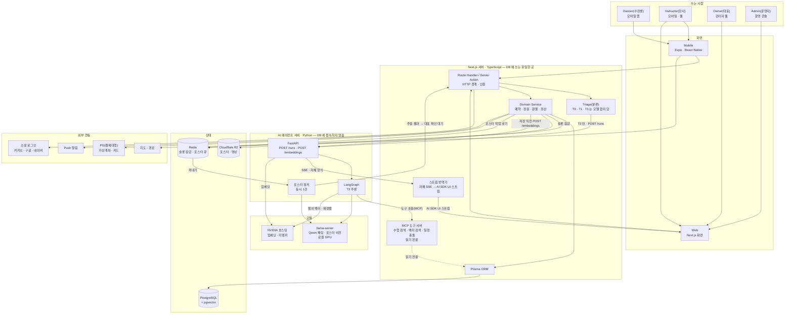

**선을 읽는 규칙 세 가지.** 그림이 복잡해 보여도 선은 이 세 규칙을 벗어나지 않는다.

| 규칙 | 그림에서 보이는 모습 | 이유 |
|---|---|---|
| **DB 에 쓰는 곳은 Next.js 하나다** | `PG` 로 들어가는 선은 `ORM` 에서만 나온다. 에이전트 서버의 선은 `MCPS` 를 거친 점선(읽기 전용)뿐이다 | 정원·금액 같은 규칙이 `Domain Service` 한 곳에만 있어야 한다. 모델이 그 규칙을 돌아가면 정합성이 통째로 무너진다 |
| **모델에 닿는 곳은 에이전트 서버 하나다** | `LLM`·`NV` 로 가는 선은 `AGENT` 상자에서만 나온다. Next.js 는 모델을 부르지 않는다 | 모델 위치가 노트북에서 GPU 서버로 옮겨 가도 에이전트 서버만 고친다 |
| **에이전트 서버는 화면 형식을 모른다** | 에이전트는 자체 SSE 만 내보내고 AI SDK 형식은 Next.js 의 `TRN` 이 만든다 | AI SDK 형식이 바뀌어도 Next.js 한 곳만 고친다(ADR-005) |

**벡터는 에이전트 서버가 계산하고 Next.js 가 기록한다.** `DOM → API → NV` 로 벡터를 받아 온 뒤,
Next.js 가 원본과 한 트랜잭션으로 저장한다. 수업 취소와 그 벡터의 비활성이 따로 놀면 "취소된
수업을 추천"하는 순간이 생기기 때문이다.

## 19-2(서브 다이어그램) — 층을 하나씩 뜯어본다

### 19-2-1(권한) — 누가 무엇을 만질 수 있는가

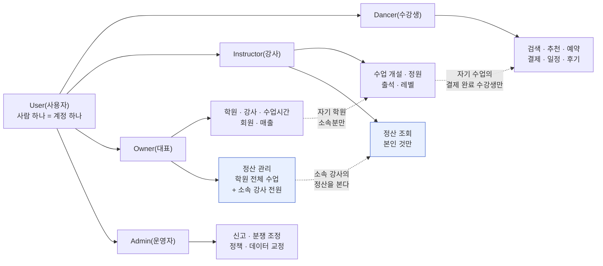

**한 사람이 여러 역할을 동시에 갖는다.** 강사가 다른 학원에서는 수강생이다. 그래서
역할을 계정에 하나 박지 않고 **집합**으로 둔다. 점선은 범위 제한이다 — 강사가 볼 수
있는 수강생은 "자기 수업을 결제한 사람" 뿐이다.

**정산 조회 범위는 비대칭이다**(파란 상자, 2026-09-21 확정). 정산은 **전부 플랫폼
안에서** 확인한다 — 별도 정산서를 주고받지 않는다.

| 역할 | 볼 수 있는 정산 |
|---|---|
| `Instructor(강사)` | **본인 것만.** 다른 강사의 정산은 같은 학원이어도 볼 수 없다 |
| `Owner(대표)` | **자기 학원의 모든 수업** + **소속 강사 전원**의 정산. 관리까지 한다 |
| `Admin(운영자)` | 결제 시스템 장애 대응에 필요한 범위만. 열람하면 기록이 남는다. 분쟁 조정은 하지 않는다(2026-09-25 변경) |

방향이 한쪽이다 — 대표는 소속 강사의 소속 학원에 대한 정산만 내려다보지만, 강사는 옆을 보지 못한다.

### 19-2-2(도메인) — 데이터가 어느 묶음에 사는가

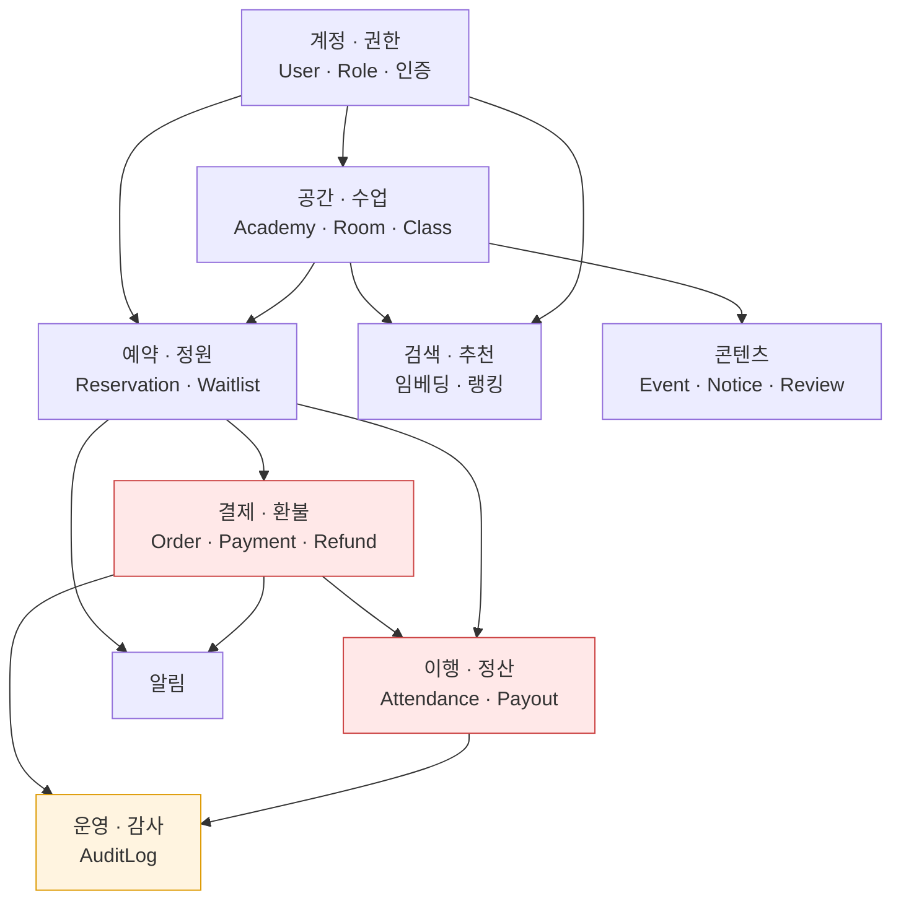

붉은 두 묶음이 **돈이 걸린 자리**다. 여기만은 정합성이 100% 여야 하고, 노란 묶음
(운영·감사)이 그 둘을 되짚을 수 있게 받쳐 준다.

### 19-2-3(런타임) — 무엇이 어디서 도는가

베타(S0, 노트북 1대 내부 시험) 기준이다. 운영으로 넘어갈 때 바뀌는 자리는 아래 표에 따로 적었다.

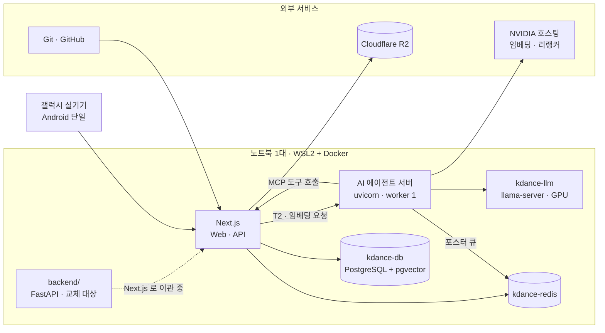

| 자리 | 베타(노트북) | 운영 | 근거 |
|---|---|---|---|
| Next.js | 노트북 | Vercel | 「11. 기술 스택 고정표」 Deploy 행 |
| AI 에이전트 서버 | 노트북, worker 1개 | 미정 | ADR-004 |
| 채팅·비전 모델 | `kdance-llm`(노트북 GPU) | GPU 서버 | 「11-2. 알려진 위험」 Qwen 비전 서빙 |
| 임베딩·리랭커 | NVIDIA 호스팅 | GPU 서버의 vLLM 자체 서빙 | 「11-2」 임베딩·리랭커 배치 |
| 홍보 이미지 생성 | Hugging Face 무료 크레딧 | HF PRO 또는 선불 크레딧(라이선스 확인 뒤) | 「11-2」 이미지 생성 |
| DB·Redis | Docker 컨테이너 | 미정 | `infra/docker-compose.yml` |

> **노트북 자원 — 실측.** GPU 는 `kdance-llm` 하나로 7,862/8,188MiB 가 찬다(2026-09-25).
> 남는 약 320MiB 에는 다른 모델을 올릴 수 없어서 임베딩·리랭커를 NVIDIA 호스팅으로 뺐다.
> AI 에이전트 서버는 모델을 싣지 않으므로 VRAM 0 이고 RAM 은 136MB 다(뼈대 서버 기준).
> 동시 10건은 예열 뒤 첫 글자 p95 8.5초·완료 p95 15.0초로 SC-041(동시 10명 첫 내용 15초·완료
> 25초)을 통과했다(`specs/001-ai-dance-class-platform/local-ai-capacity.md` 6절).

### 19-2-4(서버별 역할) — 누가 무엇을 맡고 무엇을 맡지 않는가

한 서버가 하지 않기로 한 일이 하기로 한 일만큼 중요하다. 경계가 흐려지면 규칙이 두 곳에
생기고 두 곳의 규칙은 반드시 어긋난다.

| 서버 | 한 줄 역할 | 하는 일 | 하지 않는 일 | 베타 실행 위치 | 지금 상태 |
|---|---|---|---|---|---|
| **Next.js**(Web · API) | 제품의 유일한 기록자 | 화면 · API · 인증(Better Auth) · Triage 로 T0(내 데이터 조회) · T1(정해진 지식) · T3(사람) 처리 · 예약·결제·환불·정산 규칙 · DB 쓰기 · MCP 도구 서버 · 에이전트 스트림 번역 | 모델 호출 · LangGraph 실행 | 노트북 `next dev` | 화면 2개(대시보드·환불 비율표)만 있다. API 는 아직 `backend/` 에 있다 |
| **AI 에이전트 서버**(Python) | 계산만 하는 곳 | T2(판단이 필요한 질문) 추론 · 포스터 읽기(Qwen 비전) · 임베딩·리랭크 호출 | DB 접속 · 결제·환불·사람 배정 판단(이관은 제안만) · AI SDK 스트림 형식 | 노트북 uvicorn, worker 1개 | 미구현. 패키지 버전과 자원(RAM 136MB · VRAM 0)만 실측했다 |
| **kdance-llm**(llama-server) | 모델을 돌리는 주방 | Qwen 3.5 9B 채팅 · 포스터 비전. 슬롯 10개로 동시 10건 | 임베딩 · 리랭크(VRAM 여유가 없다) | Docker, 포트 11436, GPU | 가동 중 |
| **NVIDIA 호스팅** | 외부 임베딩·리랭커 | 수업·강사 설명의 벡터 계산 · 후보 재정렬 | — | 인터넷 | 체험 약관상 운영 사용이 금지돼 있어 운영 전에 vLLM 으로 옮긴다 |
| **Hugging Face Inference Providers** | 외부 이미지 생성 | 수업 홍보 이미지(FLUX.1-dev / SDXL, 글자 없는 배경) | 글자 넣기 · 문구 생성 | 인터넷 | 무료 월 $0.10. FLUX.1-dev 는 비상업 라이선스. 호출 미검증 |
| **PostgreSQL + pgvector**(`kdance-db`) | 원본 데이터 | 관계형 데이터와 벡터를 한 DB 에 | — | Docker, 포트 5433 | 가동 중 |
| **Redis**(`kdance-redis`) | 잠깐 사는 상태 | 수업 슬롯 잠금 · 포스터 작업 큐(Redis Streams) | 오래 남길 데이터 보관 | Docker, 포트 6380 | 가동 중. 슬롯 잠금은 `backend/` 에 구현돼 있다 |
| **Cloudflare R2** | 파일 창고 | 포스터 · 영상 원본 | — | 외부 | 미연동 |
| **backend/**(FastAPI) | 교체 대상 | 예약 취소·환불 API(현재 유일하게 돌아가는 제품 코드) | 새 기능 추가 | 노트북 uvicorn, 포트 8000 | Next.js + Prisma 로 이관한다(「11-3. 백엔드 교체」) |

**서버가 아닌 것 두 가지.** Expo 개발 서버(Metro, 포트 8081)는 개발할 때 폰으로 앱 코드를
보내 주는 도구다. 배포된 앱은 빌드된 파일로 돌아서 이 서버가 없다. OmniRoute 는 개발용 LLM
게이트웨이라 제품과 관계가 없다(「15. OmniRoute」).

#### 서버 사이의 길

| 누가 → 누구 | 무엇을 | 형식 |
|---|---|---|
| Next.js → 에이전트 서버 | T2 질문 · 임베딩 요청 | HTTP `POST /runs`(사용자·권한 범위를 담은 단기 토큰) · `POST /embeddings` |
| 에이전트 서버 → Next.js | 데이터 조회 | MCP 도구 호출(읽기 전용) |
| 에이전트 서버 → Next.js | 답변 | SSE, 자체 이벤트 형식(ADR-005) |
| Next.js → Redis → 에이전트 서버 | 포스터 작업 | Redis Streams. 워커가 동시 1건으로 꺼낸다 |
| 에이전트 서버 → kdance-llm | 채팅 · 비전 | OpenAI 호환 API. `response_format` 은 `json_schema` |
| 에이전트 서버 → Hugging Face Inference Providers | 홍보 이미지 생성 | REST(HF 토큰), 결과 이미지 → R2 에 저장한 뒤 URL 만 Next.js 에 넘긴다 |
| 에이전트 서버 → NVIDIA 호스팅 | 임베딩 · 재정렬 | 임베딩은 `query: `·`passage: ` 접두어, 리랭커는 `query.text` · `passages[].text` |

## 19-3(파이프라인) — 일이 순서대로 어떻게 흐르는가

### 19-3-1(수업 등록) — 포스터 한 장에서 판매 가능 상태까지

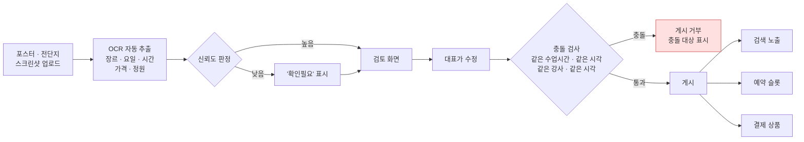

**검토 단계를 건너뛰는 경로는 만들지 않는다.** 가격·정원은 잘못 읽히면 되돌리기
어려운 값이라서다. 그리고 게시의 결과 3종(검색·슬롯·상품)은 **함께 생기거나 함께
실패한다** — 하나만 생긴 상태가 남으면 "검색에는 뜨는데 결제가 안 되는 수업" 이 된다.

### 19-3-2(예약·결제) — 모든 결제는 PG 한 경로

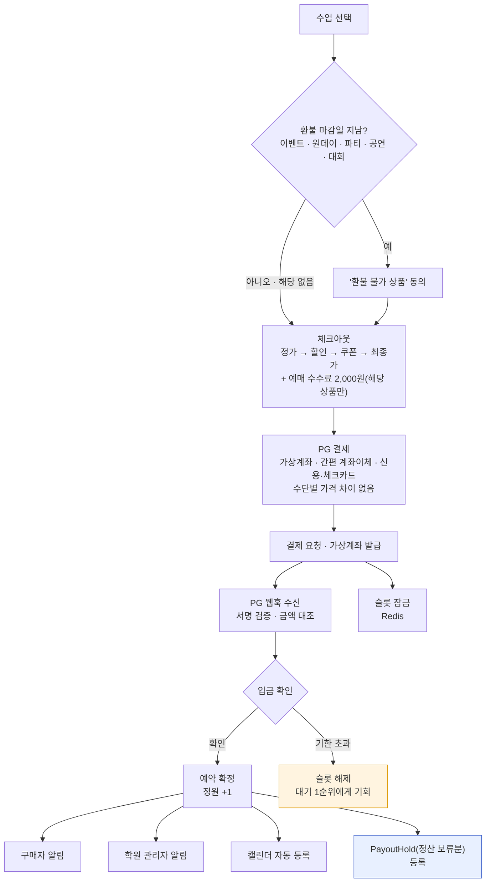

**같은 자리에 여러 명이 동시에 입금 대기를 잡을 수 있다.** 그때는 **먼저 입금이 확인된
쪽만 확정**하고 나머지는 자동 취소한다. 잠금이 없으면 정원 13/12 가 만들어진다.

파란 상자가 이번에 새로 붙은 자리다 — 결제가 끝나도 그 돈은 아직 **누구 것도 아니다.**

> **2026-09-25 변경** — 예전 그림은 9만원 이하를 계좌이체 딥링크(오픈뱅킹 입금 폴링)로 보냈다. 딥링크를 없애고 모든 결제를 PG 로 통일해 경로가 하나가 됐다(spec FR-110(PG 단일 결제 경로)). 같은 날 카드를 모든 유료 결제로 넓혔고(FR-111a(모든 결제 카드 허용)), 체크아웃에 환불 마감일 확인과 예매 수수료 줄을 넣었다(FR-099d(환불 마감일 필수 입력·결제 적용) · FR-282a(예매 수수료 2,000원)).

### 19-3-3(이행·정산) — 결제와 정산 사이의 시간

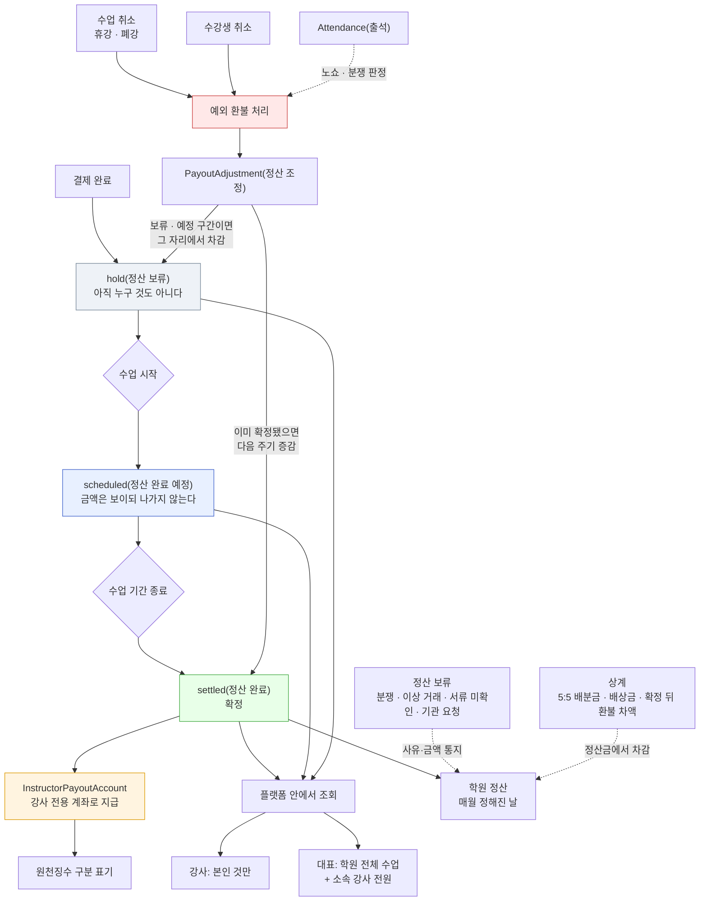

**강사는 프리랜서라 급여가 없다.** 월급도 시급도 없고, 실제로 진행해서 기간이 끝난
수업분에 대해서만 정산을 받는다.

**관문을 넘기는 것은 시각이다.** 수업이 시작되면 `scheduled(정산 완료 예정)` 로,
기간이 끝나면 `settled(정산 완료)` 로 간다. 출석 기록은 관문을 여는 스위치가 아니라
**노쇼와 분쟁을 가릴 때 꺼내 보는 근거**다(점선).

**취소는 늦게 온다.** 그래서 두 갈래로 나눈다 — 아직 보류·예정 구간이면 그 자리에서
빼고, 이미 확정돼 돈이 나갔으면 되돌리지 않고 **다음 주기에 증감으로 반영**한다.
지나간 정산을 소급해 고치면 강사 쪽 장부와 어긋나기 때문이다.

**학원 정산에는 두 개의 예외 장치가 있다(2026-09-25, 입점 약관 제8조).** 분쟁·이상 거래가 걸린 금액은 **보류**하고(FR-252(정산 보류)), 학원이 회사에 줄 돈은 정산금에서 **상계**한다(FR-253(정산 상계)). 둘 다 사유와 금액을 알리고 정산 원장에 남긴다.

**정산은 전부 플랫폼 안에서 본다.** 강사는 본인 것만, 대표는 자기 학원의 모든 수업과
소속 강사 전원의 정산을 본다. 이 비대칭은 단방향이다 — 강사는 옆 강사를 보지 못한다.

### 19-3-4(취소·환불) — 요구사항이 정한 흐름과 지금 코드

**요구사항이 정한 흐름 (2026-09-25 확정, 2026-09-26 이벤트형·행사 일괄 취소 분리)**

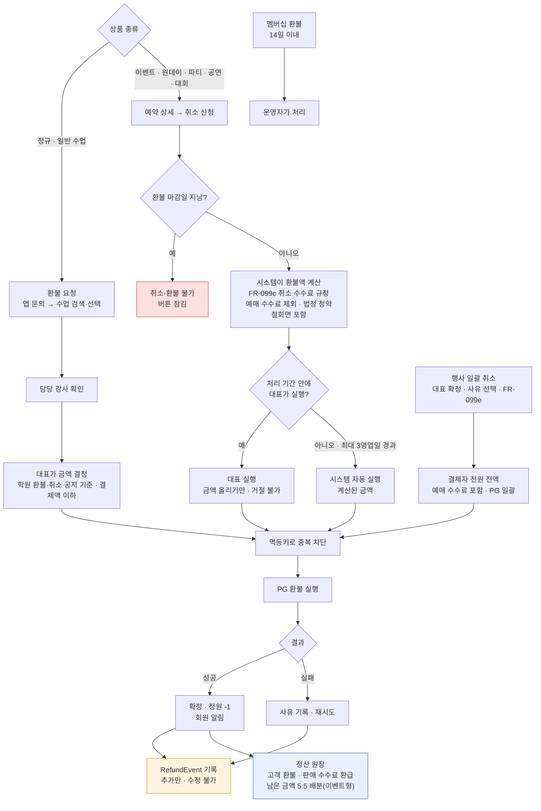

- **회사는 수업 환불 금액을 정하지 않는다.** 정규·일반 수업은 대표가 정하고 대표가 PG 환불을 누른다(FR-098b(환불 요청 경로) · FR-293(대표 환불 입력) · FR-295(수단별 환불 실행)). 회사가 직접 파는 상품의 환불은 멤버십뿐이다(FR-297a(멤버십 환불 없음)).
- **이벤트·원데이·파티·공연·대회는 경계가 다르다**(2026-09-26, FR-098(대표 처리 환불 방식) 예외). 회원이 예약 상세에서 취소를 신청하면 시스템이 FR-099c(이벤트·원데이·파티·공연·대회 취소 규정) 표대로 환불액을 계산한다. 대표는 환불액을 올리는 조정만 하고 실행한다. 공지한 처리 기간(최대 3영업일, FR-099a(환불·취소 공지 양식))이 지나면 시스템이 계산된 금액으로 자동 실행한다. 흐름도의 「예약 상세 → 취소 신청」 가지가 이 경로다.
- **행사를 통째로 취소하면**(FR-099e(행사 일괄 취소)) 대표가 사유를 골라 확정하는 즉시 결제자 전원에게 전액을 PG 로 일괄 환불한다. 회원에게 연기 참가를 고르게 하지 않고, 학원 계좌로 직접 송금하지 않는다. 돌려받지 못한 PG 수수료는 불가항력이어도 대표가 부담한다. 흐름도의 「행사 일괄 취소」 가지다.
- **학원·강사 사정의 휴강·폐강**은 회원 잘못이 아니므로 환불 마감일·취소 수수료와 상관없이 환불 또는 보강을 고른다(FR-055(휴강·보강 통지) · FR-065(회차 휴강·폐강 선택)).
- 예매 수수료는 환불하지 않는다(FR-282a(예매 수수료 2,000원)). 예외는 휴강·폐강·행사 취소·법정 청약철회다. 이때는 대표가 환불을 실행하면 시스템이 예매 수수료를 같은 PG 취소에 넣는다. 2,000원은 플랫폼 몫에서 나가고, 그 몫의 PG 수수료는 불가항력·청약철회면 플랫폼이, 대표 개인 사정·학원 운영상 이유면 대표가 부담한다(상계). 행사를 통째로 취소하는 흐름은 FR-099e(행사 일괄 취소). 예외 범위가 충분한지는 여전히 법률 검토 대상이다.
- 결제 수수료(PG·카드)는 환불할 때도 회원에게 넘기지 않는다(FR-125c(환불 PG 수수료 대표 부담)).

**지금 코드 (폐기 예정 구간 포함)**

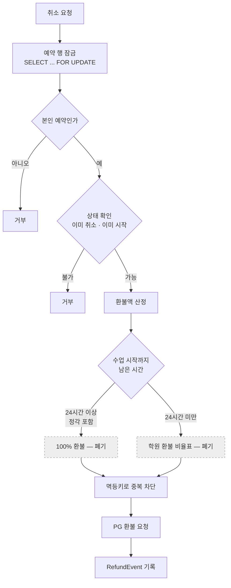

`backend/app/services/cancellation.py` · `refund_policy.py` 에만 구현돼 있다. 잠금·본인 확인·멱등키·감사 기록·PG 환불 요청은 새 흐름에서도 쓰고, **회원이 직접 누르는 즉시 환불과 "24시간 전 전액 + 비율표" 산정(`FULL`·`TIER`)은 폐기한다**(spec Q11(환불 방식 변경의 뒤처리) ② 2026-09-25 확정). `backend/` 는 Next.js 로 옮겨 갈 교체 대상이라(「11-3. 백엔드 교체」) 코드는 옮길 때 새 흐름으로 다시 만든다 — 지금 코드를 고쳐 쓰지 않는다.

### 19-3-5(AI 추천) — 문장 하나에서 실현 가능한 일정까지

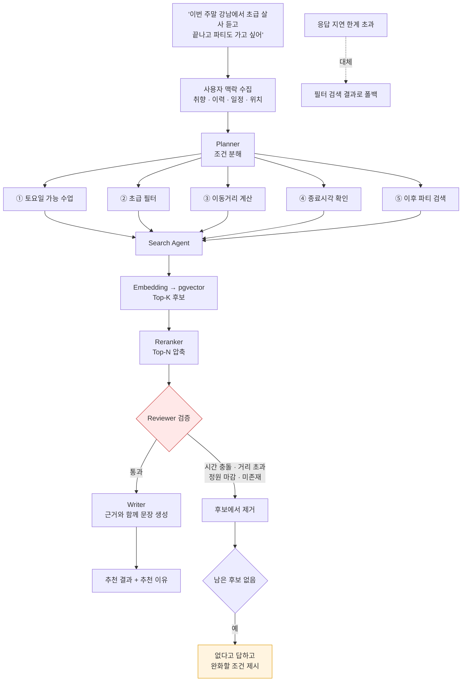

**Reviewer(붉은 상자)가 이 파이프라인의 존재 이유다.** 벡터 검색은 "비슷한 것" 을
가져올 뿐 "지금 갈 수 있는 것" 을 보장하지 않는다. 시간이 겹치거나 이미 마감됐거나
아예 존재하지 않는 수업이 섞이면, 사용자는 두 번째부터 추천을 믿지 않는다.
**없으면 없다고 답하는 것**이 지어내는 것보다 낫다.

### 19-3-6(알림) — 한 번 정해서 여러 갈래로

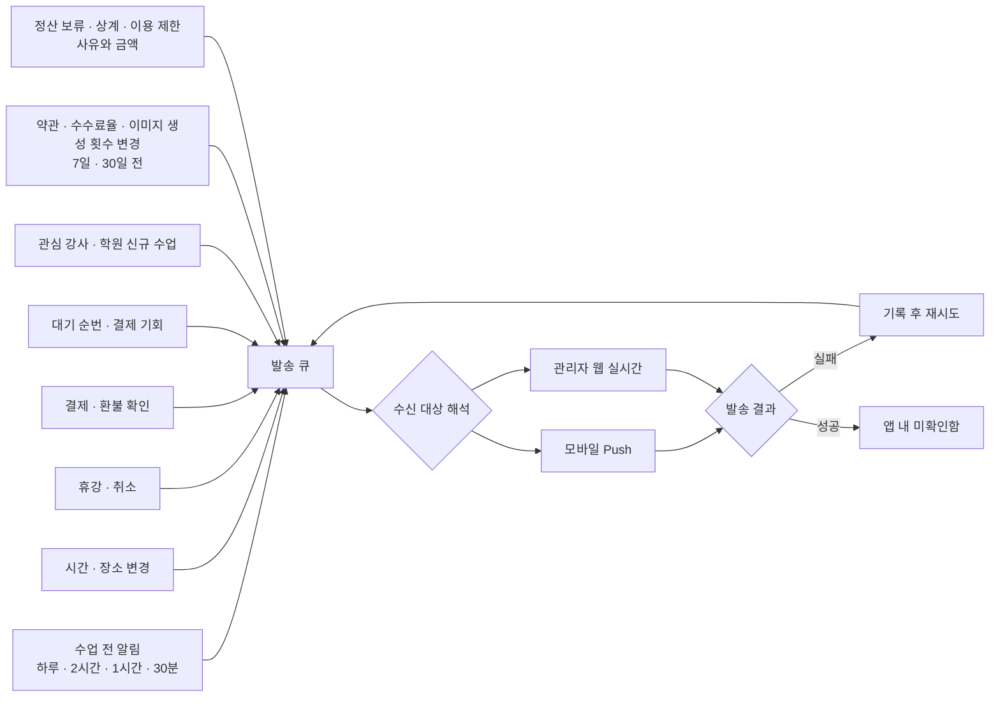

**SMS 를 쓰지 않는다.** 결제 확인조차 앱 내 알림으로 보낸다 — 결제대행사를 뺀 나머지
주변 기능은 무료·오픈 수단만 쓴다는 원칙 때문이다(`docs/policy/payment-method-policy.md`).

### 19-3-7(사용자 문의·AI 응답) — 대부분을 모델 없이 답한다

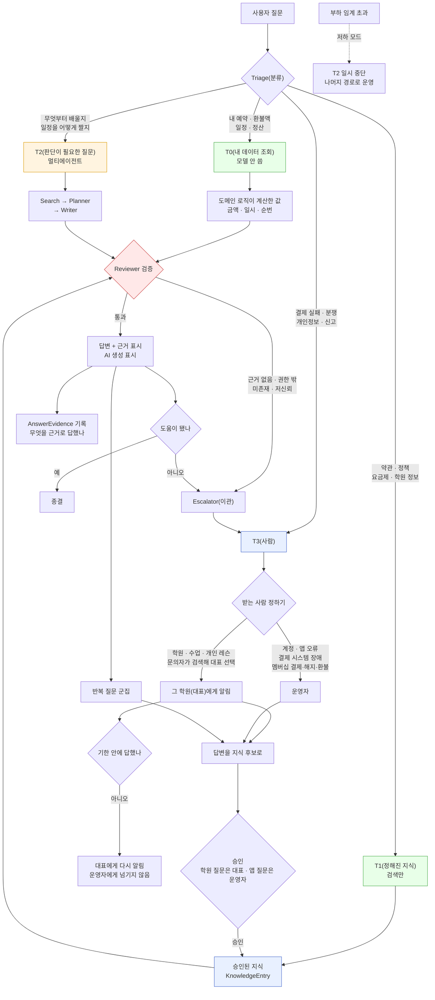

**초록 두 갈래가 이 설계의 핵심이다.** `T0(내 데이터 조회)` 와 `T1(정해진 지식)` 은
모델을 거치지 않는다. 실측상 GPU 1대의 동시 처리가 1~4건이라, 모든 질문을 모델에
보내면 저녁 피크에 대기열이 분 단위로 밀린다. 질문의 상당수는 애초에 생성이 필요
없는 조회다 — **"내 다음 수업 언제야"** 에 모델을 쓸 이유가 없다.

**금액을 모델이 만들지 않는다.** 환불 예상액을 물으면 취소 미리보기와 **같은 계산
로직**이 낸 값을 그대로 끼워 넣는다. 두 경로가 각자 계산하면 언젠가 반드시 어긋나고,
그 어긋남이 그대로 분쟁이 된다.

**AI 는 쓰기를 못 한다.** 취소·환불·예약을 실행하지 않는다. 해당 화면으로 가는 버튼을
제시하는 데까지이고, 누르는 것은 사용자다. 권한 검사도 모델이 아니라 시스템이 하므로,
사용자가 프롬프트를 어떻게 바꿔도 볼 수 있는 범위가 넓어지지 않는다.

**지식이 쌓이면 모델 부하가 준다(선순환).** 반복 질문을 모아 대표(학원 질문)나 운영자(앱·약관 질문)가 승인하면
`T1(정해진 지식)` 으로 내려간다. 운영이 길어질수록 `T2` 로 가는 비율이 떨어진다 —
**운영이 인프라를 대신 감당하는 구조**다.

**답을 아는 사람에게 묻는다.** 환불 기준이 학원마다 다르므로 플랫폼 운영자가 대신 답할 수
없다 — 환불 요청은 문의로 그 학원의 **대표에게만** 배정되고 대표가 자기 규정대로 처리한다(spec FR-098b(환불 요청 경로)). 운영자도 대신 처리하지 않는다.
정규·일반 수업에는 플랫폼 공통 환불 규칙이 없다. 이벤트·원데이·파티·공연·대회만 공통 규정
FR-099c(이벤트·원데이·파티·공연·대회 취소 규정)가 있어, 예약 상세에서 취소를 신청하면 시스템이 환불액을
계산한다(FR-098(대표 처리 환불 방식) 예외). AI 는 그 학원이 등록한 규정을 근거로 안내하고 문의 접수까지만
돕는다 — 환불 여부와 금액을 확정해 말하지 않는다. *(2026-09-25 변경 — 이전 공통 규칙은 "수업
24시간 전 취소는 전액"이었다)*

**답변 창구는 AI 없이도 살아 있어야 한다.** 스토어 심사와 전자상거래 고지에 필요한
것은 `T3(사람)` 경로이고, 나머지 셋은 그 위에 얹는 개선이다. 모델이 멈춰도 문의는
접수되고 답변된다.


# 20. 개발 우선순위

> **Phase 번호는 단독으로 쓰지 않는다** — `Phase 4(AI 추천)` 처럼 기능명을 붙인다
> (`core-rules.md` 「식별자·용어 표기 통일」). 번호만으로는 그게 무엇을 가리키는지
> 알 수 없어, 읽는 사람이 매번 이 목록으로 되돌아와야 하기 때문이다.


### Phase 1(기본 플랫폼)
- Next.js + React
- React Native
- Better Auth
- PostgreSQL
- Prisma
- 사용자/강사/대표 Role
- 기본 CRUD

### Phase 2(수업·일정)
- 강사 수업 등록
- 사용자 수업 검색
- 예약
- 일정
- 알림
- 댄스학원(학원)

### Phase 3(콘텐츠)
- 파티
- 공연
- 후기
- 이미지/영상
- 해당 장르 학원들의 파티,대회,공연 예매

### Phase 4(AI 추천)
- Embedding
- pgvector
- Reranker
- Qwen
- LangGraph
- Search/Planner/Writer/Reviewer

### Phase 5(운영 고도화)
- 대표 Dashboard
- 통계
- 정산
- 신고/관리
- 모니터링
- E2E 테스트

### Phase 6(AI 고도화)
- 개인화 추천
- 일정 기반 추천
- 사용자 행동 기반 Ranking
- 장기 사용자 Memory
- Agent 평가
- HITL
- 추천 품질 평가

---

## 핵심 방향

> **kdancex4의 핵심은 "AI 챗봇"이 아니라**
>
> **사용자 → 수업 → 강사 → 일정 → 파티 → 공연**
>
> **전체 K-댄스 활동을 AI가 연결하는 개인화 플랫폼이다.**

이 구조를 기준으로 Web, Mobile, 강사 페이지, 대표 관리자 페이지, AI Agent, RAG, 데이터베이스를 하나의 서비스 아키텍처로 연결한다.
