# 최종 아키텍처

> 출처: 옛 `docs/planning/kdancex4_service_definition_and_tech_stack.md` 의 19장. 2026-11-13 파일을 나누면서 원문 그대로 옮겼다.
> 요구사항의 원본은 `specs/001-ai-dance-class-platform/spec.md` 다. 두 문서가 다르면 spec 이 맞다.

## 19. 최종 아키텍처

여기부터는 **지금 모습이 아니라 다 만들어졌을 때의 모습**이다. 현재 코드는 예약
취소·환불 구간만 서 있고 나머지는 비어 있다 — 그 공백까지 포함해 "결국 이렇게 될
것이다" 를 그린 그림이다.

> **버전 숫자를 그림에 적지 않는다.** 값의 원본은 「11. 기술 스택 고정표」 하나다.
> 그림에 복제하면 표를 고칠 때마다 그림이 뒤처져 반드시 어긋난다(`core-rules.md`
> 「버전 정책」). 그림은 **무엇이 무엇을 부르는지**만 말한다.
>
> **2026-09-25 다시 그렸다.** 이 장은 ADR-004(에이전트 서버만 Python)보다 먼저 쓰여
> "백엔드는 TypeScript 단일 스택이고 Python 계층은 남지 않는다"고 적고 있었다. 지금은
> **제품 API 는 Next.js(TypeScript), AI 에이전트 서버만 별도 Python 프로세스**다. 그래서
> 19-1(전체 다이어그램)과 19-2-3(런타임)을 이 기준으로 고치고 서버마다 무엇을 맡는지
> 19-2-4(서버별 역할)로 따로 정리했다. 근거는 「11-3. 백엔드 교체」와 `CLAUDE-decisions.md`
> ADR-004·ADR-005(에이전트 스트림은 자체 형식, 번역은 Next.js)다.

### 19-1(전체 다이어그램) — 무엇이 무엇을 부르는가

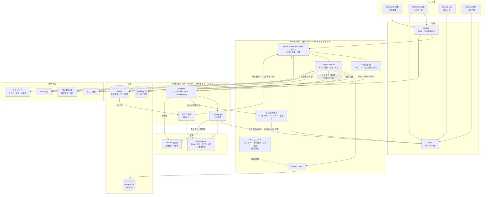

**선을 읽는 규칙 세 가지.** 그림이 복잡해 보여도 선은 이 세 규칙을 벗어나지 않는다.

| 규칙 | 그림에서 보이는 모습 | 이유 |
|---|---|---|
| **DB 에 쓰는 곳은 Next.js 하나다** | `PG` 로 들어가는 선은 `ORM` 에서만 나온다. 에이전트 서버의 선은 `MCPS` 를 거친 점선(읽기 전용)뿐이다 | 정원·금액 같은 규칙이 `Domain Service` 한 곳에만 있어야 한다. 모델이 그 규칙을 돌아가면 정합성이 통째로 무너진다 |
| **모델에 닿는 곳은 에이전트 서버 하나다** | `LLM`·`NV` 로 가는 선은 `AGENT` 상자에서만 나온다. Next.js 는 모델을 부르지 않는다 | 모델 위치가 노트북에서 GPU 서버로 옮겨 가도 에이전트 서버만 고친다 |
| **에이전트 서버는 화면 형식을 모른다** | 에이전트는 자체 SSE 만 내보내고 AI SDK 형식은 Next.js 의 `TRN` 이 만든다 | AI SDK 형식이 바뀌어도 Next.js 한 곳만 고친다(ADR-005) |

**벡터는 에이전트 서버가 계산하고 Next.js 가 기록한다.** `DOM → API → NV` 로 벡터를 받아 온 뒤,
Next.js 가 원본과 한 트랜잭션으로 저장한다. 수업 취소와 그 벡터의 비활성이 따로 놀면 "취소된
수업을 추천"하는 순간이 생기기 때문이다.

### 19-2(서브 다이어그램) — 층을 하나씩 뜯어본다

#### 19-2-1(권한) — 누가 무엇을 만질 수 있는가

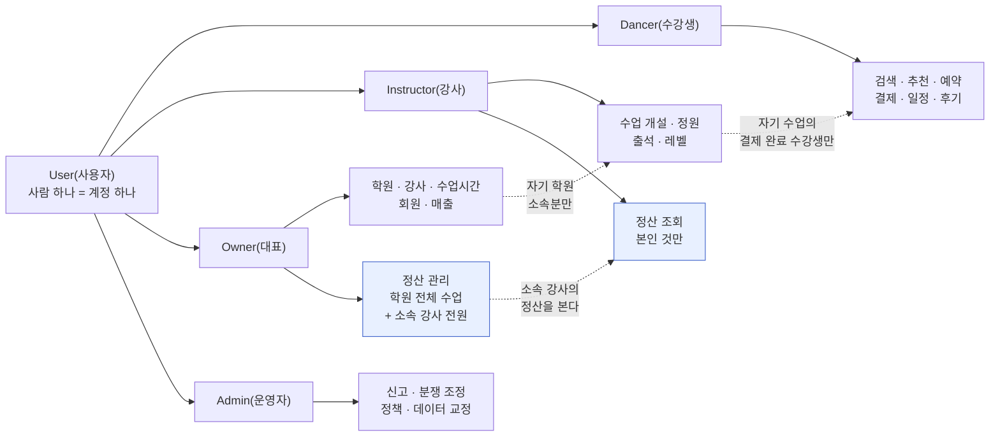

**한 사람이 여러 역할을 동시에 갖는다.** 강사가 다른 학원에서는 수강생이다. 그래서
역할을 계정에 하나 박지 않고 **집합**으로 둔다. 점선은 범위 제한이다 — 강사가 볼 수
있는 수강생은 "자기 수업을 결제한 사람" 뿐이다.

**정산 조회 범위는 비대칭이다**(파란 상자, 2026-09-21 확정). 정산은 **전부 플랫폼
안에서** 확인한다 — 별도 정산서를 주고받지 않는다.

| 역할 | 볼 수 있는 정산 |
|---|---|
| `Instructor(강사)` | **본인 것만.** 다른 강사의 정산은 같은 학원이어도 볼 수 없다 |
| `Owner(대표)` | **자기 학원의 모든 수업** + **소속 강사 전원**의 정산. 관리까지 한다 |
| `Admin(운영자)` | 결제 시스템 장애 대응에 필요한 범위만. 열람하면 기록이 남는다. 분쟁 조정은 하지 않는다(2026-09-25 변경) |

방향이 한쪽이다 — 대표는 소속 강사의 소속 학원에 대한 정산만 내려다보지만, 강사는 옆을 보지 못한다.

#### 19-2-2(도메인) — 데이터가 어느 묶음에 사는가

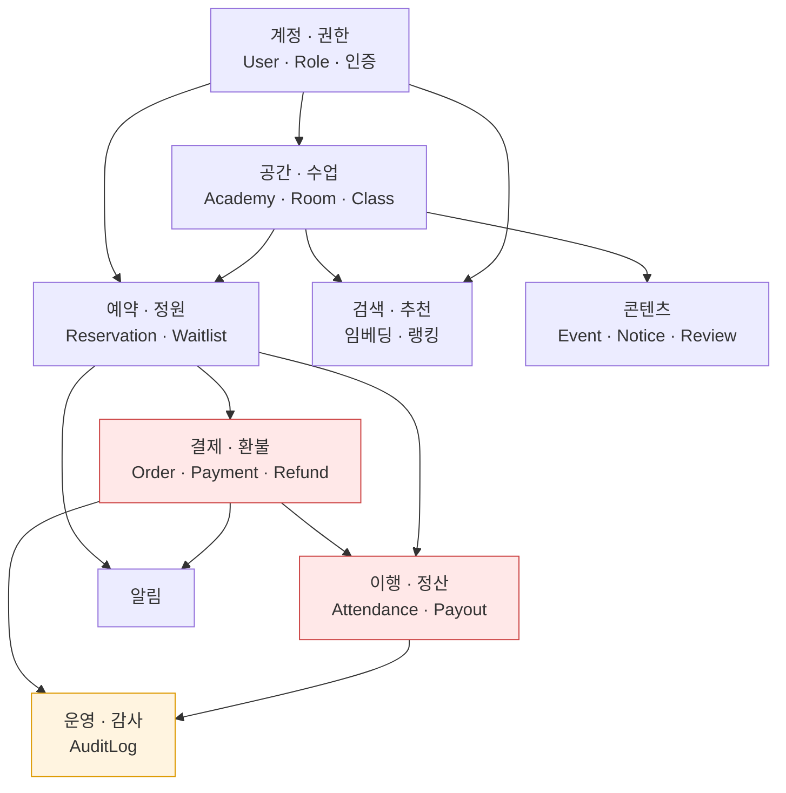

붉은 두 묶음이 **돈이 걸린 자리**다. 여기만은 정합성이 100% 여야 하고, 노란 묶음
(운영·감사)이 그 둘을 되짚을 수 있게 받쳐 준다.

#### 19-2-3(런타임) — 무엇이 어디서 도는가

베타(S0, 노트북 1대 내부 시험) 기준이다. 운영으로 넘어갈 때 바뀌는 자리는 아래 표에 따로 적었다.

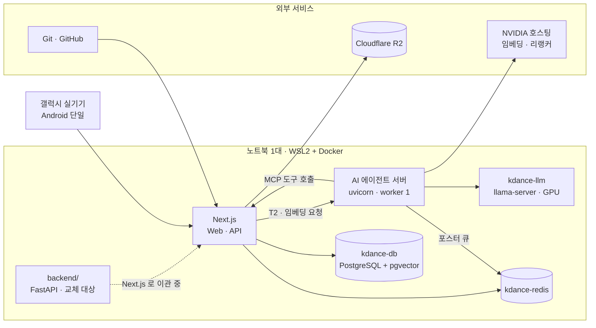

| 자리 | 베타(노트북) | 운영 | 근거 |
|---|---|---|---|
| Next.js | 노트북 | Vercel | 「11. 기술 스택 고정표」 Deploy 행 |
| AI 에이전트 서버 | 노트북, worker 1개 | 미정 | ADR-004 |
| 채팅·비전 모델 | `kdance-llm`(노트북 GPU) | GPU 서버 | 「11-2. 알려진 위험」 Qwen 비전 서빙 |
| 임베딩·리랭커 | NVIDIA 호스팅 | GPU 서버의 vLLM 자체 서빙 | 「11-2」 임베딩·리랭커 배치 |
| 홍보 이미지 생성 | Hugging Face 무료 크레딧 | HF PRO 또는 선불 크레딧(라이선스 확인 뒤) | 「11-2」 이미지 생성 |
| DB·Redis | Docker 컨테이너 | 미정 | `infra/docker-compose.yml` |

> **노트북 자원 — 실측.** GPU 는 `kdance-llm` 하나로 7,862/8,188MiB 가 찬다(2026-09-25).
> 남는 약 320MiB 에는 다른 모델을 올릴 수 없어서 임베딩·리랭커를 NVIDIA 호스팅으로 뺐다.
> AI 에이전트 서버는 모델을 싣지 않으므로 VRAM 0 이고 RAM 은 136MB 다(뼈대 서버 기준).
> 동시 10건은 예열 뒤 첫 글자 p95 8.5초·완료 p95 15.0초로 SC-041(동시 10명 첫 내용 15초·완료
> 25초)을 통과했다(`specs/001-ai-dance-class-platform/local-ai-capacity.md` 6절).

#### 19-2-4(서버별 역할) — 누가 무엇을 맡고 무엇을 맡지 않는가

한 서버가 하지 않기로 한 일이 하기로 한 일만큼 중요하다. 경계가 흐려지면 규칙이 두 곳에
생기고 두 곳의 규칙은 반드시 어긋난다.

| 서버 | 한 줄 역할 | 하는 일 | 하지 않는 일 | 베타 실행 위치 | 지금 상태 |
|---|---|---|---|---|---|
| **Next.js**(Web · API) | 제품의 유일한 기록자 | 화면 · API · 인증(Better Auth) · Triage 로 T0(내 데이터 조회) · T1(정해진 지식) · T3(사람) 처리 · 예약·결제·환불·정산 규칙 · DB 쓰기 · MCP 도구 서버 · 에이전트 스트림 번역 | 모델 호출 · LangGraph 실행 | 노트북 `next dev` | 화면 2개(대시보드·환불 비율표)만 있다. API 는 아직 `backend/` 에 있다 |
| **AI 에이전트 서버**(Python) | 계산만 하는 곳 | T2(판단이 필요한 질문) 추론 · 포스터 읽기(Qwen 비전) · 임베딩·리랭크 호출 | DB 접속 · 결제·환불·사람 배정 판단(이관은 제안만) · AI SDK 스트림 형식 | 노트북 uvicorn, worker 1개 | 미구현. 패키지 버전과 자원(RAM 136MB · VRAM 0)만 실측했다 |
| **kdance-llm**(llama-server) | 모델을 돌리는 주방 | Qwen 3.5 9B 채팅 · 포스터 비전. 슬롯 10개로 동시 10건 | 임베딩 · 리랭크(VRAM 여유가 없다) | Docker, 포트 11436, GPU | 가동 중 |
| **NVIDIA 호스팅** | 외부 임베딩·리랭커 | 수업·강사 설명의 벡터 계산 · 후보 재정렬 | — | 인터넷 | 체험 약관상 운영 사용이 금지돼 있어 운영 전에 vLLM 으로 옮긴다 |
| **Hugging Face Inference Providers** | 외부 이미지 생성 | 수업 홍보 이미지(FLUX.1-dev / SDXL, 글자 없는 배경) | 글자 넣기 · 문구 생성 | 인터넷 | 무료 월 $0.10. FLUX.1-dev 는 비상업 라이선스. 호출 미검증 |
| **PostgreSQL + pgvector**(`kdance-db`) | 원본 데이터 | 관계형 데이터와 벡터를 한 DB 에 | — | Docker, 포트 5433 | 가동 중 |
| **Redis**(`kdance-redis`) | 잠깐 사는 상태 | 수업 슬롯 잠금 · 포스터 작업 큐(Redis Streams) | 오래 남길 데이터 보관 | Docker, 포트 6380 | 가동 중. 슬롯 잠금은 `backend/` 에 구현돼 있다 |
| **Cloudflare R2** | 파일 창고 | 포스터 · 영상 원본 | — | 외부 | 미연동 |
| **backend/**(FastAPI) | 교체 대상 | 예약 취소·환불 API(현재 유일하게 돌아가는 제품 코드) | 새 기능 추가 | 노트북 uvicorn, 포트 8000 | Next.js + Prisma 로 이관한다(「11-3. 백엔드 교체」) |

**서버가 아닌 것 두 가지.** Expo 개발 서버(Metro, 포트 8081)는 개발할 때 폰으로 앱 코드를
보내 주는 도구다. 배포된 앱은 빌드된 파일로 돌아서 이 서버가 없다. OmniRoute 는 개발용 LLM
게이트웨이라 제품과 관계가 없다(「15. OmniRoute」).

##### 서버 사이의 길

| 누가 → 누구 | 무엇을 | 형식 |
|---|---|---|
| Next.js → 에이전트 서버 | T2 질문 · 임베딩 요청 | HTTP `POST /runs`(사용자·권한 범위를 담은 단기 토큰) · `POST /embeddings` |
| 에이전트 서버 → Next.js | 데이터 조회 | MCP 도구 호출(읽기 전용) |
| 에이전트 서버 → Next.js | 답변 | SSE, 자체 이벤트 형식(ADR-005) |
| Next.js → Redis → 에이전트 서버 | 포스터 작업 | Redis Streams. 워커가 동시 1건으로 꺼낸다 |
| 에이전트 서버 → kdance-llm | 채팅 · 비전 | OpenAI 호환 API. `response_format` 은 `json_schema` |
| 에이전트 서버 → Hugging Face Inference Providers | 홍보 이미지 생성 | REST(HF 토큰), 결과 이미지 → R2 에 저장한 뒤 URL 만 Next.js 에 넘긴다 |
| 에이전트 서버 → NVIDIA 호스팅 | 임베딩 · 재정렬 | 임베딩은 `query: `·`passage: ` 접두어, 리랭커는 `query.text` · `passages[].text` |

### 19-3(파이프라인) — 일이 순서대로 어떻게 흐르는가

#### 19-3-1(수업 등록) — 포스터 한 장에서 판매 가능 상태까지

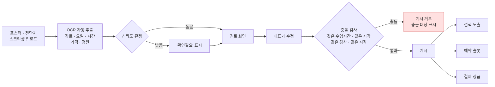

**검토 단계를 건너뛰는 경로는 만들지 않는다.** 가격·정원은 잘못 읽히면 되돌리기
어려운 값이라서다. 그리고 게시의 결과 3종(검색·슬롯·상품)은 **함께 생기거나 함께
실패한다** — 하나만 생긴 상태가 남으면 "검색에는 뜨는데 결제가 안 되는 수업" 이 된다.

#### 19-3-2(예약·결제) — 모든 결제는 PG 한 경로

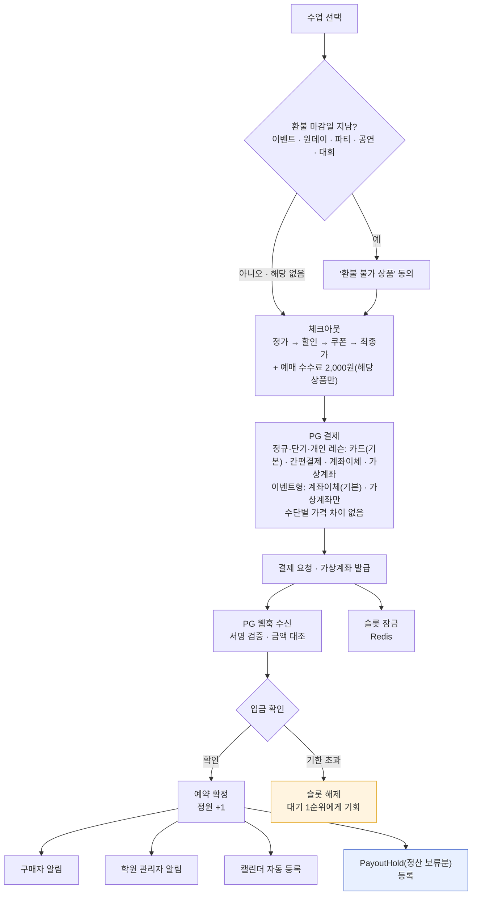

**같은 자리에 여러 명이 동시에 입금 대기를 잡을 수 있다.** 그때는 **먼저 입금이 확인된
쪽만 확정**하고 나머지는 자동 취소한다. 잠금이 없으면 정원 13/12 가 만들어진다.

파란 상자가 이번에 새로 붙은 자리다 — 결제가 끝나도 그 돈은 아직 **누구 것도 아니다.**

> **2026-09-25 변경** — 예전 그림은 9만원 이하를 계좌이체 딥링크(오픈뱅킹 입금 폴링)로 보냈다. 딥링크를 없애고 모든 결제를 PG 로 통일해 경로가 하나가 됐다(spec FR-110(PG 단일 결제 경로)). 같은 날 카드를 모든 유료 결제로 넓혔고(FR-111a(카드 허용 범위). 2026-11-10 변경 — 이전: 모든 유료 결제 카드 허용, 이후: 이벤트형은 계좌 수단만), 체크아웃에 환불 마감일 확인과 예매 수수료 줄을 넣었다(FR-099d(환불 마감일 필수 입력·결제 적용) · FR-282a(예매 수수료 2,000원)).

#### 19-3-3(이행·정산) — 결제와 정산 사이의 시간

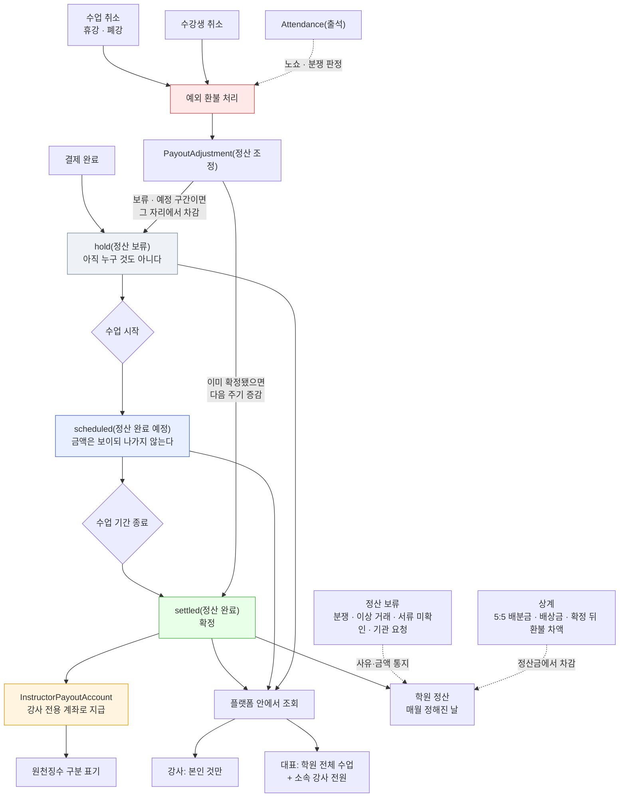

**강사는 프리랜서라 급여가 없다.** 월급도 시급도 없고, 실제로 진행해서 기간이 끝난
수업분에 대해서만 정산을 받는다.

**관문을 넘기는 것은 시각이다.** 수업이 시작되면 `scheduled(정산 완료 예정)` 로,
기간이 끝나면 `settled(정산 완료)` 로 간다. 출석 기록은 관문을 여는 스위치가 아니라
**노쇼와 분쟁을 가릴 때 꺼내 보는 근거**다(점선).

**취소는 늦게 온다.** 그래서 두 갈래로 나눈다 — 아직 보류·예정 구간이면 그 자리에서
빼고, 이미 확정돼 돈이 나갔으면 되돌리지 않고 **다음 주기에 증감으로 반영**한다.
지나간 정산을 소급해 고치면 강사 쪽 장부와 어긋나기 때문이다.

**학원 정산에는 두 개의 예외 장치가 있다(2026-09-25, 입점 약관 제8조).** 분쟁·이상 거래가 걸린 금액은 **보류**하고(FR-252(정산 보류)), 학원이 회사에 줄 돈은 정산금에서 **상계**한다(FR-253(정산 상계)). 둘 다 사유와 금액을 알리고 정산 원장에 남긴다.

**정산은 전부 플랫폼 안에서 본다.** 강사는 본인 것만, 대표는 자기 학원의 모든 수업과
소속 강사 전원의 정산을 본다. 이 비대칭은 단방향이다 — 강사는 옆 강사를 보지 못한다.

#### 19-3-4(취소·환불) — 요구사항이 정한 흐름과 지금 코드

**요구사항이 정한 흐름 (2026-09-25 확정, 2026-09-26 이벤트형·행사 일괄 취소 분리)**

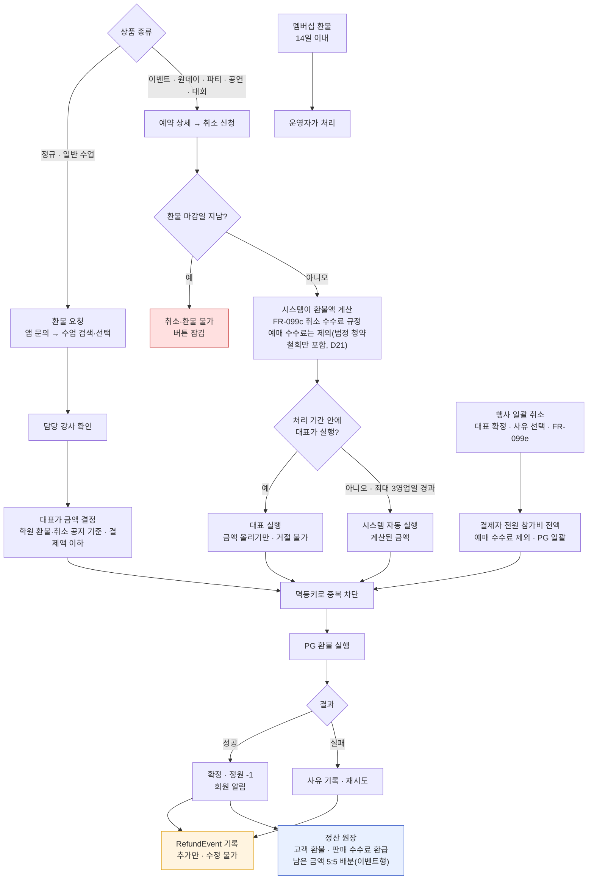

- **회사는 수업 환불 금액을 정하지 않는다.** 정규·일반 수업은 대표가 정하고 대표가 PG 환불을 누른다(FR-098b(환불 요청 경로) · FR-293(대표 환불 입력) · FR-295(수단별 환불 실행)). 회사가 직접 파는 상품의 환불은 멤버십뿐이다(FR-297a(멤버십 환불 없음)).
- **이벤트·원데이·파티·공연·대회는 경계가 다르다**(2026-09-26, FR-098(대표 처리 환불 방식) 예외). 회원이 예약 상세에서 취소를 신청하면 시스템이 FR-099c(이벤트·원데이·파티·공연·대회 취소 규정) 표대로 환불액을 계산한다. 대표는 환불액을 올리는 조정만 하고 실행한다. 공지한 처리 기간(최대 3영업일, FR-099a(환불·취소 공지 양식))이 지나면 시스템이 계산된 금액으로 자동 실행한다 — 카드 결제분만이고 계좌 결제분은 대표 재알림 + 운영자 확인이다(2026-11-20 사용자 결정). 흐름도의 「예약 상세 → 취소 신청」 가지가 이 경로다.
- **행사를 통째로 취소하면**(FR-099e(행사 일괄 취소)) 대표가 사유를 골라 확정하는 즉시 결제자 전원에게 전액을 환불한다 — 카드 결제분은 PG 로 일괄 취소하고 계좌 결제분은 대표가 W31(계좌 환불 송금)에서 송금한다(2026-11-20 사용자 결정 — 이전: 전액 PG 일괄 환불). 회원에게 연기 참가를 고르게 하지 않고, 학원 계좌로 직접 송금하지 않는다. 돌려받지 못한 PG 수수료는 불가항력이어도 대표가 부담한다. 흐름도의 「행사 일괄 취소」 가지다.
- **학원·강사 사정의 휴강·폐강**은 회원 잘못이 아니므로 환불 마감일·취소 수수료와 상관없이 환불 또는 보강을 고른다(FR-055(휴강·보강 통지) · FR-065(회차 휴강·폐강 선택)).
- 예매 수수료는 환불하지 않는다(FR-282a(예매 수수료 2,000원)). 예외는 법정 청약철회뿐이다 — 법정 청약철회(수업 시작 전, 법정 철회 기간 안의 단순 취소)는 예매 수수료까지 전액 환불하고(D21), 휴강·폐강·행사 취소·연기·연장·중도 환불은 환불액이 결제액 − 2,000원이다(2026-11-20 사용자 결정 D15 — 이전: 휴강·폐강·행사 취소·법정 청약철회는 시스템이 예매 수수료를 같은 PG 취소에 넣고 2,000원은 플랫폼 몫에서 나갔다). 행사를 통째로 취소하는 흐름은 FR-099e(행사 일괄 취소). 법정 청약철회의 범위와 그 밖의 환불에서 환불하지 않는 것이 적법한지는 법률 검토 대상이다.
- 결제 수수료(PG·카드)는 환불할 때도 회원에게 넘기지 않는다(FR-125c(환불 PG 수수료 대표 부담)).

**지금 코드 (폐기 예정 구간 포함)**

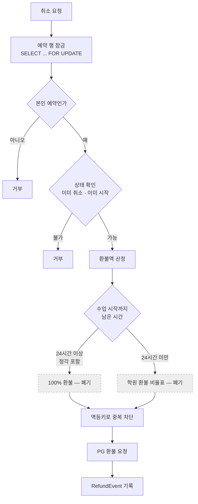

`backend/app/services/cancellation.py` · `refund_policy.py` 에만 구현돼 있다. 잠금·본인 확인·멱등키·감사 기록·PG 환불 요청은 새 흐름에서도 쓰고, **회원이 직접 누르는 즉시 환불과 "24시간 전 전액 + 비율표" 산정(`FULL`·`TIER`)은 폐기한다**(spec Q11(환불 방식 변경의 뒤처리) ② 2026-09-25 확정). `backend/` 는 Next.js 로 옮겨 갈 교체 대상이라(「11-3. 백엔드 교체」) 코드는 옮길 때 새 흐름으로 다시 만든다 — 지금 코드를 고쳐 쓰지 않는다.

#### 19-3-5(AI 추천) — 문장 하나에서 실현 가능한 일정까지

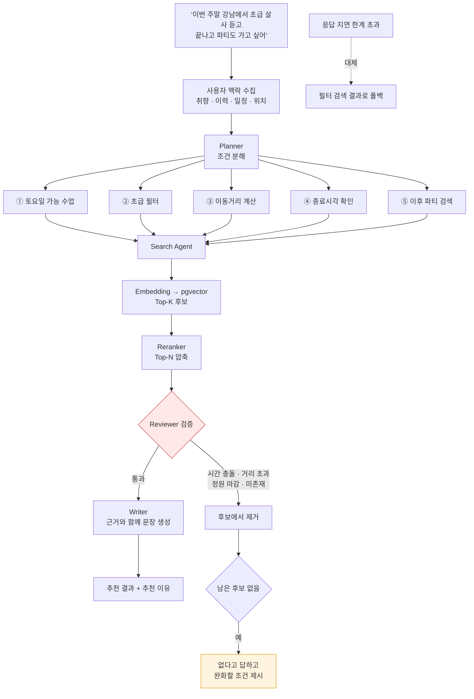

**Reviewer(붉은 상자)가 이 파이프라인의 존재 이유다.** 벡터 검색은 "비슷한 것" 을
가져올 뿐 "지금 갈 수 있는 것" 을 보장하지 않는다. 시간이 겹치거나 이미 마감됐거나
아예 존재하지 않는 수업이 섞이면, 사용자는 두 번째부터 추천을 믿지 않는다.
**없으면 없다고 답하는 것**이 지어내는 것보다 낫다.

#### 19-3-6(알림) — 한 번 정해서 여러 갈래로

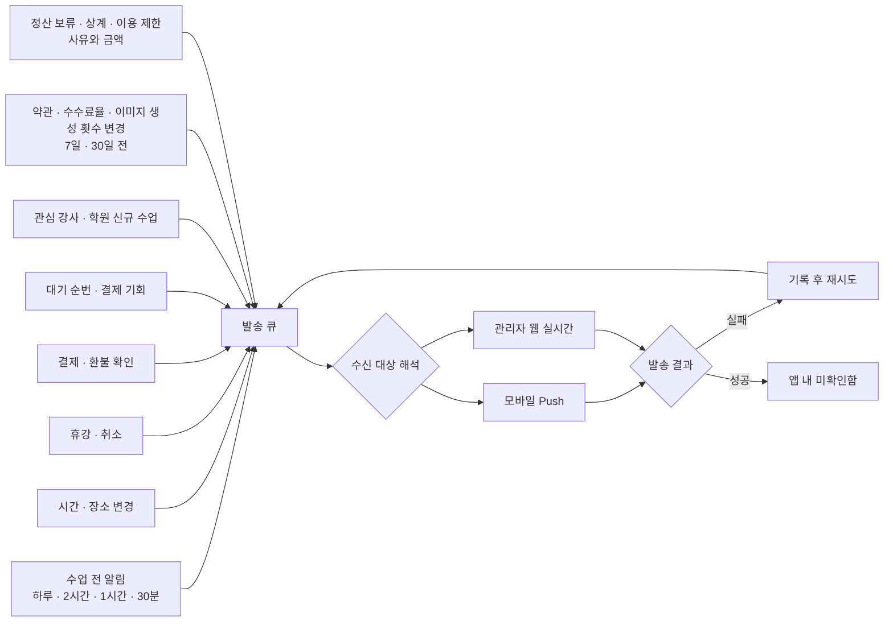

**SMS 를 쓰지 않는다.** 결제 확인조차 앱 내 알림으로 보낸다 — 결제대행사를 뺀 나머지
주변 기능은 무료·오픈 수단만 쓴다는 원칙 때문이다(`docs/policy/payment-method-policy.md`).

#### 19-3-7(사용자 문의·AI 응답) — 대부분을 모델 없이 답한다

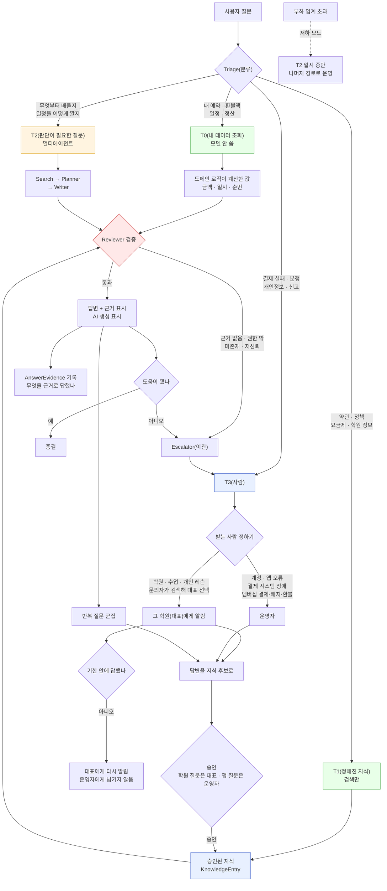

**초록 두 갈래가 이 설계의 핵심이다.** `T0(내 데이터 조회)` 와 `T1(정해진 지식)` 은
모델을 거치지 않는다. 실측상 GPU 1대의 동시 처리가 1~4건이라, 모든 질문을 모델에
보내면 저녁 피크에 대기열이 분 단위로 밀린다. 질문의 상당수는 애초에 생성이 필요
없는 조회다 — **"내 다음 수업 언제야"** 에 모델을 쓸 이유가 없다.

**금액을 모델이 만들지 않는다.** 환불 예상액을 물으면 취소 미리보기와 **같은 계산
로직**이 낸 값을 그대로 끼워 넣는다. 두 경로가 각자 계산하면 언젠가 반드시 어긋나고,
그 어긋남이 그대로 분쟁이 된다.

**AI 는 쓰기를 못 한다.** 취소·환불·예약을 실행하지 않는다. 해당 화면으로 가는 버튼을
제시하는 데까지이고, 누르는 것은 사용자다. 권한 검사도 모델이 아니라 시스템이 하므로,
사용자가 프롬프트를 어떻게 바꿔도 볼 수 있는 범위가 넓어지지 않는다.

**지식이 쌓이면 모델 부하가 준다(선순환).** 반복 질문을 모아 대표(학원 질문)나 운영자(앱·약관 질문)가 승인하면
`T1(정해진 지식)` 으로 내려간다. 운영이 길어질수록 `T2` 로 가는 비율이 떨어진다 —
**운영이 인프라를 대신 감당하는 구조**다.

**답을 아는 사람에게 묻는다.** 환불 기준이 학원마다 다르므로 플랫폼 운영자가 대신 답할 수
없다 — 환불 요청은 문의로 그 학원의 **대표에게만** 배정되고 대표가 자기 규정대로 처리한다(spec FR-098b(환불 요청 경로)). 운영자도 대신 처리하지 않는다.
정규·일반 수업에는 플랫폼 공통 환불 규칙이 없다. 이벤트·원데이·파티·공연·대회만 공통 규정
FR-099c(이벤트·원데이·파티·공연·대회 취소 규정)가 있어, 예약 상세에서 취소를 신청하면 시스템이 환불액을
계산한다(FR-098(대표 처리 환불 방식) 예외). AI 는 그 학원이 등록한 규정을 근거로 안내하고 문의 접수까지만
돕는다 — 환불 여부와 금액을 확정해 말하지 않는다. *(2026-09-25 변경 — 이전 공통 규칙은 "수업
24시간 전 취소는 전액"이었다)*

**답변 창구는 AI 없이도 살아 있어야 한다.** 스토어 심사와 전자상거래 고지에 필요한
것은 `T3(사람)` 경로이고, 나머지 셋은 그 위에 얹는 개선이다. 모델이 멈춰도 문의는
접수되고 답변된다.
