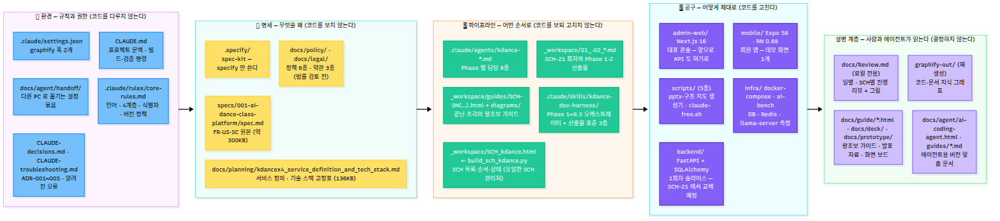
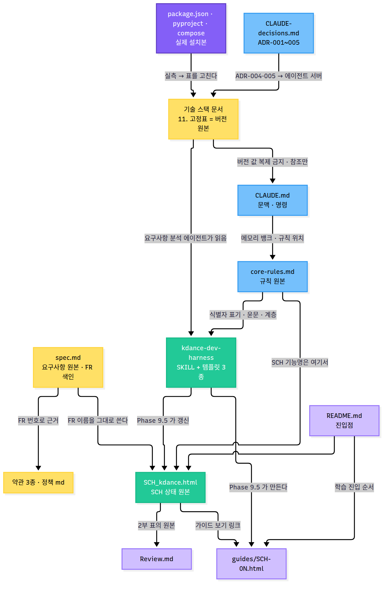
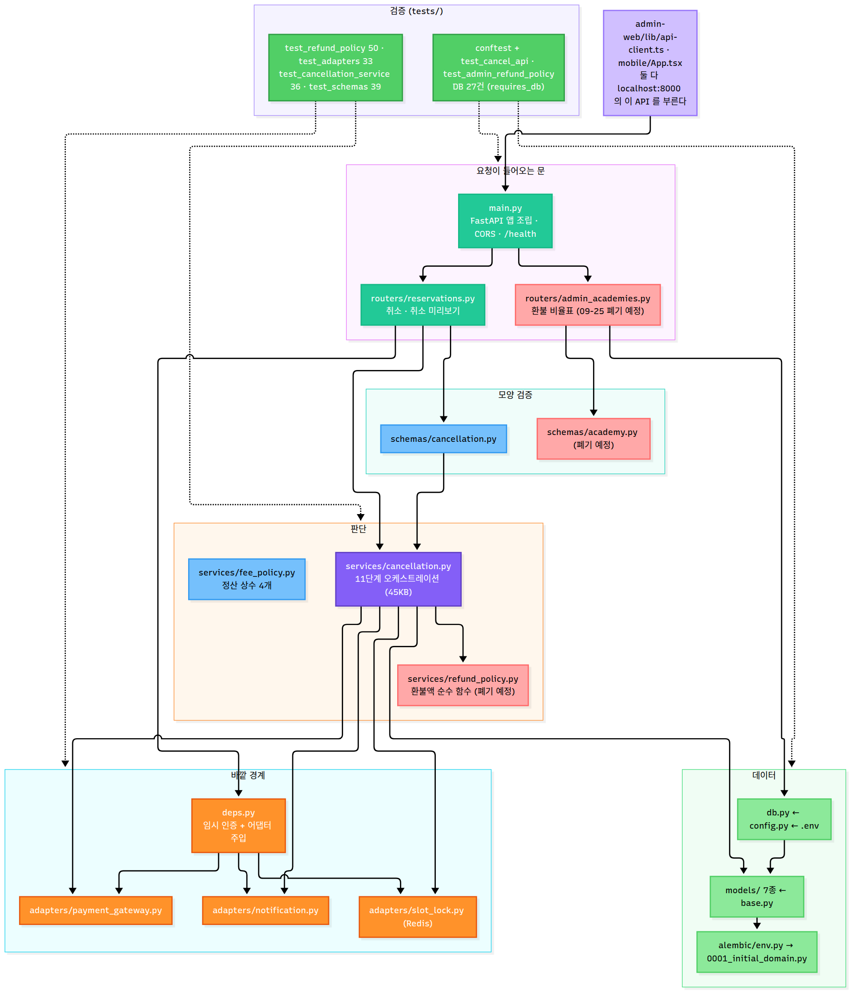

# kdance 저장소 구조 지도 — 파일 계층 · 연관성 · 정합성 점검

- 기준일: 2026-10-01 (커밋 `cca23ba` 이후 작업 트리 — 이날 `docs/` 를 성격별 폴더로 재편했다)
- 누가 읽나: 개발 경력 6개월차 비전공자와 이 저장소를 처음 여는 에이전트
- 그림판: 폴더와 파일마다 한 줄 설명이 붙은 접이식 트리는 [`docs/guide/structure-map.html`](guide/structure-map.html) 에 있다. `scripts/build_structure_map.py` 가 만들고, 적힌 경로가 실제로 있는지와 추적 파일이 빠졌는지를 같이 검사한다
- 어떻게 확인했나: git 이 추적하는 파일 전부(`git ls-files`, 벤더 파일 제외)와 미추적 파일을 하나씩 열어 제목·역할을 적고, 문서 안의 경로 참조 전부를 실제 파일과 대조했다. 재편 때는 스크립트로 경로 272곳을 고쳤다. 경로는 참조하는 파일의 옛 위치 기준으로 풀어 새 위치로 다시 계산했고 옮긴 뒤 다시 전수 검사했다. 버전은 `package.json`·`pyproject.toml`·`docker-compose.yml` 과 기술 스택 고정표를 맞춰 봤고, backend 는 `from app.… import` 줄로 파일끼리의 의존을 그렸다

---

## 목차

1. [한눈에 — 다섯 층으로 본 저장소](#1)
2. [디렉터리 계층 — 폴더마다 무엇이 있고 어떤 성격인가](#2)
3. [문서의 연관성 — 무엇이 원본이고 누가 읽나](#3)
4. [소스의 연관성과 소스 구조 정의](#4)
5. [정합성 점검 결과](#5)
6. [2026-10-01 재편 기록](#6)
7. [이 문서를 유지하는 법](#7)

---

<a id="1"></a>
## 1. 한눈에 — 다섯 층으로 본 저장소

이 저장소는 코드보다 문서와 규칙이 많다. 파일을 폴더 이름이 아니라 **역할**로 나누면 다섯 층이 된다. 위 네 층은 `core-rules.md` 의 4계층(환경·명세·파이프라인·공구)이고, 다섯째는 사람과 에이전트가 읽기만 하는 설명 층이다.



*그림 1 · 저장소를 다섯 층으로 — 왼쪽에서 오른쪽으로 규칙 → 명세 → 순서 → 코드 → 설명 (10-01 재편 뒤 다시 그림)*

| 층 | 핵심 질문 | 대표 파일 | 코드를 |
|---|---|---|---|
| 🧱 환경 | 어떤 규칙과 권한으로 일하나 | `CLAUDE.md` · `.claude/rules/core-rules.md` · `.claude/settings.json` · `CLAUDE-decisions.md` · `docs/agent/` | 다루지 않는다 |
| 📐 명세 | 무엇을 왜 만드나 | `specs/…/spec.md` · `docs/planning/` · `docs/policy/` · `docs/legal/` | 보지 않는다 |
| 🏗 파이프라인 | 어떤 순서로 하나 | `.claude/skills/kdance-dev-harness/` · `.claude/agents/kdance-*.md` · `_workspace/SCH_kdance.html` | 보되 고치지 않는다 |
| 🛡 공구 | 어떻게 제대로 만드나 | `backend/` · `admin-web/` · `mobile/` · `infra/` · `scripts/` | 고친다 |
| 설명 | 끝난 것과 판단을 어떻게 남기나 | `docs/Review.md` · `docs/guide/*.html` · `_workspace/guides/` · `graphify-out/` | 결정하지 않는다 |

---

<a id="2"></a>
## 2. 디렉터리 계층

성격 표시: **원본** = 다른 파일이 참조하는 단일 진실 원천 · **파생** = 원본에서 만들어지거나 원본을 요약 · **로컬** = git 이 추적하지 않음 · **미추적** = 아직 `git add` 하지 않은 새 파일 · **폐기 예정** = 결정은 났지만 파일은 남아 있음 · **재생성** = 명령 한 번으로 다시 만들 수 있음

```
kdance/
├── CLAUDE.md                     환경 · 프로젝트 문맥과 빌드·검증 명령 (원본)
├── CLAUDE-decisions.md           환경 · ADR-001~005 (원본)
├── CLAUDE-troubleshooting.md     환경 · 알려진 오류와 해결 (원본)
├── README.md                     설명 · 학습 진입점
├── .gitignore                    환경 · 무엇을 추적하지 않나 (Review.md 와 그 그림은 로컬)
├── skills-lock.json              환경 · 설치된 스킬 잠금
│
├── .claude/                      환경 + 파이프라인
│   ├── rules/core-rules.md         규칙 원본 — 언어 · 4계층 · 식별자 표기 · 버전 정책 · 진행 리뷰
│   ├── settings.json               훅 2개(graphify) — 품질 게이트 훅은 아직 없다
│   ├── agents/kdance-*.md (8)      Phase 1~9 담당 에이전트
│   ├── agents/(그 밖에 4)           code-searcher · memory-bank-synchronizer · ux-design-expert · get-current-datetime
│   ├── skills/kdance-dev-harness/  Phase 1~9.5 오케스트레이터 + 산출물 표준 3종
│   ├── skills/speckit-*/ (10)      spec-kit — specify 하나만 쓰고 나머지 9개는 규칙상 사용 금지
│   ├── skills/diagram-this          → .agents/skills/diagram-this 의 심볼릭 링크
│   ├── skills/(그 밖에 6)           graphify · ai-image-creator · session-metrics · audit-session-metrics · task-breakdown · claude-docs-consultant
│   └── commands/ (14 + 테스트 예시 6)   범용 슬래시 명령 템플릿 (anthropic · architecture · documentation · refactor · security …)
├── .agents/skills/diagram-this/  Mermaid → HTML 뷰어 스킬 (mermaid.min.js 3.5MB 포함)
├── .specify/                     명세 · spec-kit 설정 — constitution.md 는 core-rules.md 를 가리키는 포인터
│
├── specs/001-ai-dance-class-platform/
│   ├── spec.md                     요구사항 원본 — FR·US·SC · 변경 이력 · 미해결 질문 · FR 색인 (약 300KB)
│   ├── checklists/requirements.md  명세 품질 체크리스트
│   └── local-ai-capacity.md        노트북 AI 수용량 실측 (S0 근거)
│
├── docs/                         명세 + 설명 — 10-01 재편: 성격별 폴더
│   ├── structure-map.md            이 문서 (원본)
│   ├── policy/ (6)                 정책 원본 — payment-method · pricing · distribution · genre-taxonomy · admin-input · subscription-benefits
│   ├── legal/ (3 + archive/)       약관 3종(terms-of-service · merchant-terms · privacy-policy, 법률 검토 전 초안) + archive/terms-2026-09-25/ 상세판 보관본. 같은 내용의 .zip 은 미추적 중복
│   ├── planning/ (4)               kdancex4_service_definition_and_tech_stack.md(서비스 정의 · 「11. 기술 스택 고정표」= 버전 원본, 136KB) · plan-summary · requirements-analysis · role-split-analysis
│   ├── guide/ (13 html)            사람이 읽는 가이드 — structure-map(이 문서의 그림판, 재생성) · harness-ecc-guide · payment-system-guide-for-beginners · reservation-refund-diagrams · kdance-screens-spec · kdance-beta-infra · omniroute-setup · omniroute-setup-visual-guide · penpot-mcp-guide · playwright-mcp-… · social-dance-app-dev-guide · social-dance-academy-pitch
│   ├── agent/                      에이전트가 읽는 문서 + 인수인계 — ai-coding-agent.html(스택 개요, 원본) · handoff.md + handoff/(설정 묶음) · claude-skills-checklist.md
│   ├── deprecated/ (2)             ⛔ 09-25 폐기 — payment-deeplink-reference · sch-payment-deeplink-implementation (기록으로만)
│   ├── deck/ (2 pptx)              K-DanceX4_입점설명회_대표강사회원.pptx(09-30, 미추적) · kdance_화면명세서.pptx(09-14) — scripts/build_*_pptx.py 가 만든다 (재생성)
│   ├── prototype/ (미추적)          kdance-prototype.html(클릭형 프로토타입) · kdance-screens-2026.html(Figma 캡처용 보드) · gen_genre_images.py(장르 카드 생성기) · build_compare.py → genre-compare.html(현재 vs 후보 비교) · assets/genres/(카드 4장 + reference.jpg, candidate/)
│   ├── assets/structure/           이 문서의 그림 3장 .mmd + .png
│   ├── assets/omniroute-guide/     OmniRoute 가이드의 이미지 43장
│   ├── assets/review/              Review 의 그림 .mmd + .png (로컬)
│   └── Review.md                   진행 리뷰 — 일별 · SCH별 (로컬 · 푸시 금지)
│
├── _workspace/                   파이프라인 산출물
│   ├── SCH_kdance.html             SCH 목록·순서·상태 원본 — 여기서만 관리 (재생성)
│   ├── build_sch_kdance.py         SCH_kdance.html 생성기 (데이터를 여기서 고친다)
│   ├── 01_req-analyst_requirements.md · 02_code-searcher_structure.md   SCH-21 회차 Phase 1·2 산출물
│   ├── guides/SCH-01~07(…).html    끝난 조각의 왕초보 가이드 (파생)
│   └── guides/diagrams/            가이드 그림 21장 .mmd + .png
│
├── backend/                      공구 · FastAPI 1회차 슬라이스 (SCH-21 에서 교체 예정)
│   ├── app/ (config · db · deps · main · adapters/3 · models/7+base · routers/2 · schemas/2 · services/3)
│   ├── alembic/ (env.py · versions/0001_initial_domain.py)
│   ├── tests/ (8 파일 · 186 건)
│   └── pyproject.toml · uv.lock · .env.example
├── admin-web/                    공구 · Next.js 16 대표 콘솔 (앞으로 API 도 여기로)
│   ├── app/ (layout · page · refund-policy/page ⛔ 폐기 예정)
│   ├── components/ (AdminNav · RefundPolicySettings ⛔)
│   ├── lib/api-client.ts           FastAPI 를 부르는 얇은 fetch 래퍼
│   └── AGENTS.md · CLAUDE.md       Next.js 16 이 설치한 에이전트용 문서
├── mobile/                       공구 · Expo 58 회원 앱 — App.tsx 데모 화면 하나
├── infra/                        공구 · docker-compose (DB · Redis · llama-server · ollama) · ai-bench/ 측정 스크립트
├── scripts/                      공구 · 저장소 전체 스크립트
│   ├── build_structure_map.py      이 문서의 그림판(docs/guide/structure-map.html) 생성기
│   ├── build_onboarding_pptx.py · build_screens_pptx.py · build_pitch_pptx.py   pptx 생성기 → docs/deck/ (10-01 docs/ 에서 옮김, pitch 는 onboarding 이 대체)
│   └── claude-free.sh              OmniRoute 무료 체인으로 Claude Code 실행
└── graphify-out/                 설명 · 지식 그래프 (재생성 · 로컬)
```

로컬 전용이라 저장소에 없는 것: `docs/Review.md` 와 `docs/assets/review/`, `.diagrams/`, `graphify-out/`, `.playwright-mcp/`, `_workspace/00_input/`, 각 패키지의 `node_modules/`·`.venv/`·`.env`.

---

<a id="3"></a>
## 3. 문서의 연관성 — 무엇이 원본이고 누가 읽나

같은 값을 두 곳에 적으면 반드시 한 곳이 뒤처지므로 값마다 원본을 하나만 두고 나머지는 참조한다. 화살표는 "누가 누구를 읽거나 갱신하나"다.



*그림 2 · 문서 연관도 — 노란색이 원본, 파란색이 규칙, 초록색이 파이프라인, 보라색이 설명*

| 값 | 원본 (여기서만 고친다) | 참조하는 곳 |
|---|---|---|
| 요구사항 FR·US·SC 와 공식 짧은 이름 | `specs/…/spec.md` | SCH_kdance.html · 약관 · Review · 가이드 · 정의서 |
| 버전 | 정의서 「11. 기술 스택 고정표」 (`docs/planning/`) | CLAUDE.md · ai-coding-agent.html · 에이전트 md (값을 복제하지 않고 표를 가리킨다) |
| 실제 설치본 | `package.json` · `pyproject.toml` · `docker-compose.yml` | 실측 뒤 고정표를 고친다 — 표가 설치본을 따라간다 |
| 규칙 | `.claude/rules/core-rules.md` | CLAUDE.md · 하네스 스킬 · 에이전트 · `.specify/memory/constitution.md`(포인터) |
| 설계 결정 | `CLAUDE-decisions.md` (ADR) | 정의서 · Review · 스케줄표 |
| SCH 번호·기능명·상태 | `_workspace/SCH_kdance.html` (← `build_sch_kdance.py`) | Review 2부 · 가이드 · 소스 학습 주석 · core-rules 의 표기 규칙 |
| 결제·환불 정책 | `docs/policy/payment-method-policy.md` + spec | 약관 · 가이드 · 스케줄표 |
| 저장소 구조 | 이 문서 + `scripts/build_structure_map.py` 의 `TREE` | README · `docs/guide/structure-map.html` |
| 진행 판단과 막힌 것 | `docs/Review.md` (로컬) | — (읽기만) |

**흐름으로 보면**: `spec.md` 가 무엇을 정하고 → 하네스가 `SCH_kdance.html` 로 순서를 자르고 → 코드가 만들어지면 → Phase 9.5 가 가이드·학습 주석·Review 를 남긴다. 반대 방향(설치본 → 고정표 → 문서)은 버전에만 있다.

---

<a id="4"></a>
## 4. 소스의 연관성과 소스 구조 정의

### 4-1. backend — 요청이 들어와 DB 에 닿기까지



*그림 3 · backend 모듈 의존도 — `from app.… import` 줄을 그대로 옮겼다. 빨간 상자는 09-25 결정으로 폐기 예정*

| 층 | 파일 | 무엇을 | 의존 |
|---|---|---|---|
| 문 | `main.py` | 앱 조립 · CORS(5173·3000) · `/health` | routers |
| 문 | `routers/reservations.py` | 취소 · 취소 미리보기 | schemas.cancellation · services.cancellation · deps · db · adapters |
| 문 | `routers/admin_academies.py` ⛔ | 환불 비율표 GET·PUT | schemas.academy · models.academy · db |
| 모양 | `schemas/cancellation.py` | 요청·응답 형태 | services.cancellation · adapters.payment_gateway |
| 모양 | `schemas/academy.py` ⛔ | 비율표 형태 | — |
| 판단 | `services/cancellation.py` | 취소 11단계 (1,069줄) | models 6종 · adapters 3종 · services.refund_policy |
| 판단 | `services/refund_policy.py` ⛔ | 환불액 순수 함수 | — |
| 판단 | `services/fee_policy.py` | 정산 상수 4개 (읽는 코드 없음) | — |
| 경계 | `deps.py` | 임시 인증(`X-User-Id`) · 어댑터 주입 | adapters 3종 |
| 경계 | `adapters/*.py` | PG · 알림 · 슬롯락 Protocol + Fake | — |
| 데이터 | `db.py` ← `config.py` ← `.env` | 엔진 · 세션 · `get_db` | — |
| 데이터 | `models/*.py` ← `base.py` | 테이블 7종 | — |
| 데이터 | `alembic/env.py` → `versions/0001_initial_domain.py` | 마이그레이션 (17문) | models |

테스트 8파일은 어느 층을 검증하나: `test_refund_policy`(50) → 판단 · `test_adapters`(33) → 경계 · `test_cancellation_service`(36) → 판단+경계 · `test_schemas`(39) → 문+모양 · `conftest` + `test_cancel_api`(9) + `test_admin_refund_policy`(17) → 전 층을 실제 DB 로(`requires_db` 27건) · `test_health`(1).

### 4-2. admin-web · mobile · infra

| 파일 | 무엇을 | 부르는 곳 |
|---|---|---|
| `admin-web/app/layout.tsx` → `components/AdminNav.tsx` | 공통 틀 | — |
| `admin-web/app/page.tsx` → `lib/api-client.ts` | 대시보드 · `/health` 확인 | `http://localhost:8000` (FastAPI) |
| `admin-web/app/refund-policy/page.tsx` → `components/RefundPolicySettings.tsx` ⛔ | 비율표 설정 | `/admin/academies/{id}/refund-policy` |
| `mobile/index.ts` → `App.tsx` | 데모 화면 — 취소 미리보기 · 취소 | `/reservations/{id}/cancellation-preview` · `/cancel` |
| `infra/docker-compose.yml` | `kdance-db`(pgvector 0.8.6-pg18) · `kdance-redis`(redis:alpine) · `kdance-llm`(llama-server 10슬롯) · `ollama`(멈춤) | backend `.env` 의 5433·6380, AI 11436 |
| `infra/ai-bench/*.py` | 동시 N명 첫 글자·완료 시간 측정 | `kdance-llm` |

admin-web 에 설치된 prisma 8 · better-auth · ai · langgraph · MCP SDK 는 **아직 어느 소스도 import 하지 않는다** — SCH-21·22 가 처음 쓴다.

### 4-3. 소스 구조 정의 — 코드는 여섯 층으로 쌓는다

4-1 의 층 이름은 설명용으로만 붙인 것이 아니다. **새 코드를 어디에 둘지 정하는 규칙**이다. 각 층은 바로 아래 층만 부른다. 예외는 `schemas` 가 `services` 를 읽는 한 방향 하나이고 순환은 없다. SCH-21(FastAPI→Next.js 전환) 뒤에도 이 여섯 구분은 그대로 가져간다. 폴더 이름만 Next.js 식으로 바뀐다.

| 층 | 질문 | 지금 (backend) | SCH-21 뒤 (admin-web) | 넣지 않는 것 |
|---|---|---|---|---|
| 문 | 요청이 어디로 들어오나 | `main.py` · `routers/` | `app/api/` route handlers | 업무 규칙 |
| 모양 | 요청·응답이 어떤 형태인가 | `schemas/` (Pydantic) | `lib/schemas/` (zod) | DB 접근 |
| 판단 | 무엇을 어떤 순서로 하나 | `services/` | server actions · `lib/services/` | HTTP · SQL 직접 호출 |
| 경계 | 바깥 세상(PG·알림·잠금·인증)과 어떻게 만나나 | `adapters/` · `deps.py` | `lib/adapters/` · better-auth | 업무 판단 |
| 데이터 | 어디에 어떻게 저장하나 | `models/` · `db.py` · `alembic/` | `prisma/` (schema + migrations) | 판단 |
| 검증 | 층마다 짝이 있는가 | `tests/` | `__tests__/` · Playwright | — |

**패키지별로는 이렇게 간다**

| 패키지 | 지금 | 어디로 가나 |
|---|---|---|
| `admin-web/` | `app/`(라우트·레이아웃) · `components/`(화면 조각) · `lib/`(API 호출). 환불 비율표 화면은 ⛔ | SCH-21 부터 제품 API 가 여기로 온다. DB 를 쓰는 곳은 Next.js 하나(ADR-004) |
| `mobile/` | `App.tsx` 데모 하나 — 화면·API 호출이 한 파일 | SCH-32·33 에서 화면 · 상태 · API 클라이언트로 나눈다. 모델은 부르지 않고 Next.js API 만 부른다 |
| `infra/` | `docker-compose.yml` 하나에 DB · Redis · llama-server · ollama | 운영 전환 때 임베딩·리랭커(vLLM)가 추가된다 |
| AI 에이전트 서버 | 아직 없음 | Python(FastAPI + LangGraph) 별도 프로세스. DB 는 MCP 도구로 읽기만(ADR-004) |

**새 파일은 어디에 두나**

| 무엇을 만들 때 | 어디에 · 어떻게 |
|---|---|
| 새 API 하나 | 문 → 모양 → 판단 → (필요하면) 경계 → 검증 순서로 한 층씩. 한 파일에 두 층을 넣지 않는다 |
| 정책 값(수수료·환불 비율·장르) | `docs/policy/*.md` 가 원본. 코드에는 상수로 옮기고 주석에 정책 파일 경로를 적는다(`backend/app/adapters/*.py` 가 그 예) |
| 버전 | 고정표만 고친다. CLAUDE.md · ai-coding-agent.html 은 값을 복제하지 않고 표를 가리킨다 |
| 사람이 읽는 설명 | `docs/guide/*.html`. SCH 단위 가이드는 `_workspace/guides/` |
| 에이전트가 읽는 설명 | `docs/agent/`. SCH 단위는 `_workspace/guides/SCH-XX(기능명).md` |
| 일회성 생성 스크립트 | `scripts/`. 산출물은 `docs/deck/` 같은 결과 폴더에 — 스크립트를 결과 폴더에 두지 않는다 |
| 화면 프로토타입 · 디자인 자산 | `docs/prototype/`. 이미지 생성기와 비교 페이지도 여기(디자인 작업에 묶여 있어서) |
| 규칙 · 권한 · 훅 | `.claude/rules/core-rules.md` · `.claude/settings.json`. CLAUDE.md 에는 문맥만 |

---

<a id="5"></a>
## 5. 정합성 점검 결과

문서 안의 경로 참조 전부, 세 manifest 와 고정표의 버전, backend import 를 대조한 결과다. **고쳤음**은 바로잡은 것, **결정 필요**는 판단이 걸려 그대로 둔 것이다.

### 5-1. 고쳤음

| # | 날짜 | 어디 | 무엇이 어긋났나 | 어떻게 |
|---|---|---|---|---|
| 1 | 09-29 | `README.md` 9행 | 학습 진입점 1번 링크가 `docs/harness-ecc-guide.html` 을 가리켰는데 실제 파일은 다른 폴더 | 경로 수정 |
| 2 | 09-29 | `README.md` 3행 | 스택을 "FastAPI + SQLAlchemy2(backend)" 라고만 적어 09-20 교체 결정이 안 보였다 | SCH-21 교체 예정 표기 |
| 3 | 09-29 | `CLAUDE.md` 10행 | "Expo SDK 57" — 실제는 `expo 58.0.0-preview.6` | 58 로 고치고 값의 원본이 고정표임을 표기 |
| 4 | 09-29 | `.gitignore` 28행 주석 | 추적 목록에 옛 이름 `kdance.html` | 주석 수정 |
| 5 | 09-29 | `docs/planning/plan-summary.md` 5행 | 옮겨진 가이드 2개와 저장소에 없는 `docs/superpowers/…` 참조 | 경로 수정, 없는 파일은 그렇다고 표기 |
| 6 | 09-29 | 가이드 7개(14곳) | 작성 기준 `_workspace/05_implementer_TS-0N_summary.md` 가 09-20 에 지워짐 | 커밋 위치(`7f28ab1^`) 병기 |
| 7 | 09-29 | 참조 24개 파일 | 옛 이름 `_workspace/kdance.html` | 일괄 수정(커밋 `4711a85`) |
| 8 | **10-01** | `docs/` 25개 파일 | 정책·약관·기획·설명·스크립트가 한 층에 섞여 있었다(옛 5-2 G) | 성격별 7개 폴더로 재편 — 6절 |
| 9 | **10-01** | `docs/build_*_pptx.py` 3개 | 문서 폴더에 실행 스크립트(옛 5-2 F). 출력 경로가 `/home/user/kdance/docs/…` 로 박혀 있었다 | `scripts/` 로 옮기고 출력을 `Path(__file__)` 기준 `docs/deck/` 로 |
| 10 | **10-01** | `.gitignore` 34행 · `docs/agent/handoff.md` 184행 | 이미 없는 `_workspace/mobydick-v2-schedule.html` 을 무시 목록과 할 일 표가 가리켰다(옛 5-2 C) | 줄 삭제, 표에 완료 표시 |
| 11 | **10-01** | 지도 2절 | `.claude/commands/` 14개 · `ai-image-creator` 스킬 · `docs/claude-skills-checklist.md` · `docs/prototype/` 가 지도에 없었다 | 트리에 추가. 생성기가 추적 파일 전수와 대조하므로 다시 빠지면 경고가 난다 |
| 12 | **10-01** | 참조 272곳(파일 54개) | 재편으로 바뀐 경로 — 루트 기준(`docs/x.md`)과 상대 기준(`../x.md`, `x.md`)이 섞여 있었다 | 참조하는 파일의 옛 위치에서 풀어 새 위치 기준으로 다시 계산. `SCH_kdance.html` 은 생성기로 다시 만들어 치환본과 같음을 확인 |

### 5-2. 결정 필요 — 그대로 두었다

| # | 어디 | 무엇 | 왜 그대로 두었나 · 제안 |
|---|---|---|---|
| A | `infra/docker-compose.yml` 32행 | `redis:alpine` 은 내용이 바뀌는 부동 태그 | 인프라 변경은 컨테이너 재생성이 따라와서 사용자 확인 뒤. `redis:8.2-alpine` 처럼 고정 권장 |
| B | backend `routers/admin_academies.py` · `schemas/academy.py` · `services/refund_policy.py` · 테스트 2개, admin-web `app/refund-policy/` · `components/RefundPolicySettings.tsx` | 09-25 결정(Q11 ②)으로 폐기가 확정된 코드가 남아 있고 테스트 67건이 계속 돈다 | SCH-21 이 "옮기지 않는다" 로 처리하기로 이미 정해져 있다. 그 전에 지우면 SCH-01~07 가이드·학습 주석과 어긋난다 |
| D | `docs/legal/archive/terms-2026-09-25.zip` | 미추적 파일. 같은 내용이 옆 폴더로 추적되고 있다 | 중복이므로 삭제 권장. 09-29 세 차례, 10-01 한 차례 확인 요청 |
| E | `.claude/skills/speckit-*` 9개 | 규칙상 쓰지 않는데 설치는 되어 있다 | 실수로 `/speckit-plan` 을 돌릴 위험. 지우거나 SKILL.md 머리에 "사용 금지" 한 줄 |
| H | `mobile/App.tsx` | FastAPI 의 옛 취소 흐름을 부른다 | SCH-09 기록대로 데모. 새 흐름은 SCH-32·33 에서 다시 만든다 |
| I | `.specify/extensions.yml` | speckit 스킬 10개가 참조하지만 파일이 없다 | spec-kit 기본 동작(없으면 건너뜀). E 와 함께 정리 |
| J | `docs/prototype/` · `docs/deck/K-DanceX4_….pptx` · `scripts/build_onboarding_pptx.py` | 09-30·10-01 에 생긴 파일들이 아직 미추적이다 | 커밋은 사용자가 정한다. 추적하면 2절의 "미추적" 표시를 지운다 |

### 5-3. 맞는 것으로 확인함

- 버전: `next 16.3.5` · `react 19.3.0` · `expo 58.0.0-preview.6` · `react-native 0.88.0-rc.1` · `typescript 6.0.3` · `prisma 8.0.0-rc.15` / `@prisma/orm-postgres 8.0.0-rc.11` · `better-auth 1.7.5` · `ai 7.0.113` · `@modelcontextprotocol/sdk 1.30.1` · `zod 4.6.5` · `temporal-polyfill 1.0.5` · `fastapi ≥0.141.1` · Python 3.12 · `pgvector/pgvector:0.8.6-pg18` — 세 manifest 와 고정표가 전부 같다(09-29 확인, 10-01 변경 없음).
- `SCH_kdance.html` · `Review.md` 2부 · 가이드의 SCH 번호·기능명 — 한 데이터(`build_sch_kdance.py`)에서 나와 같다.
- backend import 에 순환이 없다. `schemas` 가 `services` 를 읽는 한 방향뿐이고, `models` 는 `base` 만 읽는다.
- 에이전트 md 가 가리키는 `_workspace/03_*`·`04_*`·`06_*`~`09_*` 는 파이프라인이 도는 동안 생기는 산출물이라 지금 없는 것이 정상이다.
- `.claude/skills/diagram-this` 는 `.agents/skills/diagram-this` 의 심볼릭 링크 — 한 벌이다.
- 재편 뒤 전수 검사에서 남은 "없는 경로" 는 전부 본문에 이름만 적은 것(`social-dance-app-dev-guide.html` 참고, 처럼)이거나 파이프라인 중간 산출물·외부 경로다. 링크(`[…](경로)` · `href` · `src`)는 깨진 것이 없다.

---

<a id="6"></a>
## 6. 2026-10-01 재편 기록

읽는 사람은 `docs/` 에서만 헤맸다. 25개 파일이 성격 구분 없이 한 층에 있었고, 폴더 하나는 한글 이름(`가이드/`)이라 링크와 도구에서 번번이 걸렸다. 폴더를 나누면 링크를 고쳐야 하므로 한 번에 했다.

| 새 폴더 | 무엇이 들어갔나 | 왜 |
|---|---|---|
| `docs/policy/` | 정책 6종 | 값을 바꾸는 자리를 한 곳에 |
| `docs/legal/` | 약관 3종 + `archive/` | 약관은 법률 검토가 따로 붙는 문서라 분리 |
| `docs/planning/` | 서비스 정의(고정표) · 기획 요약 · 요구사항 분석 · 역할 분리 분석 | 버전 원본이 여기 있다 |
| `docs/guide/` | HTML 가이드 11개 (옛 `docs/가이드/` 5 + `docs/*.html` 5 + 새 구조 지도) | 한글 폴더명을 ASCII 로 |
| `docs/agent/` | `ai-coding-agent.html` · `handoff.md` + `handoff/` · 스킬 체크리스트 | 에이전트와 인수인계용 |
| `docs/deprecated/` | 딥링크 A안 문서 2종 | 09-25 폐기, 기록으로만 |
| `docs/deck/` | pptx 2개 | 발표 자료는 생성 스크립트와 떼어 놓는다 |
| `scripts/` | `build_*_pptx.py` 3개 (+ 새 `build_structure_map.py`) | 문서 폴더에 실행 스크립트가 있던 것을 옮김 |

**어떻게 했나** — 파일 이동은 전부 `git mv` 라 이력이 이어진다. 참조는 스크립트로 고쳤다. 저장소의 모든 텍스트 파일에서 경로처럼 생긴 토큰을 뽑아 참조하는 파일의 **옛** 위치 기준으로 절대 경로를 구했다. 그 경로가 옮김표에 있으면 새 위치로 바꾸고 참조하는 파일 자체가 옮겨졌으면 새 상대 경로로 다시 계산했다. 미리보기로 288곳을 검토해 오탐 두 가지를 걸러낸 뒤 272곳을 적용했다. 하나는 절대 경로 `/home/…`, 다른 하나는 안 옮기는 파일의 `./` 정규화였다. 그 뒤 `SCH_kdance.html` 을 생성기로 다시 만들어 치환본과 바이트 단위로 같음을 확인했다.

**손으로 고친 것** — pptx 스크립트 3개의 출력 경로(절대 경로 → `Path(__file__)` 기준 `docs/deck/`), `build_onboarding_pptx.py` 머리말의 실행 명령(`cd backend && … ../scripts/…`), 그림 1 의 `.mmd` 레이블과 PNG 재렌더(npx 캐시의 `mmdc` + Playwright 의 chromium-1247).

**안 한 것** — 본문에 파일 이름만 적은 곳(`social-dance-app-dev-guide.html` 참고 같은 문장)은 링크가 아니어서 그대로 두었다. 옛 입점설명회 pptx(`소셜댄스_입점설명회.pptx`)를 언급한 문장 3곳도 역사 기록이라 두었다. 그 파일은 09-30 에 새 설명회 자료로 대체되어 삭제됐다.

---

<a id="7"></a>
## 7. 이 문서를 유지하는 법

1. 파일을 옮기거나 이름을 바꾸면 **세 곳**을 같이 고친다: 2절 트리 · 3절 표 · `scripts/build_structure_map.py` 의 `TREE`. 그리고 `python3 scripts/build_structure_map.py` 를 돌린다. 적힌 경로가 없거나 추적 파일이 트리에서 빠지면 경고가 난다.
2. 참조 검사는 문서 안의 `폴더/…확장자` 꼴 문자열을 뽑아 `os.path.exists` 로 확인하는 것이 전부다. 오탐이 많다. 본문에 이름만 적은 것, 파이프라인 중간 산출물, 정규식이 `.tsx` 를 `.ts` 로 자르는 경우가 걸리니 결과를 눈으로 본다.
3. 버전을 올리면 고정표 → 이 문서 5-3 순서로 확인한다.
4. 그림 3장의 원본은 `docs/assets/structure/*.mmd` 다. `mmdc` 는 PATH 에 없고 npx 캐시(`~/.npm/_npx/*/node_modules/.bin/mmdc`)에 있다. Chrome 은 Playwright 것을 쓴다:
   ```
   printf '{"executablePath":"%s","args":["--no-sandbox"]}' ~/.cache/ms-playwright/chromium-1247/chrome-linux64/chrome > /tmp/pup.json
   mmdc -p /tmp/pup.json -i s0N-*.mmd -o s0N-*.png -b white -s 2 -w 1100
   ```
   (`--size` 옵션은 이 버전에 없다 — `-w` 를 쓴다. 한국어 글꼴은 `~/.fonts/NotoSansCJKkr`.)
5. 5-2 의 항목이 처리되면 5-1 로 옮기고 날짜를 적는다.

<!-- HUMANIZE-SUMMARY v1.6.1
run_id: 2026-10-01-001
metrics:
  char_in: 19257
  char_out: 19283
  change_rate: 0.5%
  self_check: 6/6
  grade: B
categories:  # before → after (산문 구간 한정)
  J-3 산문 속 대시(—): 4 → 0  (헤딩·목차·굵은 라벨·표·트리 대시는 보존)
  A-18 관형절 겹친 장문: 3 → 0
  C-8 'A가 아니라 B' 대구: 3 → 1  (1절 '폴더 이름이 아니라 역할로'는 보존)
  E-1 도입 단정문 리듬: 3절 도입 2문장 → 1문장
  J-4 문장 분량 괄호 부연: 3 → 0
  C-11 연결어미 뒤 쉼표: 감소(증가 없음)
self_check:
  - 고유명사·수치·인용·내용 앵커 100% 보존: ✅ (272곳·288곳·커밋 해시·식별자 개수 대조)
  - 변경률 30% 이하: ✅
  - 장르 이탈 없음: ✅
  - register 보존: ✅ (한다체)
  - S1 잔존 0건: ✅
  - 인공 표현 추가 없음: ✅
highlights:
  - id: J-3
    before: "그대로 가져간다 — 폴더 이름만 Next.js 식으로 바뀐다."
    after: "그대로 가져간다. 폴더 이름만 Next.js 식으로 바뀐다."
  - id: A-18
    before: "참조하는 파일의 옛 위치 기준으로 경로를 풀어 새 위치로 다시 계산하는 스크립트를 썼고(272곳)"
    after: "스크립트로 경로 272곳을 고쳤다. 경로는 참조하는 파일의 옛 위치 기준으로 풀어 새 위치로 다시 계산했고"
  - id: J-4
    before: "두 가지 오탐(절대 경로 `/home/…` 과 안 옮기는 파일의 `./` 정규화)을 걸러낸 뒤"
    after: "오탐 두 가지를 걸러낸 뒤 272곳을 적용했다. 하나는 절대 경로 `/home/…`, 다른 하나는 …"
  - id: C-8
    before: "링크가 아니라 그대로 두었다"
    after: "링크가 아니어서 그대로 두었다"
residual_findings:
  - J-3 굵은 라벨 3곳('**어떻게 했나** —' 등) 대시 유지 — 보수 강도, 문서 전체에서 일관된 서식이라 보존
  - E-1 1절 도입 '이 저장소는 코드보다 문서와 규칙이 많다.' 유지 — 핵심 구분 문장과 묶여 있어 손대지 않음
grade_reason: "B — S1 0건, 자체검증 6항 통과. 보수 강도라 변경률이 A 기준(10~25%)보다 낮다. 표·트리·코드 블록·헤딩 무변경, 한다체 유지."
-->
